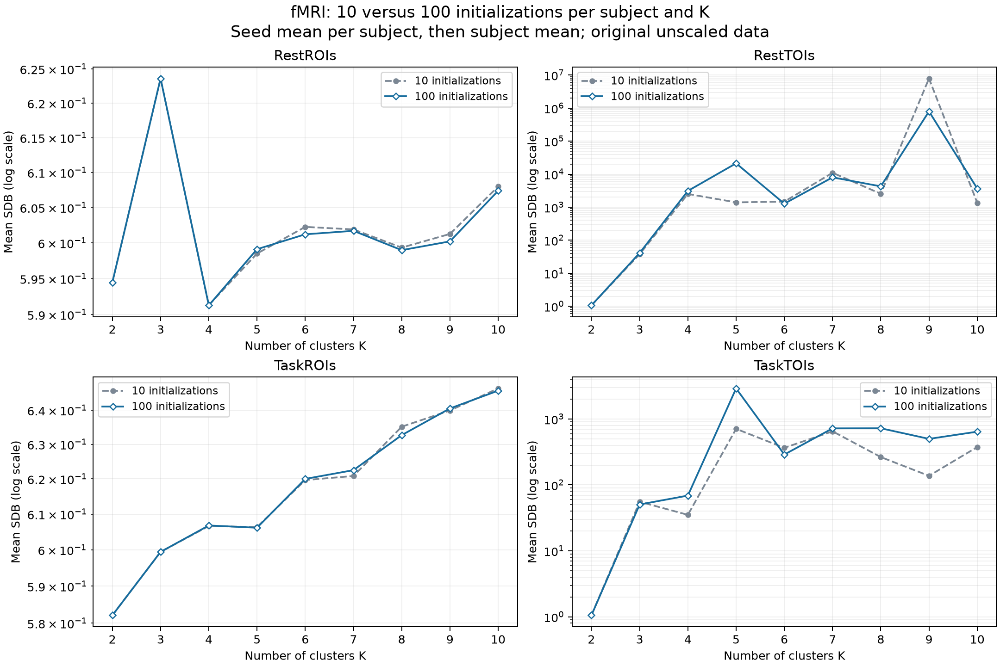
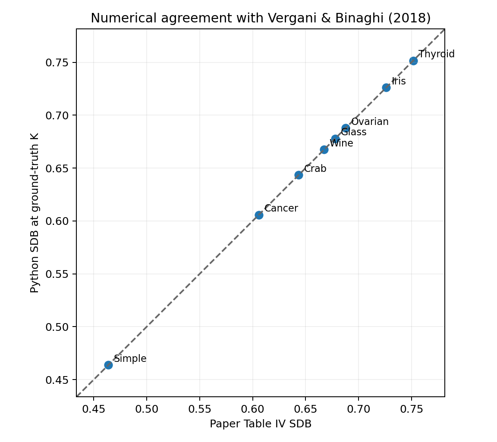
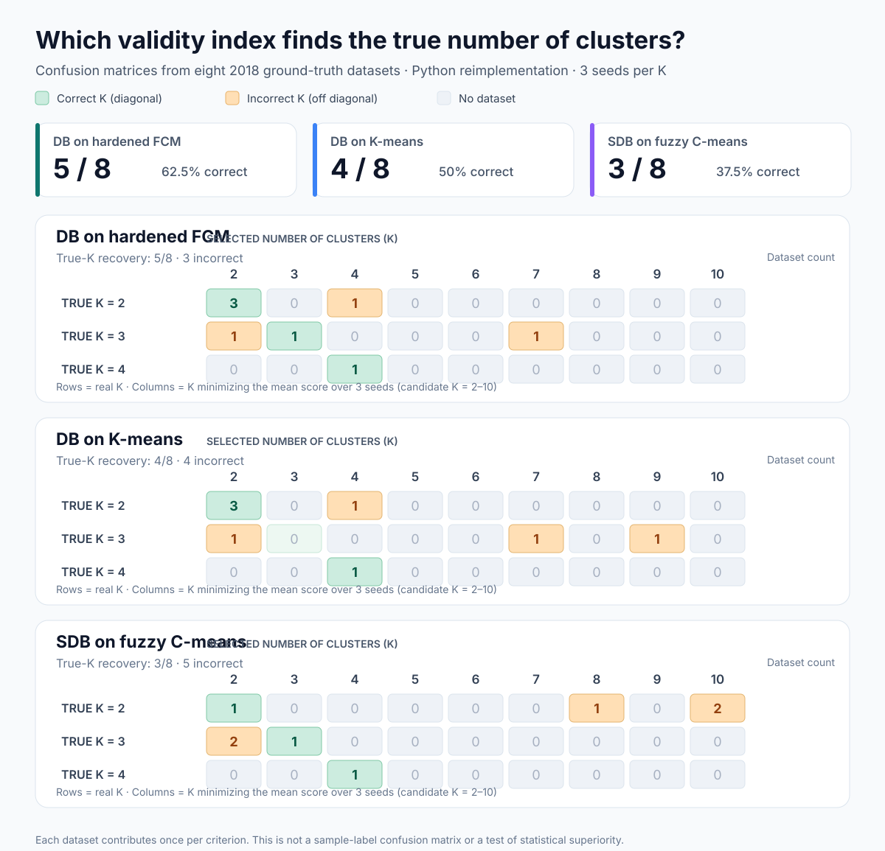
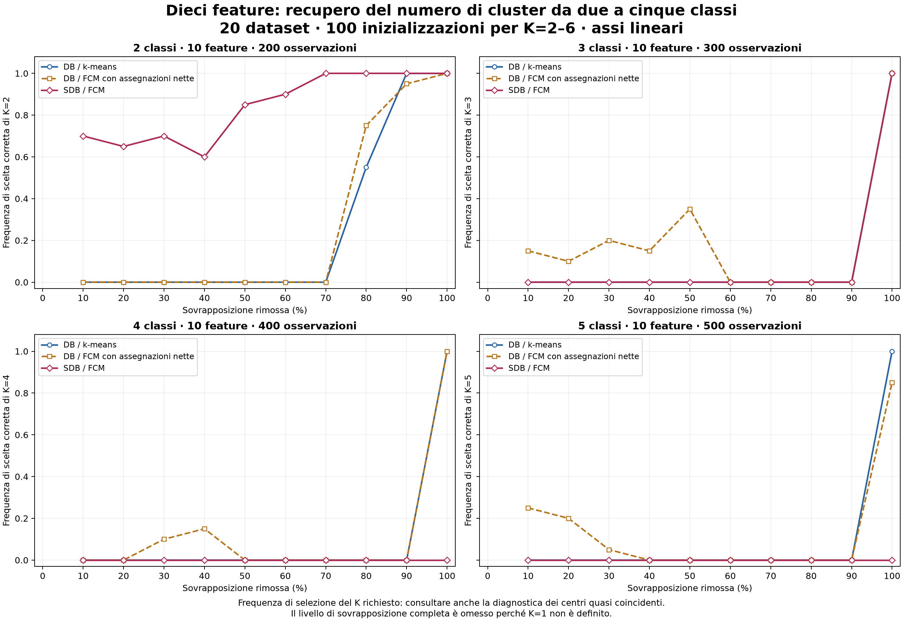

# Soft Davies–Bouldin (SDB) Index

[](#testing) [](#matlab) [](https://doi.org/10.1109/FUZZ-IEEE.2018.8491581)

**A cross-language implementation of the Soft Davies–Bouldin separation measure for fuzzy clustering.**

SDB measures cluster separation **without hardening fuzzy memberships**. It extends the classic Davies–Bouldin (DB) framework to fuzzy partitions by combining geometry with the average membership grade of every cluster. **Lower is better within the same index and experimental protocol.**

This independent, modern implementation follows equations (5)–(8) of:

> Vergani, A. A., & Binaghi, E. (2018). *A Soft Davies-Bouldin Separation Measure*. 2018 IEEE International Conference on Fuzzy Systems (FUZZ-IEEE). https://doi.org/10.1109/FUZZ-IEEE.2018.8491581

## What you get

- **Python:** NumPy implementation of SDB, classic DB baseline, and an independent fuzzy c-means (FCM) implementation.
- **MATLAB:** Corresponding functions in the `+sdb` package, with a runnable example and original-data benchmark.
- **Reproducibility:** numerical tests, cross-language toy fixture, paper-reference Table IV checks, dataset provenance, and independently generated benchmark results.
- **Eight original ground-truth benchmarks:** Cancer, Crab, Glass, Iris, Ovarian, Simple, Thyroid, and Wine, **supported as user-provided `.mat` files**. Raw legacy data are not part of the public distribution pending dataset-specific redistribution checks.

## Repository layout

```text
Soft-Davies-Bouldin/
├── README.md
├── CITATION.cff
├── LICENSE
├── pyproject.toml
├── scripts/
│   ├── python/
│   │   ├── sdb/{index.py,fcm.py}
│   │   ├── example.py
│   │   ├── benchmark.py
│   │   ├── analyze_benchmark.py
│   │   └── convert_original_mat.py
│   └── matlab/
│       ├── +sdb/{soft_davies_bouldin.m,davies_bouldin_crisp.m,fuzzy_c_means.m}
│       ├── example.m
│       ├── benchmark_original.m
│       └── test_sdb.m
├── data/{fixtures,original}
├── tests/
├── docs/{METHOD.md,BENCHMARKS.md,CITATION.bib}
└── results/
```

## Python

```bash
python -m pip install -e ".[benchmarks,dev]"
python scripts/python/example.py
pytest -q
```

Direct library use:

```python
from sklearn.datasets import load_iris
from sdb import fuzzy_c_means, soft_davies_bouldin, davies_bouldin_crisp
import numpy as np

X = load_iris().data
centers, U, iterations = fuzzy_c_means(X, k=3, m=2.0, seed=42)
sdb_value = soft_davies_bouldin(X, centers, U)
db_value = davies_bouldin_crisp(X, np.argmax(U, axis=1))
print(f"SDB={sdb_value:.6f}, DB after hardening={db_value:.6f}")
```

**Input convention:** `X` is `(n_samples, n_features)`, `centers` is `(n_clusters, n_features)`, and `U` is `(n_samples, n_clusters)` with each row summing to 1.

### Original paper benchmark

Place the eight original `.mat` files under `data/original/` (see `data/README.md`). To run the original-data protocol over `K=2,…,10`:

```bash
python scripts/python/benchmark.py --datasets all --original-dir data/original --runs 3 --max-k 10 --output results/benchmark.csv
python scripts/python/analyze_benchmark.py --input results/benchmark.csv --output-dir results/recomputed
```

To make a more computationally extensive comparison, increase `--runs` to `100` (as in the 2018 publication). To test without archived files:

```bash
python scripts/python/benchmark.py --datasets iris wine --runs 3 --max-k 10 --output results/iris_wine.csv
```

The built-in Iris/Wine fallback uses scikit-learn, **not** the archived data. The default experiment uses original feature scales (`--scale none`). The `--scale zscore` option defines an alternative experiment; do not compare scaled results directly with the 2018 table.

## MATLAB

In MATLAB R2019b or later, from the repository root:

```matlab
addpath(fullfile(pwd,'scripts','matlab'));
run('scripts/matlab/example.m');
run('scripts/matlab/test_sdb.m');
run('scripts/matlab/benchmark_original.m');
```

Direct API:

```matlab
[centers,U] = sdb.fuzzy_c_means(X,3,2,42);
value = sdb.soft_davies_bouldin(X,centers,U);
```

Both languages follow the same index formula, but their seeded FCM initializations use different random generators: numerical agreement for independent *fixed inputs* is expected; identical random partitions are not.

## Formula and interpretation

For cluster `i`, the paper defines

\[
S_i^f=\left(\frac{1}{N}\sum_{x\in X}\|x-a_i\|_2^q\right)^{1/q}, \qquad
\bar{u}_i=\frac{1}{N}\sum_{x\in X}u_i(x).
\]

Then

\[
\mathrm{SDB}=\frac{1}{C}\sum_{i=1}^{C}\max_{j\neq i}\frac{S_i^f\bar{u}_i+S_j^f\bar{u}_j}{\|a_i-a_j\|_2}.
\]

The default uses `q=1`, Minkowski exponent `p=2`, and **raw mean memberships** (`membership_power=1`), consistent with the printed equations (5)–(8) in the 2018 paper. A historical MATLAB function also used `mean(U**m)`; to investigate that **optional, non-published variant**, pass `membership_power=m` in Python or the fifth MATLAB parameter. This variant is explicitly separated from the published default.

**Important:** SDB and classic DB have different within-scatter definitions. A smaller SDB *numerical value* than a DB value does not by itself establish higher clustering accuracy. For known-label datasets, assess recovered `K`, adjusted Rand index (ARI), stability, and sensitivity to preprocessing. The method is undefined for fewer than two distinct centroids: the public API rejects such cases instead of silently returning zero.

## Reproduction status

**Updated 17 November 2026: the three headline results of the 2018 abstract remain confirmed after increasing fMRI to 100 initializations per subject and K.**

The independent Python reanalysis uses the eight original labeled benchmarks and both ROI/TOI orientations of the original fMRI matrices: **19 REST subjects and 15 TASK subjects**, with **100 seeds for every K=2–10**. This gives **7,200 benchmark configurations + 61,200 fMRI configurations = 68,400 configurations**, each comparing DB on K-means, DB on hardened FCM, and SDB on fuzzy FCM. All configurations completed without recorded errors and produced finite index values.

| Abstract comparison | Paper (2018) | fMRI at 10 initializations | fMRI at 100 initializations |
|:--|--:|--:|--:|
| **AIM:** minimum SDB below both DB minima, across 12 configurations | 7/12 | 7/12 | **7/12** |
| **RIM:** SDB below both DB indices at the known K, across 8 labeled datasets | 4/8 | 4/8 | **4/8** |
| **MRC:** median SDB across 12 configurations below both DB medians for K=2–10 | 9/9 | 9/9 | **9/9** |

The eight labeled benchmarks remain at 100 seeds in both comparisons. Their **eight Table IV SDB values agree to four decimal places**, and their **eight SDB-optimal K values match Table III**. The four fMRI SDB-optimal K values also remain unchanged: REST-ROI **4**, REST-TOI **2**, TASK-ROI **2**, TASK-TOI **2**. The MRC summary medians are unchanged at the precision of the saved tables. All 6,120 fMRI configurations shared with the earlier local 10-seed run reproduce exactly.

See the [100-initialization report](docs/FMRI_100_INITIALIZATIONS.md), [numerical results and provenance](results/reproduction_100seeds/), and [direct 10-versus-100 comparison](results/reproduction_100seeds/comparison_10_initializations.csv). The earlier [10-seed fMRI report](docs/ABSTRACT_REPRODUCTION.md) and [3-seed benchmark pilot](docs/BENCHMARKS.md) remain available.

**Interpretation:** the initialization count now matches the 100-start design, while Python/MATLAB initialization and implementation differences remain. This confirms the abstract's numerical comparison counts, rather than establishing greater clustering accuracy or reproducing every historical value. Near-coincident centroids still produce extreme SDB values, and reaching the FCM iteration limit is not evidence of convergence; these cases are retained and documented in the report.

## Selected reproducibility figures

### Updated Figure 1: 100 initializations for benchmarks and fMRI


Upper panels show AIM minima, RIM values at known K, and MRC medians. Lower panels summarize those displayed values. K=1 is undefined and excluded. [PDF](results/figures/figure1_100seeds.pdf) · [SVG](results/figures/figure1_100seeds.svg)

### fMRI sensitivity to increasing initializations from 10 to 100



Scores are averaged over seeds within each subject, then over subjects. Vertical axes are logarithmic with separate limits in each panel. Some high-K TOI means change substantially because of near-coincident centroids, although the four SDB-optimal K values and all three abstract comparison counts remain unchanged. [PDF](results/figures/fmri_10_vs_100.pdf) · [SVG](results/figures/fmri_10_vs_100.svg)

### Earlier benchmark implementation checks




## Recovery of the ground-truth cluster count

Each matrix compares **true cluster count (rows)** with the **optimal cluster count selected by an index (columns)**. Each nonzero cell counts benchmark datasets, not individual samples. The diagonal indicates the correct number of clusters; off-diagonal cells indicate errors. Each dataset contributes one selection per criterion, obtained by minimizing the index averaged across **3 random seeds** for candidate **K = 2–10**. These are results of the modern Python reimplementation, not the complete 100-run experiment from 2018.



| Validation criterion | Correct K | Incorrect K | Recovery rate |
|:--|--:|--:|--:|
| Davies–Bouldin on hardened Fuzzy C-means (DB FCM*) | **5 / 8** | 3 / 8 | **62.5%** |
| Davies–Bouldin on K-means (DB K-means) | **4 / 8** | 4 / 8 | **50.0%** |
| Soft Davies–Bouldin on Fuzzy C-means (SDB FCM) | **3 / 8** | 5 / 8 | **37.5%** |

For the underlying per-dataset selections, see [BENCHMARKS.md](docs/BENCHMARKS.md) and [the raw benchmark CSV](results/benchmark_original_raw_3seeds_k2-10.csv). **Recovering the correct K does not imply correct assignment of individual samples**, and a lower SDB score than a crisp DB score does not establish superiority because the indices have different definitions and scales.

## Technical notes — supplementary analysis

**New experiment, outside the 2018 paper:** a one-variable dataset with two triangular classes follows **11 exact overlap levels: 100%, 90%, …, 0%**. Twenty independent datasets and 100 starts for every K=2–6 give **110,000 configurations**. The FCM fuzzifier stays fixed at m=2.

At 10% remaining overlap, **SDB selects K=2 in 19/20 datasets**, versus **16/20 for DB/k-means** and **15/20 for DB/hardened FCM**. At zero overlap, all three select K=2 in 20/20 datasets. Hard-label accuracy at fixed K=2 is almost identical between algorithms; these results do not establish universal superiority. At complete overlap, K=1 would describe the single distribution, but none of these indices is defined for K=1.


A [focused Italian graph](results/figures/overlap_success_it.png) shows class-count recovery on a 0–1 scale. Read [Technical note 1: overlap continuum](docs/TECHNICAL_NOTES_OVERLAP.md) for the dataset construction, all eleven steps, membership diagnostics, convergence sensitivity, and full synthetic results. Extending the 144 capped FCM runs to 10,000 iterations changes none of the 660 K selections.

**Three-class extension, with linear axes:** the same 11 adjacent-overlap levels, 20 datasets and 100 starts per K=2–6 give a further **110,000 configurations**. Samples per class remain 100, so training size increases to 300. **SDB's advantage does not persist across the full sweep.** At 20% overlap, SDB selects K=3 in **13/20 datasets**, versus **5/20 for both DB criteria**. At 10% overlap, the counts are **11/20 for SDB**, **18/20 for DB/k-means** and **17/20 for DB/hardened FCM**. At zero overlap, SDB selects K=3 in **15/20**, while both DB criteria reach **20/20**; SDB chooses K=2 in the five remaining cases.


See [Technical note 2: three classes](docs/TECHNICAL_NOTES_THREE_CLASSES.md), the [two-versus-three comparison on linear axes](results/figures/overlap_2_vs_3_recovery.png), and [full synthetic results](results/supplementary_overlap_3classes/). Extending all 123 capped three-class FCM fits changes **0/660 K choices**. At disjointness, FCM itself recovers the classes accurately when K=3 is fixed; the five SDB errors come from preferring K=2. This limits the earlier claim of an SDB advantage to particular overlap settings and geometries.

<!-- four-five-overlap:start -->
**Four- and five-class extension:** both new studies retain 11 adjacent-overlap levels, 20 datasets, 100 starts and candidates K=2–6. There are **220,000 additional configurations**. At disjointness, SDB recovers K=4 in **0/20 datasets** and K=5 in **0/20**, compared with **20/20 and 20/20 for DB/k-means**, and **20/20 and 20/20 for DB/hardened FCM**. The earlier SDB advantage therefore cannot be generalized to these additional class counts.


Read [Technical note 3: four and five classes](docs/TECHNICAL_NOTES_FOUR_FIVE_CLASSES.md) for every overlap level, four dataset examples for each study, fixed-K accuracy, selected-K distributions and convergence sensitivity. Samples per class stay at 100, while total size increases to 400/500; the fixed K=2–6 range also leaves fewer over-counting alternatives as class count increases. Results are descriptive for this geometry. [Four-class results](results/supplementary_overlap_4classes/) · [Five-class results](results/supplementary_overlap_5classes/).
<!-- four-five-overlap:end -->

<!-- two-feature-overlap:start -->
**Two-feature extension (18 November 2026):** the same 11 **joint-density overlap levels**, 20 datasets and 100 starts per K=2–6 are repeated for **2, 3, 4 and 5 classes**, adding **440,000 configurations**. Both features are informative, with independent noise within class and centers along the diagonal. At disjointness, SDB correct-count selections are K=2: **20/20**; K=3: **16/20**; K=4: **0/20**; K=5: **0/20**.

At 10% joint overlap with **two classes**, SDB correct-count recovery changes from **19/20 with one feature** to **0/20 with two features**. In the new two-feature study, DB/k-means recovers K=2 in **20/20** and DB/hardened FCM in **20/20**. The earlier binary SDB advantage therefore does not transfer to this two-feature geometry at that overlap.

The ranking is not uniform: with **three classes at 10% joint overlap**, SDB recovers K=3 in **6/20**, versus **0/20 for DB/k-means** and **0/20 for DB/hardened FCM**. These frequencies are descriptive and do not establish statistical significance.

Correct-count selections with **completely disjoint classes**:

| Classes | Features | DB / k-means | DB / hardened FCM | SDB / FCM |
| :-- | :-- | :-- | :-- | :-- |
| 2 | 1 | 20/20 | 20/20 | 20/20 |
| 2 | 2 | 20/20 | 20/20 | 20/20 |
| 3 | 1 | 20/20 | 20/20 | 15/20 |
| 3 | 2 | 20/20 | 20/20 | 16/20 |
| 4 | 1 | 20/20 | 20/20 | 0/20 |
| 4 | 2 | 20/20 | 20/20 | 0/20 |
| 5 | 1 | 20/20 | 20/20 | 0/20 |
| 5 | 2 | 20/20 | 20/20 | 0/20 |

Extending all **3,256 capped FCM fits** to 10,000 iterations leaves **0** at the cap and changes **1/2,640 K selections** across the four studies, including **0/880 SDB selections**. The displayed results retain the primary protocol.


Read [Technical note 4: two features](docs/TECHNICAL_NOTES_TWO_FEATURES.md) for the complete sweep, the [one-versus-two-feature comparison](results/figures/overlap_1_vs_2_features.png), four dataset examples per class count, convergence sensitivity and full synthetic data. Percentages are calibrated on joint density overlap, not on each coordinate separately; the compared geometries have the same Bayes accuracy at each C/overlap level. This specific collinear geometry does not establish a general effect of dimensionality.
<!-- two-feature-overlap:end -->

<!-- ten-feature-overlap:start -->
**Ten-feature extension (19 November 2026):** 2–5 classes, 11 calibrated joint-overlap levels, 20 datasets and 100 starts per K=2–6 add **440,000 configurations**. All figures have linear axes.

SDB recovers two and three disjoint classes, but still under-counts four and five classes. The success at complete separation does not extend across the overlap continuum.

Correct K selections at complete separation:

| Classes | DB / k-means | DB / hardened FCM | SDB / FCM |
| :-- | :-- | :-- | :-- |
| 2 | 20/20 | 20/20 | 20/20 |
| 3 | 20/20 | 20/20 | 20/20 |
| 4 | 20/20 | 20/20 | 0/20 |
| 5 | 20/20 | 17/20 | 0/20 |

At 10% remaining joint overlap:

| Classes | DB / k-means | DB / hardened FCM | SDB / FCM |
| :-- | :-- | :-- | :-- |
| 2 | 20/20 | 19/20 | 20/20 |
| 3 | 0/20 | 0/20 | 0/20 |
| 4 | 0/20 | 0/20 | 0/20 |
| 5 | 0/20 | 0/20 | 0/20 |

**Ten-dimensional FCM frequently produces nearly coincident centers.** Primary results select requested K by mean index; the technical note separately reports distinct-cluster screening and held-out accuracy. Undefined scores are retained as +inf with reasons and invalidate that candidate's mean, rather than being silently discarded. These results do not establish a general benefit from additional features.

Extending all **18,563 capped FCM fits** to 10,000 iterations leaves **747** at the cap and changes **1/2,640 K selections**, including **0/880 SDB selections**. Primary results retain the 1,000-iteration protocol.



For two classes at 10% overlap, extending the capped fits raises DB/hardened FCM from 19/20 to 20/20, matching SDB's unchanged 20/20; the primary one-dataset difference is not stable to this check.

Read [Technical note 6: ten features](docs/TECHNICAL_NOTES_TEN_FEATURES.md) for every overlap level, four projected dataset examples per class count, the [one/two/three/ten-feature comparison](results/figures/overlap_1_vs_2_vs_3_vs_10_features.png), numerical calibration, validity diagnostics and reproducible synthetic data. The [completed three-feature studies](docs/TECHNICAL_NOTES_THREE_FEATURES.md) cover 2–4 classes; their five-class extension remains interrupted and unavailable.
<!-- ten-feature-overlap:end -->

<!-- hundred-feature-overlap:start -->
**Hundred-feature extension (19 November 2026):** 2–5 classes, 11 calibrated joint-overlap levels, 20 datasets and 100 starts per K=2–6 add **440,000 configurations**. All new axes are linear.

Correct generating-K selections with disjoint supports:

| Classes | DB / k-means | DB / hardened FCM | SDB / FCM |
| :-- | :-- | :-- | :-- |
| 2 | 20/20 | 20/20 | 20/20 |
| 3 | 20/20 | 20/20 | 20/20 |
| 4 | 20/20 | 20/20 | 0/20 |
| 5 | 19/20 | 13/20 | 0/20 |

At 10% remaining joint overlap:

| Classes | DB / k-means | DB / hardened FCM | SDB / FCM |
| :-- | :-- | :-- | :-- |
| 2 | 0/20 | 0/20 | 1/20 |
| 3 | 0/20 | 0/20 | 0/20 |
| 4 | 0/20 | 0/20 | 0/20 |
| 5 | 0/20 | 0/20 | 0/20 |

At 10% remaining overlap, binary SDB recovery changes from **20/20 with ten features** to **1/20 with one hundred features** under the primary mean-index rule. The hundred-feature count becomes **0/20** after distinct-center screening. Nominal K recovery in a nearly collapsed solution should not be presented as a well-separated clustering.

**Numerical K selection must be distinguished from distinct recovered clusters.** The report separately measures nearly coincident FCM centers, occupied hard-label groups, conservative candidate screening and held-out accuracy at fixed K. Undefined scores remain +inf and are retained in every 100-start mean.

Extending all **43 capped FCM fits** to 10,000 iterations leaves **0** at the cap and changes **0/2,640 K choices**, including **0/880 SDB choices**. Primary results retain the 1,000-iteration protocol.


Read [Technical note 7: one hundred features](docs/TECHNICAL_NOTES_HUNDRED_FEATURES.md) for the full sweep, four dataset projections per class count, numerical overlap checks and the [comparison with 1, 2, 3 and 10 features](results/figures/overlap_1_vs_2_vs_3_vs_10_vs_100_features.png). Earlier results remain unchanged; the interrupted 3-feature/5-class study remains unavailable. This one collinear geometry does not establish universal dimensionality benefits.
<!-- hundred-feature-overlap:end -->

## Testing

`pytest -q` covers analytic toy examples, cluster-order permutation, translation/scale invariance, degenerate inputs, FCM membership constraints, and a scikit-learn reference check. It also checks the public 100-seed aggregate tables and abstract comparison counts, the exact synthetic overlap levels and Bayes references, binary-score regression, and all nineteen complete 110,000-configuration supplementary grids, including joint-overlap quadrature, ten-/hundred-feature degeneracy handling, likelihood-ratio convolution and checkpoint compatibility checks. An additional local test validates all 68,400 original-data configurations when the private individual-score files are present. `scripts/matlab/test_sdb.m` checks MATLAB against the same analytic fixture. MATLAB has not been executed in the authoring environment; run it in your local MATLAB installation or CI runner.

## Citation

If SDB contributes to your work, please cite the 2018 paper using [`CITATION.cff`](CITATION.cff) or [`docs/CITATION.bib`](docs/CITATION.bib). Paper DOI: [10.1109/FUZZ-IEEE.2018.8491581](https://doi.org/10.1109/FUZZ-IEEE.2018.8491581).

**BibTeX (copy and paste):**

```bibtex
@inproceedings{VerganiBinaghi2018SDB,
  author = {Vergani, Alberto Arturo and Binaghi, Elisabetta},
  title = {A Soft Davies-Bouldin Separation Measure},
  booktitle = {2018 IEEE International Conference on Fuzzy Systems (FUZZ-IEEE)},
  year = {2018},
  doi = {10.1109/FUZZ-IEEE.2018.8491581},
  publisher = {IEEE}
}
```

## Rights and licensing

The **new implementation code** is MIT-licensed (see `LICENSE`). MATLAB original code and the copyrighted IEEE PDF were consulted as references; the PDF is not included in this public-code package. Archived third-party data are not redistributed here until each dataset's provenance and license have been reviewed; see `data/README.md`. Authors of the published method: Alberto Arturo Vergani and Elisabetta Binaghi.
