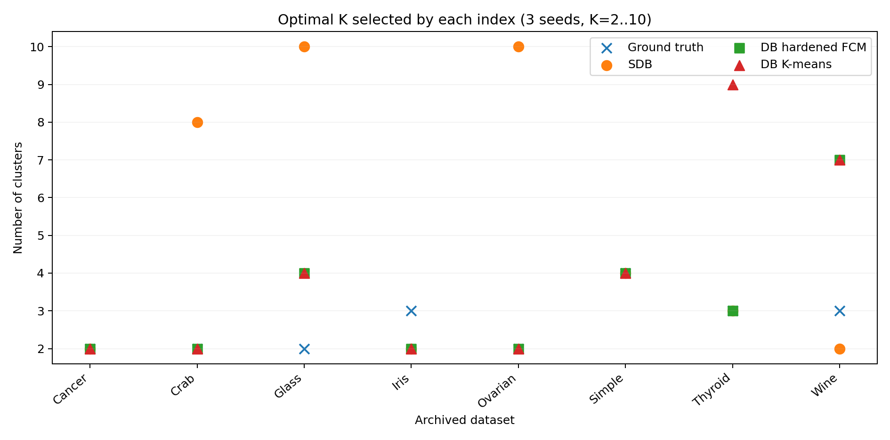

# Soft Davies–Bouldin (SDB) Index

[](#testing) [](#matlab) [](https://doi.org/10.1109/FUZZ-IEEE.2018.8491581)

**A cross-language implementation of the Soft Davies–Bouldin separation measure for fuzzy clustering.**

SDB measures cluster separation **without hardening fuzzy memberships**. It extends the classic Davies–Bouldin (DB) framework to fuzzy partitions by combining geometry with the average membership grade of every cluster. **Lower is better within the same index and experimental protocol.**

This independent, modern implementation follows equations (5)–(8) of:

> Vergani, A. A., & Binaghi, E. (2018). *A Soft Davies-Bouldin Separation Measure*. 2018 IEEE International Conference on Fuzzy Systems (FUZZ-IEEE). https://doi.org/10.1109/FUZZ-IEEE.2018.8491581

## What you get

- **Python:** NumPy implementation of SDB, classic DB baseline, and an independent fuzzy c-means (FCM) implementation.
- **MATLAB:** Corresponding functions in the `+sdb` package, with a runnable example and original-data benchmark.
- **Reproducibility:** numerical tests, cross-language toy fixture, paper-reference Table IV checks, dataset provenance, and independently generated benchmark results.
- **Eight original ground-truth benchmarks:** Cancer, Crab, Glass, Iris, Ovarian, Simple, Thyroid, and Wine, **supported as user-provided `.mat` files**. Raw legacy data are not part of the public distribution pending dataset-specific redistribution checks.

## Repository layout

```text
Soft-Davies-Bouldin/
├── README.md
├── CITATION.cff
├── LICENSE
├── pyproject.toml
├── scripts/
│   ├── python/
│   │   ├── sdb/{index.py,fcm.py}
│   │   ├── example.py
│   │   ├── benchmark.py
│   │   ├── analyze_benchmark.py
│   │   └── convert_original_mat.py
│   └── matlab/
│       ├── +sdb/{soft_davies_bouldin.m,davies_bouldin_crisp.m,fuzzy_c_means.m}
│       ├── example.m
│       ├── benchmark_original.m
│       └── test_sdb.m
├── data/{fixtures,original}
├── tests/
├── docs/{METHOD.md,BENCHMARKS.md,CITATION.bib}
└── results/
```

## Python

```bash
python -m pip install -e ".[benchmarks,dev]"
python scripts/python/example.py
pytest -q
```

Direct library use:

```python
from sklearn.datasets import load_iris
from sdb import fuzzy_c_means, soft_davies_bouldin, davies_bouldin_crisp
import numpy as np

X = load_iris().data
centers, U, iterations = fuzzy_c_means(X, k=3, m=2.0, seed=42)
sdb_value = soft_davies_bouldin(X, centers, U)
db_value = davies_bouldin_crisp(X, np.argmax(U, axis=1))
print(f"SDB={sdb_value:.6f}, DB after hardening={db_value:.6f}")
```

**Input convention:** `X` is `(n_samples, n_features)`, `centers` is `(n_clusters, n_features)`, and `U` is `(n_samples, n_clusters)` with each row summing to 1.

### Original paper benchmark

Place the eight original `.mat` files under `data/original/` (see `data/README.md`). To run the original-data protocol over `K=2,…,10`:

```bash
python scripts/python/benchmark.py --datasets all --original-dir data/original --runs 3 --max-k 10 --output results/benchmark.csv
python scripts/python/analyze_benchmark.py --input results/benchmark.csv --output-dir results/recomputed
```

To make a more computationally extensive comparison, increase `--runs` to `100` (as in the 2018 publication). To test without archived files:

```bash
python scripts/python/benchmark.py --datasets iris wine --runs 3 --max-k 10 --output results/iris_wine.csv
```

The built-in Iris/Wine fallback uses scikit-learn, **not** the archived data. The default experiment uses original feature scales (`--scale none`). The `--scale zscore` option defines an alternative experiment; do not compare scaled results directly with the 2018 table.

## MATLAB

In MATLAB R2019b or later, from the repository root:

```matlab
addpath(fullfile(pwd,'scripts','matlab'));
run('scripts/matlab/example.m');
run('scripts/matlab/test_sdb.m');
run('scripts/matlab/benchmark_original.m');
```

Direct API:

```matlab
[centers,U] = sdb.fuzzy_c_means(X,3,2,42);
value = sdb.soft_davies_bouldin(X,centers,U);
```

Both languages follow the same index formula, but their seeded FCM initializations use different random generators: numerical agreement for independent *fixed inputs* is expected; identical random partitions are not.

## Formula and interpretation

For cluster `i`, the paper defines

\[
S_i^f=\left(\frac{1}{N}\sum_{x\in X}\|x-a_i\|_2^q\right)^{1/q}, \qquad
\bar{u}_i=\frac{1}{N}\sum_{x\in X}u_i(x).
\]

Then

\[
\mathrm{SDB}=\frac{1}{C}\sum_{i=1}^{C}\max_{j\neq i}\frac{S_i^f\bar{u}_i+S_j^f\bar{u}_j}{\|a_i-a_j\|_2}.
\]

The default uses `q=1`, Minkowski exponent `p=2`, and **raw mean memberships** (`membership_power=1`), consistent with the printed equations (5)–(8) in the 2018 paper. A historical MATLAB function also used `mean(U**m)`; to investigate that **optional, non-published variant**, pass `membership_power=m` in Python or the fifth MATLAB parameter. This variant is explicitly separated from the published default.

**Important:** SDB and classic DB have different within-scatter definitions. A smaller SDB *numerical value* than a DB value does not by itself establish higher clustering accuracy. For known-label datasets, assess recovered `K`, adjusted Rand index (ARI), stability, and sensitivity to preprocessing. The method is undefined for fewer than two distinct centroids: the public API rejects such cases instead of silently returning zero.

## Reproduction status

Using the actual eight 2018 archive datasets (all with `Data` and one-hot `T`), our independent Python implementation reproduced the eight SDB values in paper Table IV to **four decimal places** when evaluated at the known class count. Re-running `K=2,…,10`, three seeds per `K`, also recovered **all eight SDB-optimal K values in paper Table III**. See [`docs/BENCHMARKS.md`](docs/BENCHMARKS.md) and `results/` for numeric evidence, configuration, and limitations. This is a successful implementation check, not a full reproduction of all original 100-run statistics, plots, or fMRI analyses.

## Selected reproducibility figures




## Testing

`pytest -q` covers analytic toy examples, cluster-order permutation, translation/scale invariance, degenerate inputs, FCM membership constraints, and a scikit-learn reference check. `scripts/matlab/test_sdb.m` checks MATLAB against the same analytic fixture. MATLAB has not been executed in the authoring environment; run it in your local MATLAB installation or CI runner.

## Citation

If SDB contributes to your work, please cite the 2018 paper using [`CITATION.cff`](CITATION.cff) or [`docs/CITATION.bib`](docs/CITATION.bib). Paper DOI: [10.1109/FUZZ-IEEE.2018.8491581](https://doi.org/10.1109/FUZZ-IEEE.2018.8491581).

## Rights and licensing

The **new implementation code** is MIT-licensed (see `LICENSE`). MATLAB original code and the copyrighted IEEE PDF were consulted as references; the PDF is not included in this public-code package. Archived third-party data are not redistributed here until each dataset's provenance and license have been reviewed; see `data/README.md`. Authors of the published method: Alberto Arturo Vergani and Elisabetta Binaghi.
