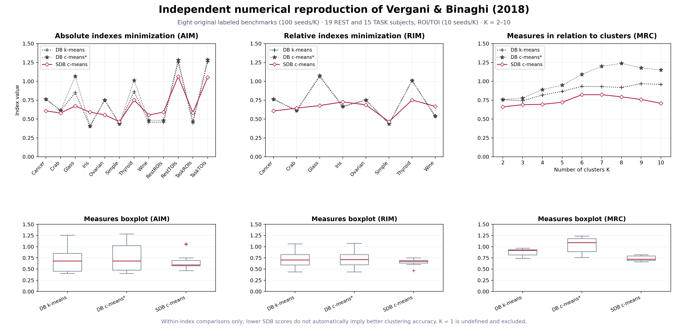

# Independent check of the 2018 abstract: AIM, RIM and MRC

> **Historical 10-seed fMRI report.** The current [100-initialization reanalysis](FMRI_100_INITIALIZATIONS.md) uses 61,200 fMRI configurations and confirms the same AIM 7/12, RIM 4/8 and MRC 9/9 counts. The tables and figures below document the earlier experiment and are retained for comparison.

**Study:** Vergani & Binaghi (2018), *A Soft Davies-Bouldin Separation Measure* — DOI [10.1109/FUZZ-IEEE.2018.8491581](https://doi.org/10.1109/FUZZ-IEEE.2018.8491581).

**Status:** Independent Python re-computation from the original feature matrices, not a transcription of the published figure. The three headline comparison counts in the abstract are recovered. The exact historical numerical analysis and its ANOVA p-values are **not** bitwise reproduced.

## Principal outcome

| Comparison | Published (2018) | Recomputed | Agreement |
|:--|--:|--:|:--|
| AIM: SDB optimal score numerically below **both** DB baselines, across 12 data configurations | 7/12 | **7/12** | Yes |
| RIM: SDB score numerically below **both** DB baselines at the known K, across 8 labeled datasets | 4/8 | **4/8** | Yes |
| MRC: cross-dataset median SDB below **both** DB baselines at each K=2,…,10 | 9/9 | **9/9** | Yes |



**Figure 1, independent reanalysis.** Upper panels: dataset-wise minima (AIM), scores at the ground-truth number of groups (RIM), and median separation score across 12 configurations for each K (MRC). Lower panels: descriptive boxplots of the displayed summarized values. The three methods are DB on K-means, DB on max-membership-hardened FCM (asterisk), and SDB on fuzzy FCM. This is a new computation, not an image extracted from the IEEE article.

## Protocol

- Eight original labeled MATLAB `Data`/`T` matrices: Cancer, Crab, Glass, Iris, Ovarian, Simple, Thyroid, Wine; each evaluated for K=2,…,10 with **100 seeded independent starts**, 7,200 fitting configurations total.
- REST (`dataset_rest_rio.mat`): 19 subjects; TASK (`dataset_task_208_rio.mat`): 15 subjects; each subject evaluated in both ROI/TOI matrix orientations for K=2,…,10 with **10 seeded starts**, 6,120 configurations total. The fMRI replication is therefore a **10-start extension/pilot**, not the original 100-start procedure.
- Raw, unstandardized features; Euclidean distances; fuzzy exponent m=2; FCM maximum iterations=100 and convergence tolerance=1e-6; SDB uses mean raw memberships (the published equation), within scatter q=1, centroid separation p=2.
- K-means is scikit-learn with `n_init=10`, `random_state=seed`, `max_iter=100`. Historical MATLAB random generators, clustering initialization, and precise stopping conditions are not identical; minor numerical and best-K differences are expected.
- For fMRI, original archived MATLAB `measures_RestROI.mat`/`measures_TaskTOI.mat` values were used to check orientation: the array saved as `(96,time)` is evaluated as ROIs, while its transpose is evaluated as TOIs. Scores are averaged over seeds per subject, then averaged over subjects at each K. The names reflect the archival scripts/outputs rather than an asserted anatomical interpretation of the row/column direction.
- For AIM, take the minimum (over K=2,…,10) of each index separately. For RIM, inspect the value at the known number of ground-truth classes. For MRC, take the median across **all 12** dataset configurations at each K.
- `K=1` is mathematically undefined for Davies–Bouldin-type ratios. It is omitted from the new MRC plot; the historical Figure 1 represented K=1 with a zero placeholder.

## Numerical comparison: AIM (minimum score by index)

| Dataset | DB-KM (2018) | DB-KM new | DB-FCM* (2018) | DB-FCM* new | SDB (2018) | SDB new | SDB below both? |
|:--|--:|--:|--:|--:|--:|--:|:--:|
| Cancer | 0.7628 | 0.7628 | 0.7630 | 0.7630 | 0.6058 | 0.6058 | Yes |
| Crab | 0.6113 | 0.6108 | 0.6137 | 0.6137 | 0.5802 | 0.5802 | Yes |
| Glass | 0.9167 | 0.8478 | 1.0658 | 1.0658 | 0.6723 | 0.6727 | Yes |
| Iris | 0.4048 | 0.4048 | 0.4048 | 0.4048 | 0.5904 | 0.5904 | No |
| Ovarian | 0.7487 | 0.7501 | 0.7520 | 0.7520 | 0.5553 | 0.5551 | Yes |
| Simple | 0.4428 | 0.4375 | 0.4375 | 0.4375 | 0.4637 | 0.4637 | No |
| Thyroid | 0.9802 | 0.8621 | 1.0105 | 1.0105 | 0.7516 | 0.7516 | Yes |
| Wine | 0.4612 | 0.4574 | 0.4577 | 0.4817 | 0.5524 | 0.5524 | No |
| RestROIs | 0.4332 | 0.4580 | 0.4519 | 0.4806 | 0.5563 | 0.5913 | No |
| RestTOIs | 1.2417 | 1.2544 | 1.2812 | 1.2812 | 1.0565 | 1.0639 | Yes |
| TaskROIs | 0.4427 | 0.4483 | 0.4336 | 0.4680 | 0.5618 | 0.5821 | No |
| TaskTOIs | 1.2432 | 1.2593 | 1.2830 | 1.2851 | 1.0484 | 1.0513 | Yes |

**Optimal SDB K agrees with Table III in 8/8 labeled datasets.** The new numerical SDB at the true K matches all eight Table IV entries to four decimal places. Absolute minima and K selected by the crisp indices can differ because the optimization implementations and initialization are not identical.

## Numerical comparison: RIM (known K)

| Dataset | True K | DB-KM new | DB-FCM* new | SDB published | SDB new | SDB below both? |
|:--|--:|--:|--:|--:|--:|:--:|
| Cancer | 2 | 0.7628 | 0.7630 | 0.6058 | 0.6058 | Yes |
| Crab | 2 | 0.6108 | 0.6137 | 0.6434 | 0.6434 | No |
| Glass | 2 | 1.0645 | 1.0752 | 0.6779 | 0.6779 | Yes |
| Iris | 3 | 0.6623 | 0.6696 | 0.7261 | 0.7261 | No |
| Ovarian | 2 | 0.7501 | 0.7520 | 0.6879 | 0.6879 | Yes |
| Simple | 4 | 0.4375 | 0.4375 | 0.4637 | 0.4637 | No |
| Thyroid | 3 | 1.0098 | 1.0105 | 0.7516 | 0.7516 | Yes |
| Wine | 3 | 0.5342 | 0.5394 | 0.6675 | 0.6675 | No |

## Numerical comparison: MRC (cross-dataset medians)

| K | DB-KM published | DB-KM new | DB-FCM* published | DB-FCM* new | SDB published | SDB new |
|--:|--:|--:|--:|--:|--:|--:|
| 2 | 0.7564 | 0.7564 | 0.7575 | 0.7575 | 0.6607 | 0.6607 |
| 3 | 0.7410 | 0.7413 | 0.7492 | 0.7773 | 0.7104 | 0.6895 |
| 4 | 0.8596 | 0.8170 | 0.8797 | 0.8896 | 0.6889 | 0.6944 |
| 5 | 0.8572 | 0.8662 | 0.9300 | 0.9478 | 0.6968 | 0.7215 |
| 6 | 0.8948 | 0.9320 | 1.0860 | 1.0908 | 0.8531 | 0.8219 |
| 7 | 0.8960 | 0.9292 | 1.1997 | 1.1986 | 0.8306 | 0.8220 |
| 8 | 0.9064 | 0.9179 | 1.2995 | 1.2373 | 0.8407 | 0.7933 |
| 9 | 0.9492 | 0.9678 | 1.2069 | 1.1786 | 0.7705 | 0.7587 |
| 10 | 0.9917 | 0.9577 | 1.1550 | 1.1505 | 0.6712 | 0.7075 |

## Descriptive two-way ANOVA (index effect)

For comparability, use an additive two-factor ANOVA on the summary scores (index × dataset or index × K). MRC includes a **synthetic K=1 zero** solely for comparison with the published 2018 ANOVA; it is not a valid computed SDB value. These tests do not model dependence between repeated K or subjects and should not be interpreted as evidence of superior cluster accuracy.

| Analysis | Published p (index effect) | New p (index effect) | Qualitative interpretation |
|:--|--:|--:|:--|
| AIM | 0.1772 | 0.162 | Not below 0.05 |
| RIM | 0.2377 | 0.252 | Not below 0.05 |
| MRC | 0.0001 | 1.32e-05 | Below 0.05 |

## Cluster-number recovery (distinct from index magnitude)

| Criterion | Ground-truth K recovered |
|:--|--:|
| DB on K-means | **4/8** |
| DB on hardened FCM | **5/8** |
| SDB on FCM | **3/8** |

The comparatively smaller absolute SDB scores do **not** imply a superior solution: SDB and classical DB use different within-cluster scatter definitions, and the recovery of K and the quality of per-sample assignments are separate outcomes. The original methodological contribution is the ability to validate soft partitions without hardening them.

## How to reproduce the independent analysis

Install `python -m pip install -e ".[benchmarks,dev]"` at repository root and place the eight original `.mat` files plus `dataset_rest_rio.mat` and `dataset_task_208_rio.mat` in `data/original/`, subject to dataset redistribution permissions.

```bash
python scripts/python/reproduce_abstract.py --only ground --ground-runs 100 --output results/abstract_reproduction/ground_raw.csv
python scripts/python/reproduce_abstract.py --only fmri --include-fmri --fmri-runs 10 --output results/abstract_reproduction/fmri_raw.csv
python scripts/python/summarize_abstract.py --input-files results/abstract_reproduction/ground_raw.csv results/abstract_reproduction/fmri_raw.csv
python scripts/python/plot_abstract_figure.py
```

The committed small CSV summaries (`aggregated_scores.csv`, `AIM_summary.csv`, `RIM_summary.csv`, `MRC_summary.csv`, `ANOVA_summary.csv`) allow regeneration of the plot without redistributing the original source data. The input datasets themselves are not included in the public repository.

**Limits of the confirmation:** We reproduced the three **directions/counts** in the abstract and the SDB scores at ground-truth K to four decimals, while some raw scores differ. The original fMRI 100-seed experiments and historical preprocessing/randomization were not exactly recreated; the ANOVA results are only qualitatively concordant.
