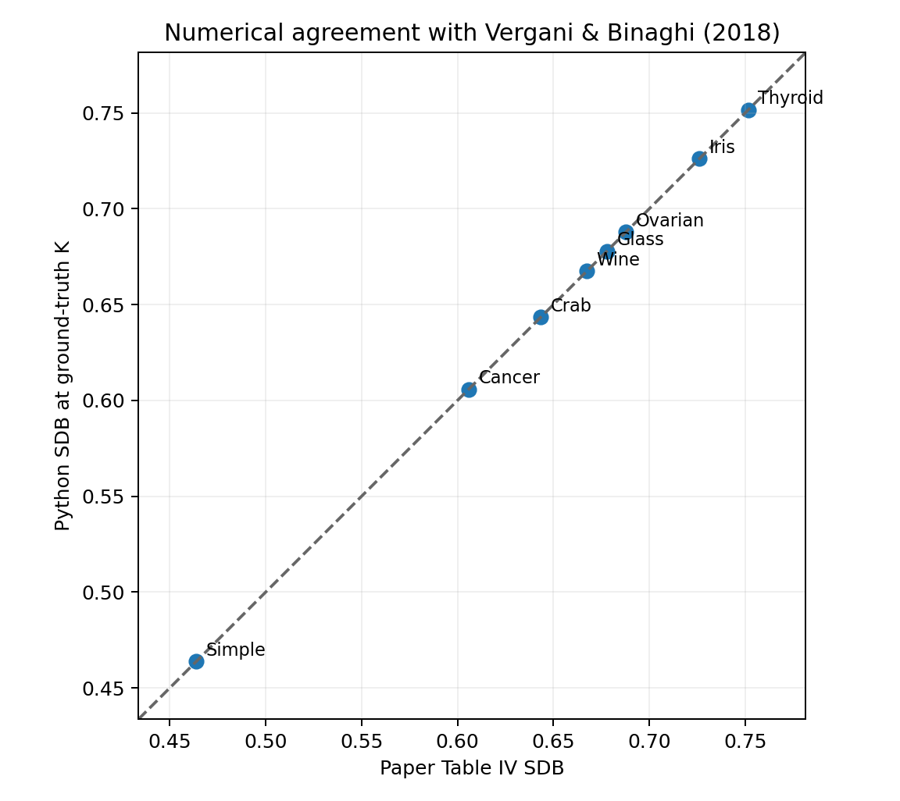
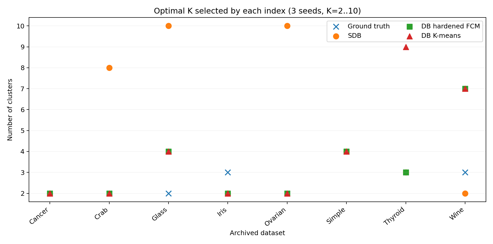

# Independent Python reimplementation: benchmark report

**Protocol:** archived eight original Data/T MATLAB datasets; original unstandardized features; FCM exponent m=2; q=1; Euclidean geometry; candidate K=2–10; 3 seeded FCM and K-means replicates per K; mean scores over seeds; FCM max 100 iterations. K-means uses scikit-learn with `n_init=10`. All scores are recomputed with new NumPy implementation code.

This report is a **computational reproduction check**, not a rerun of all 100 replicates or the fMRI experiment. Exact hard partitions and random initializations differ from historic MATLAB. Low scores must not be conflated with better agreement to ground-truth labels.

## Agreement with published SDB (Table IV, ground-truth K)

| Dataset | N | D | Ground-truth K | Paper SDB | Python SDB | Abs error |
|:--|--:|--:|--:|--:|--:|--:|
| Cancer | 699 | 9 | 2 | 0.6058 | 0.6058 | 0.000008 |
| Crab | 200 | 6 | 2 | 0.6434 | 0.6434 | 0.000022 |
| Glass | 214 | 9 | 2 | 0.6779 | 0.6779 | 0.000016 |
| Iris | 150 | 4 | 3 | 0.7261 | 0.7261 | 0.000001 |
| Ovarian | 216 | 100 | 2 | 0.6879 | 0.6879 | 0.000017 |
| Simple | 1000 | 2 | 4 | 0.4637 | 0.4637 | 0.000014 |
| Thyroid | 7200 | 21 | 3 | 0.7516 | 0.7516 | 0.000023 |
| Wine | 178 | 13 | 3 | 0.6675 | 0.6675 | 0.000010 |

**Maximum unrounded absolute deviation:** 0.000023. The eight Table IV scores all agree to four decimal places.

## Selection of optimal K (paper Table III, AIM)

| Dataset | True K | SDB K (2018) | SDB K (Python) | DB K-means K (Python) | DB hardened FCM K (Python) |
|:--|--:|--:|--:|--:|--:|
| Cancer | 2 | 2 | 2 | 2 | 2 |
| Crab | 2 | 8 | 8 | 2 | 2 |
| Glass | 2 | 10 | 10 | 4 | 4 |
| Iris | 3 | 2 | 2 | 2 | 2 |
| Ovarian | 2 | 10 | 10 | 2 | 2 |
| Simple | 4 | 4 | 4 | 4 | 4 |
| Thyroid | 3 | 3 | 3 | 9 | 3 |
| Wine | 3 | 2 | 2 | 7 | 7 |

SDB selected the same optimal K as the paper in **8/8 datasets**.
Matching ground-truth K among these eight: SDB_published: 3/8, SDB_power_variant: 1/8, DB_fcm_hard: 5/8, DB_kmeans: 4/8.

## Scientific interpretation

- SDB is numerically reproducible from its published equations, with no need to copy the original MATLAB source.
- Recovering a low index score is not synonymous with recovering the true number of classes. SDB recovers true K in 3/8 for this K-range.
- The absolute scores of SDB and crisp DB are on different scales because they use different definitions of within-cluster scatter. Their absolute magnitudes cannot alone establish superiority.
- In high-K, high-dimensional/imbalanced data such as Cancer and Thyroid, FCM cluster centers can approach each other; the ratio is very sensitive to inter-center distance and some runs give extremely large SDB values. Inspect distributions across random restarts, instability, and closeness of centroids.
- To replicate historical ANOVAs and the cross-dataset median MRC figure, use the paper's 100 repetitions and explicitly match all original preprocessing and clustering choices. No claims of statistical significance are made from the present 3-seed pilot.

## Figures

## Sources

Paper: https://doi.org/10.1109/FUZZ-IEEE.2018.8491581

Original MAT files are not committed; see `data/README.md`. The raw benchmark table is `results/benchmark_original_raw_3seeds_k2-10.csv`.
