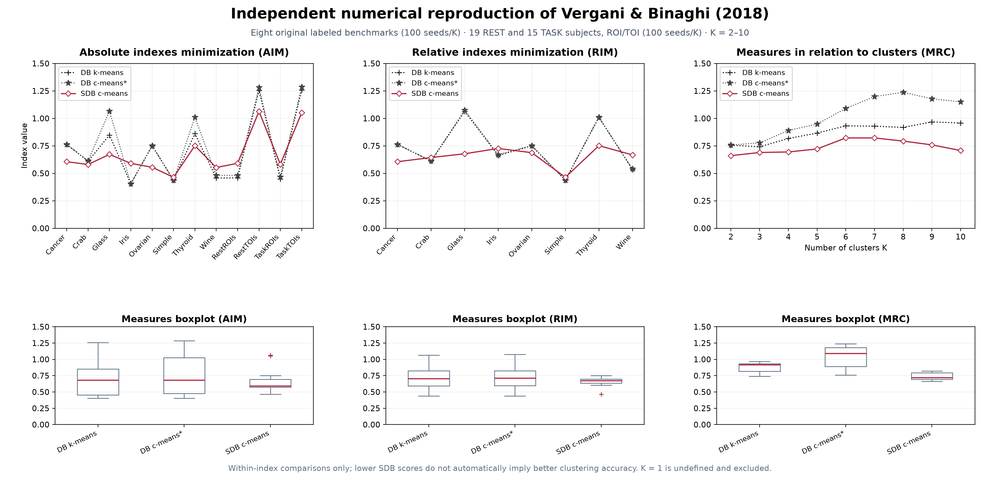
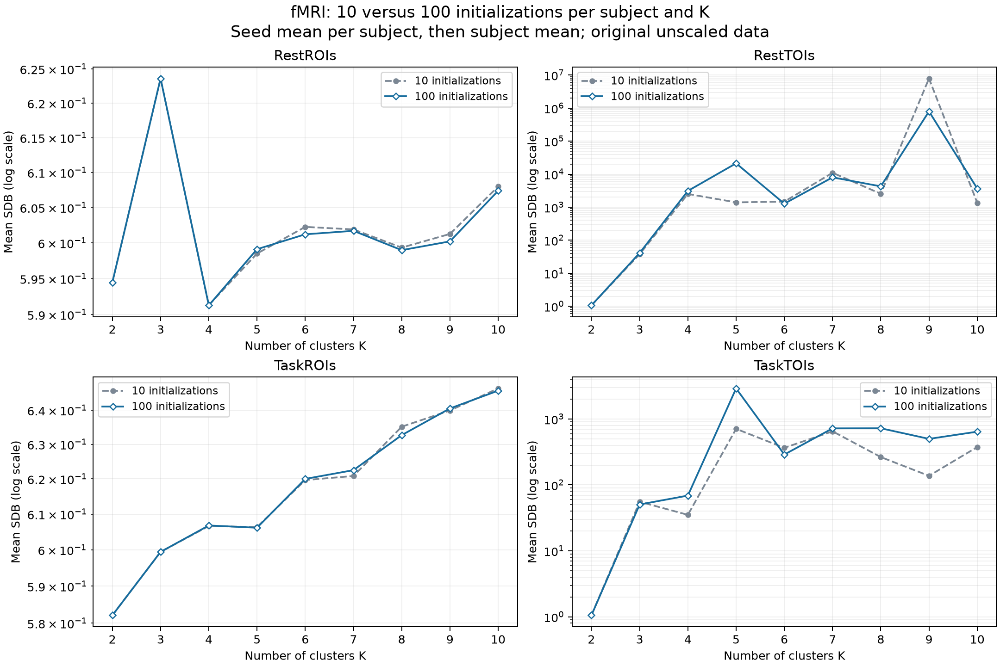

# Reanalysis with 100 fMRI initializations per subject and K

**17 November 2026 — Vergani & Binaghi (2018), [A Soft Davies-Bouldin Separation Measure](https://doi.org/10.1109/FUZZ-IEEE.2018.8491581).**

The three numerical comparison counts in the abstract remain confirmed after extending the independent Python fMRI experiment from 10 to **100 initializations per subject and K**. This matches the historical number of starts. Implementation, randomization and stopping details still differ from historical MATLAB, so individual values and ANOVA p-values need not match exactly.

## Results

| Comparison | Paper 2018 | Local fMRI: 10 starts | Local fMRI: 100 starts |
|:--|--:|--:|--:|
| AIM: minimum SDB below the separate minima of both DB baselines, across 12 configurations | 7/12 | 7/12 | **7/12** |
| RIM: SDB below both DB indices at known K, across 8 labeled datasets | 4/8 | 4/8 | **4/8** |
| MRC: median SDB across 12 configurations below both DB medians for K=2–10 | 9/9 | 9/9 | **9/9** |

The benchmark analysis remains at 100 starts and is unchanged between these local runs. RIM therefore remains unchanged by design. The eight Table IV SDB values agree with the paper to four decimals (maximum absolute error **0.00002274**); all eight SDB-optimal K values match Table III. The MRC summary medians are unchanged at the precision of the saved CSVs.



[Figure PDF](../results/figures/figure1_100seeds.pdf) · [Figure SVG](../results/figures/figure1_100seeds.svg)

## What changed between 10 and 100 starts?

All 61,200 fMRI configurations were recomputed using seeds 0–99. The first **6,120 configurations** (seeds 0–9) reproduce the earlier **local** run exactly. The ten source-file hashes and the benchmark CSV remain unchanged. This comparison isolates the number of fMRI starts, rather than differences between operating systems or library versions.

| fMRI configuration | Minimum SDB, 10 starts | Minimum SDB, 100 starts | SDB-optimal K, 10 → 100 | SDB below both DB minima? |
|:--|--:|--:|:--:|:--:|
| REST-ROI | 0.59130645 | 0.59127075 | 4 → 4 | No → No |
| REST-TOI | 1.06386530 | 1.06386530 | 2 → 2 | Yes → Yes |
| TASK-ROI | 0.58211180 | 0.58211180 | 2 → 2 | No → No |
| TASK-TOI | 1.05134950 | 1.05131520 | 2 → 2 | Yes → Yes |

These are minima over K of seed- and subject-averaged scores. The four SDB-optimal K values are unchanged. The DB K-means optimum for TASK-ROI changes from K=10 to K=9; the abstract comparison counts are unaffected.



The vertical axes are logarithmic, with different limits between panels. High-K TOI means can change substantially because some seeds produce almost coincident centroids. All finite cases, including extreme scores, remain in the means. [PDF](../results/figures/fmri_10_vs_100.pdf) · [SVG](../results/figures/fmri_10_vs_100.svg)

The earlier committed 10-seed experiment was run in a different environment. For a controlled comparison, the figure and [comparison CSV](../results/reproduction_100seeds/comparison_10_initializations.csv) use the local 10-seed baseline that shares its environment with the new 100-seed run. The [historical report](ABSTRACT_REPRODUCTION.md) and its scores remain available separately.

## Protocol and validation

- Eight original labeled `Data`/`T` datasets: 100 starts for each K=2–10, **7,200 configurations**.
- REST: 19 subjects, both ROI/TOI orientations, 100 starts for each K=2–10, **34,200 configurations**.
- TASK: 15 subjects, both ROI/TOI orientations, 100 starts for each K=2–10, **27,000 configurations**.
- Total: **68,400 configurations**, each evaluating the three indices.
- Original unstandardized features; Euclidean geometry; fuzzy exponent m=2; SDB uses mean raw memberships, q=1 and p=2.
- FCM: maximum 100 iterations, tolerance 1e-6. K-means: scikit-learn, `n_init=10`, `max_iter=100`, `random_state=seed`. The 100 seeds are outer repetitions; K-means retains ten internal starts within each repetition.
- fMRI scores are averaged over seeds within subject, then over subjects at each K. The archive's `(96,time)` array is evaluated as ROI and its transpose as TOI, consistent with the earlier reanalysis.
- AIM minimizes each index separately over K; RIM uses known K in the labeled benchmarks; MRC takes the median across all 12 configurations. K=1 is undefined and excluded from the plots.
- The complete subject × K × seed grid, unique keys, source hashes, absence of recorded errors and finite index scores were checked. No rows were excluded.

The computation used code commit `a73237e77f4a0801446631e9f71cad46d96fb63b`, Python 3.12.14, NumPy 2.5.5, SciPy 1.18.1, scikit-learn 1.9.1, pandas 3.1.1 and Matplotlib 3.11.2 on Windows. [Provenance and checksums](../results/reproduction_100seeds/provenance.json) record source-data hashes and checksums of the locally retained score files. The scientific fitting code was unchanged for this extension.

## Numerical limitations

**31,631 of 61,200 fMRI configurations** reach the FCM limit of 100 iterations; reaching the limit does not certify convergence. **2,201 fMRI configurations have SDB > 1,000**, a descriptive threshold rather than an exclusion rule. The largest observed SDB is about **1.497 × 10⁹** in REST-TOI. Dividing by nearly zero centroid separation explains the sensitivity of extreme values. See [convergence diagnostics](../results/reproduction_100seeds/convergence_diagnostics.csv).

The smaller absolute SDB values do not establish better clustering accuracy: SDB and crisp DB use different scatter definitions and scales. Ground-truth K recovery remains DB K-means **4/8**, hardened FCM DB **5/8**, and SDB **3/8**.

## Descriptive ANOVA

| Analysis | Paper p | Local 10-start fMRI p | Local 100-start fMRI p |
|:--|--:|--:|--:|
| AIM | 0.1772 | 0.161536751 | 0.162254536 |
| RIM | 0.2377 | 0.252163513 | 0.252163513 |
| MRC | 0.0001 | 0.0000131814519 | 0.0000131814519 |

These are additive two-factor ANOVAs on summary scores. The MRC comparison includes the historical synthetic K=1 zero **only for this descriptive test**, not as a valid computed index. Dependence between K and subjects is not modeled. The tests support a qualitative comparison to the paper, not a claim of superior clustering accuracy.

## Files and reproduction commands

The [result directory](../results/reproduction_100seeds/) contains **aggregated results only**: summary tables, the 10-versus-100 comparison, Table IV checks, dataset-level convergence diagnostics and provenance. The new per-subject/per-initialization scores, original identifiers and fMRI time series remain local, as requested by the data owner.

To regenerate Figure 1 and the comparison plot from the published aggregate tables, without the original matrices:

```bash
python -m pip install -e ".[benchmarks,dev]"
python scripts/python/plot_abstract_figure.py --input-dir results/reproduction_100seeds --output results/recomputed/100seeds/figure1.png
python scripts/python/plot_fmri_initializations.py --output results/recomputed/100seeds/fmri_10_vs_100.png
pytest -q
```

To rerun the fitting from user-provided original matrices in `data/original/`:

```bash
python scripts/python/reproduce_abstract.py --only ground --ground-runs 100 --output results/recomputed/100seeds/ground_raw.csv
python scripts/python/reproduce_abstract.py --only fmri --include-fmri --fmri-runs 100 --output results/recomputed/100seeds/fmri_raw.csv
python scripts/python/summarize_abstract.py --input-files results/recomputed/100seeds/ground_raw.csv results/recomputed/100seeds/fmri_raw.csv --ground-runs 100 --fmri-runs 100 --output-dir results/recomputed/100seeds
```

Fitting outputs retain the identifiers supplied in the private input matrices. Keep those rerun files local. Public tests check the aggregate grid and summary counts; an additional local test validates the full 68,400-row grid when the private score files are present.
