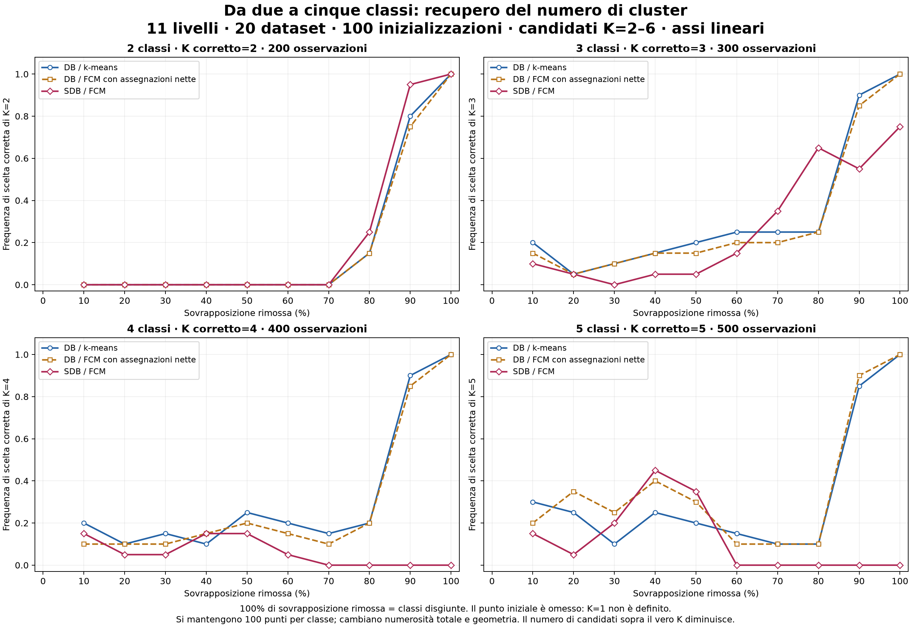
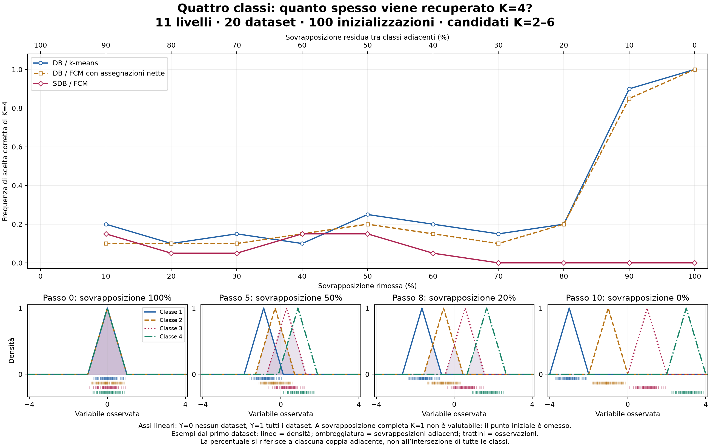
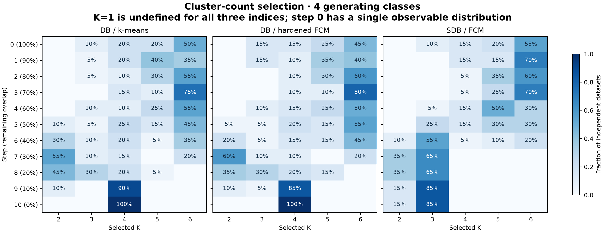
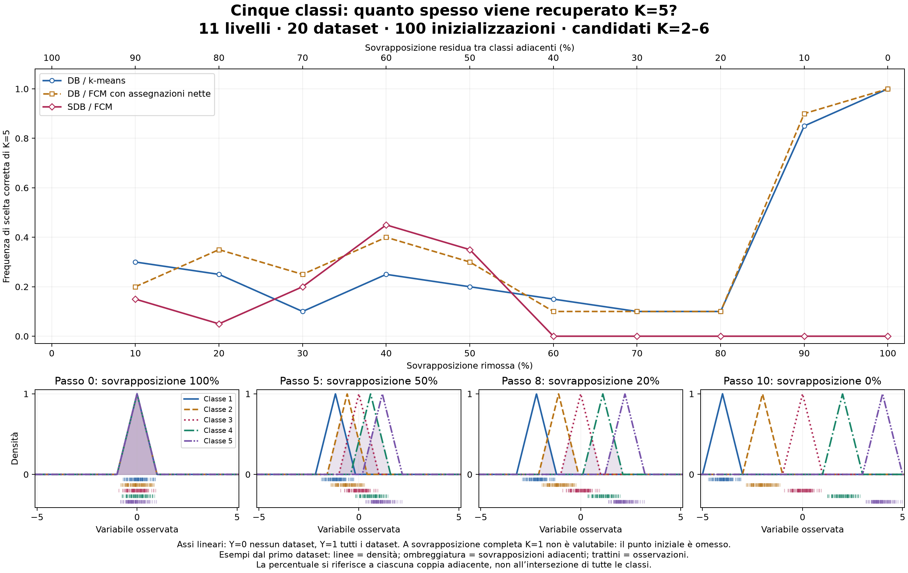
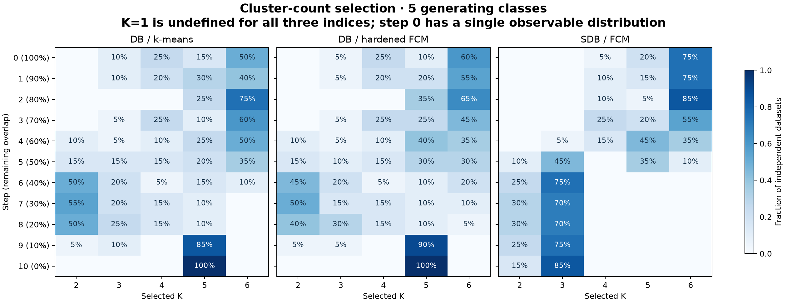

# Technical note 3 — four and five classes across an overlap continuum

**17 November 2026. New supplementary synthetic experiments, outside the 2018 paper. All new figures use linear axes.**

The three-class study is repeated first with **four classes** and then with **five classes**, keeping **11 overlap levels, 20 independent datasets and 100 initializations per candidate K=2–6**. Each new study contains **110,000 configurations and 330,000 index values**. The target is K=4 or K=5 at positive separation.

## Main result

**SDB under-selects the number of clusters when these four- and five-class mixtures become well separated.** At disjointness it chooses K=3 in 17/20 datasets and K=2 in 3/20, in each study, while both DB criteria select the true count in 20/20. This is not a uniform ranking over overlap: with five classes at 60% remaining overlap, SDB recovers K=5 in 9/20 versus 5/20 for DB/k-means and 8/20 for DB/hardened FCM; at 50% the counts are 7/20, 4/20 and 6/20 respectively. These small observed differences are descriptive, not significance claims.

Correct generating-count selections near separation, out of 20 datasets:

| Classes | Adjacent overlap | DB / k-means | DB / hardened FCM | SDB / FCM |
|--:|--:|--:|--:|--:|
| 4 | 20% | 4/20 | 4/20 | 0/20 |
| 4 | 10% | 18/20 | 17/20 | 0/20 |
| 4 | 0% | 20/20 | 20/20 | 0/20 |
| 5 | 20% | 2/20 | 2/20 | 0/20 |
| 5 | 10% | 17/20 | 18/20 | 0/20 |
| 5 | 0% | 20/20 | 20/20 | 0/20 |

At complete separation, the comparison across all four studies is:

| Generating classes | DB / k-means | DB / hardened FCM | SDB / FCM |
|--:|--:|--:|--:|
| 2 | 20/20 | 20/20 | 20/20 |
| 3 | 20/20 | 20/20 | 15/20 |
| 4 | 20/20 | 20/20 | 0/20 |
| 5 | 20/20 | 20/20 | 0/20 |

These are frequencies over independent datasets, not percentages of correctly assigned observations or frequencies over the 100 starts. Using 100 starts does not guarantee recovery of the correct generating count.



[PDF](../results/figures/overlap_2_to_5_recovery.pdf) · [SVG](../results/figures/overlap_2_to_5_recovery.svg) · [Two-class note](TECHNICAL_NOTES_OVERLAP.md) · [Three-class note](TECHNICAL_NOTES_THREE_CLASSES.md)

## Dataset and unchanged protocol

One variable contains C equally likely triangular class densities with half-width 1:

```text
C = 4 or 5
center_j = (j - (C-1)/2) * d, j = 0, ..., C-1
f_j(x) = max(1 - abs(x-center_j), 0)
adjacent overlap O = integral min(f_j, f_(j+1)) = (1-d/2)^2
step s = 0, 1, ..., 10; O_s = 1-s/10; d_s = 2*(1-sqrt(O_s))
population Bayes accuracy = 1 - ((C-1)/C)*O
```

The percentages are shared density areas for **each adjacent pair**, not the common intersection of all classes or a fraction of points. Non-adjacent pairs have smaller overlap. At step 0 all densities coincide, the posterior is uniform 1/C, and the observable population has one distribution. K=1 is undefined for DB and SDB; it is therefore omitted from the correct-count curves. At step 10 positive-density supports are disjoint and neighboring closed supports touch only where density is zero. At intermediate steps the target is the number of generating components, which need not equal the number of visible modes.

- **100 training observations per class:** 400 for C=4 and 500 for C=5; **2,000 independent test observations per class:** 8,000 and 10,000 respectively. The two- and three-class studies used 200/300 training observations. Total sample size and spatial extent increase with class count.
- Same dataset seed scheme, `SeedSequence([20261117, replicate, test_flag])`. Within each replicate, fixed base draws and latent labels are translated across the eleven levels. Levels are paired, not independent replicates.
- **100 starts (seeds 0–99) at every K=2–6** for both algorithms. K-means uses k-means++ with `n_init=1` per seed. FCM uses random memberships and fixed m=2. No standardization is applied. Both primary solvers have an iteration cap of 1,000 and tolerance 1e-7, with their respective stopping rules.
- SDB uses the published q=1, p=2, raw-mean-membership formula. **K minimizes the index averaged across 100 starts**, separately for each dataset/step. Exact ties select the smaller K. Labels and test data do not enter selection.
- For external evaluation, select the smallest native training-objective partition separately for each algorithm/K. At fixed K=C, order centers left to right to assign class names without label-based fitting. ARI at selected K is label-permutation invariant. Posterior MSE and Brier components average over observations and class columns.
- The candidate range remains **K=2–6** for comparability. For C=4 only K=5,6 can overestimate the count; for C=5 only K=6 can. This asymmetric range and the changing sample size/geometry limit comparisons across class counts. They do not prevent either K=4 or K=5 from being selected.

No existing two-class, three-class or fMRI results are overwritten. Both new bundles contain only synthetic data.

## 4 classes



[PDF](../results/figures/overlap_4classes_recovery_it.pdf) · [SVG](../results/figures/overlap_4classes_recovery_it.svg) · [Full results](../results/supplementary_overlap_4classes/)

| Step | Adjacent overlap | DB / k-means | DB / hardened FCM | SDB / FCM |
|--:|--:|--:|--:|--:|
| 0 | 100% | — | — | — |
| 1 | 90% | 4/20 | 2/20 | 3/20 |
| 2 | 80% | 2/20 | 2/20 | 1/20 |
| 3 | 70% | 3/20 | 2/20 | 1/20 |
| 4 | 60% | 2/20 | 3/20 | 3/20 |
| 5 | 50% | 5/20 | 4/20 | 3/20 |
| 6 | 40% | 4/20 | 3/20 | 1/20 |
| 7 | 30% | 3/20 | 2/20 | 0/20 |
| 8 | 20% | 4/20 | 4/20 | 0/20 |
| 9 | 10% | 18/20 | 17/20 | 0/20 |
| 10 | 0% | 20/20 | 20/20 | 0/20 |

The dash at complete overlap marks an undefined observable-count evaluation. Saved tables retain how often K=4 was selected at that endpoint, but those frequencies are not correct-count recovery of the single observable distribution. The four example panels show 100%, 50%, 20% and 0% remaining overlap, with class densities and actual training observations from replicate 0.

At **zero overlap**, the full distribution of selected counts is:

| Criterion | K=2 | K=3 | K=4 | K=5 | K=6 |
|--:|--:|--:|--:|--:|--:|
| DB / k-means | 0 | 0 | 20 | 0 | 0 |
| DB / hardened FCM | 0 | 0 | 20 | 0 | 0 |
| SDB / FCM | 3 | 17 | 0 | 0 | 0 |

At fixed K=4, mean held-out accuracy is **99.9594% for k-means** and **99.9363% for FCM**. With K chosen by each index, mean held-out ARI is DB / k-means: **0.99892**, DB / hardened FCM: **0.99830**, SDB / FCM: **0.59574**. Count selection and class assignment at fixed K are different questions.

At this endpoint, **0 FCM fits** reached the primary iteration cap. In the 20 SDB count errors, mean SDB at the true K exceeds mean SDB at the selected K by **0.03837–0.05895**. Since smaller SDB is preferred, the numerical selection rule favors the incorrect count despite the high fixed-K accuracy.



[Selected K per dataset](../results/supplementary_overlap_4classes/selected_k.csv) · [Mean scores](../results/supplementary_overlap_4classes/mean_scores.csv) · [Fixed-K test metrics](../results/supplementary_overlap_4classes/k4_performance.csv)

All 330,000 index values are finite. **87 FCM runs** reached the primary cap and were extended to 10,000 iterations. **0** remain at the extended cap; maximum fixed-point residual is **9.89e-08**. Substituting the extended-run index scores changes **2/660 K selections**. Primary scores remain intact. This sensitivity check concerns K selection, not a refit of held-out best-objective partitions. [Convergence sensitivity](../results/supplementary_overlap_4classes/convergence_sensitivity.json).

Changed choices are listed explicitly below. **0/33 criterion/step recovery frequencies change**; the tables and figures above retain the primary 1,000-iteration protocol.

| Replicate | Step | Adjacent overlap | Criterion | Primary K | Extended K |
|--:|--:|--:|--:|--:|--:|
| 4 | 6 | 40% | DB_fcm_hard | 5 | 6 |
| 4 | 6 | 40% | SDB_fcm | 3 | 6 |

The [eleven density panels](../results/figures/overlap_4classes_distributions.png) and [index/accuracy/membership diagnostics](../results/figures/overlap_4classes_results.png) provide the full sweep. The latter uses a separate linear Y scale for each index; bands are 10th–90th percentiles across datasets, not confidence intervals. At zero overlap, posterior MSE per class is **0.006743 for FCM** versus **0.000203 for crisp k-means**. FCM with m=2 need not produce crisp or calibrated posterior memberships for disjoint generating classes.

At fixed K=4, the mean within-replicate Spearman correlation of index value with separation step is DB / k-means: **-0.556**, DB / hardened FCM: **-0.535**, SDB / FCM: **0.852**. A positive value means the index tends to increase with separation on this sweep. These scores should not be treated as a calibrated fuzziness scale; numerical magnitudes also cannot be compared directly between DB and SDB.

## 5 classes



[PDF](../results/figures/overlap_5classes_recovery_it.pdf) · [SVG](../results/figures/overlap_5classes_recovery_it.svg) · [Full results](../results/supplementary_overlap_5classes/)

| Step | Adjacent overlap | DB / k-means | DB / hardened FCM | SDB / FCM |
|--:|--:|--:|--:|--:|
| 0 | 100% | — | — | — |
| 1 | 90% | 6/20 | 4/20 | 3/20 |
| 2 | 80% | 5/20 | 7/20 | 1/20 |
| 3 | 70% | 2/20 | 5/20 | 4/20 |
| 4 | 60% | 5/20 | 8/20 | 9/20 |
| 5 | 50% | 4/20 | 6/20 | 7/20 |
| 6 | 40% | 3/20 | 2/20 | 0/20 |
| 7 | 30% | 2/20 | 2/20 | 0/20 |
| 8 | 20% | 2/20 | 2/20 | 0/20 |
| 9 | 10% | 17/20 | 18/20 | 0/20 |
| 10 | 0% | 20/20 | 20/20 | 0/20 |

The dash at complete overlap marks an undefined observable-count evaluation. Saved tables retain how often K=5 was selected at that endpoint, but those frequencies are not correct-count recovery of the single observable distribution. The four example panels show 100%, 50%, 20% and 0% remaining overlap, with class densities and actual training observations from replicate 0.

At **zero overlap**, the full distribution of selected counts is:

| Criterion | K=2 | K=3 | K=4 | K=5 | K=6 |
|--:|--:|--:|--:|--:|--:|
| DB / k-means | 0 | 0 | 0 | 20 | 0 |
| DB / hardened FCM | 0 | 0 | 0 | 20 | 0 |
| SDB / FCM | 3 | 17 | 0 | 0 | 0 |

At fixed K=5, mean held-out accuracy is **99.9580% for k-means** and **99.9375% for FCM**. With K chosen by each index, mean held-out ARI is DB / k-means: **0.99895**, DB / hardened FCM: **0.99844**, SDB / FCM: **0.48492**. Count selection and class assignment at fixed K are different questions.

At this endpoint, **3 FCM fits** reached the primary iteration cap. In the 20 SDB count errors, mean SDB at the true K exceeds mean SDB at the selected K by **0.05301–0.08741**. Since smaller SDB is preferred, the numerical selection rule favors the incorrect count despite the high fixed-K accuracy.



[Selected K per dataset](../results/supplementary_overlap_5classes/selected_k.csv) · [Mean scores](../results/supplementary_overlap_5classes/mean_scores.csv) · [Fixed-K test metrics](../results/supplementary_overlap_5classes/k5_performance.csv)

All 330,000 index values are finite. **132 FCM runs** reached the primary cap and were extended to 10,000 iterations. **0** remain at the extended cap; maximum fixed-point residual is **9.92e-08**. Substituting the extended-run index scores changes **0/660 K selections**. Primary scores remain intact. This sensitivity check concerns K selection, not a refit of held-out best-objective partitions. [Convergence sensitivity](../results/supplementary_overlap_5classes/convergence_sensitivity.json).

No K choices or correct-count frequencies change in this sensitivity check.

The [eleven density panels](../results/figures/overlap_5classes_distributions.png) and [index/accuracy/membership diagnostics](../results/figures/overlap_5classes_results.png) provide the full sweep. The latter uses a separate linear Y scale for each index; bands are 10th–90th percentiles across datasets, not confidence intervals. At zero overlap, posterior MSE per class is **0.005897 for FCM** versus **0.000168 for crisp k-means**. FCM with m=2 need not produce crisp or calibrated posterior memberships for disjoint generating classes.

At fixed K=5, the mean within-replicate Spearman correlation of index value with separation step is DB / k-means: **-0.580**, DB / hardened FCM: **-0.560**, SDB / FCM: **0.896**. A positive value means the index tends to increase with separation on this sweep. These scores should not be treated as a calibrated fuzziness scale; numerical magnitudes also cannot be compared directly between DB and SDB.

## Scope and reproducibility

This is a descriptive check over 20 samples of each balanced triangular geometry. It does not establish statistical significance or a universal ranking. The count of generating components, the number of observable modes, fixed-K classification accuracy and posterior fidelity are distinct targets. An index can prefer an incorrect K even when FCM accurately separates the classes at the correct fixed K.

The tests verify all eleven overlap levels and Bayes references for C=3,4,5, paired generation and endpoint posteriors, unchanged seeded two-class scores, and complete grids/means/K choices for all four studies. Provenance files record configuration, package versions and SHA-256 hashes. The two new studies together evaluate **220,000 configurations and 660,000 index values**.

```bash
python -m pip install -e ".[benchmarks,dev]"
python scripts/python/supplementary_overlap.py --classes 4 --workers 8
python scripts/python/check_overlap_convergence.py --input-dir results/supplementary_overlap_4classes
python scripts/python/plot_supplementary_overlap.py --input-dir results/supplementary_overlap_4classes
python scripts/python/plot_overlap_recovery_linear.py --input-dir results/supplementary_overlap_4classes --skip-comparison
python scripts/python/supplementary_overlap.py --classes 5 --workers 8
python scripts/python/check_overlap_convergence.py --input-dir results/supplementary_overlap_5classes
python scripts/python/plot_supplementary_overlap.py --input-dir results/supplementary_overlap_5classes
python scripts/python/plot_overlap_recovery_linear.py --input-dir results/supplementary_overlap_5classes --skip-comparison
python scripts/python/plot_overlap_class_comparison.py
pytest -q
```

The worker count changes scheduling only; each solver is limited to one numerical-library thread. To rebuild tables without refitting, add `--summarize-only` to the corresponding `supplementary_overlap.py --classes C` command. Use a separate `--output-dir` under `results/recomputed/` for alternative settings. Existing two- and three-class archives and figures remain unchanged.
