# Technical note 7 — one hundred features across the overlap continuum

**19 November 2026. Supplementary synthetic analysis outside the 2018 paper. All new plot axes are linear.**

The protocol retains **2–5 classes, 11 nominal joint-overlap levels, 20 independent datasets and 100 initializations per candidate K=2–6**. The extension adds **440,000 configurations and 880,000 primary algorithm fits**. All 100 coordinates are informative, with independent triangular noise within class and class centers on the same diagonal line. These are count-selection frequencies across datasets, not classification accuracy or success rates across the 100 starts.

## Main result

For SDB at complete separation: **2 classes: 20/20; 3 classes: 20/20; 4 classes: 0/20; 5 classes: 0/20**.

Correct generating-K selections with **completely disjoint class supports**:

| Classes | DB / k-means | DB / hardened FCM | SDB / FCM |
| :-- | :-- | :-- | :-- |
| 2 | 20/20 | 20/20 | 20/20 |
| 3 | 20/20 | 20/20 | 20/20 |
| 4 | 20/20 | 20/20 | 0/20 |
| 5 | 19/20 | 13/20 | 0/20 |

At **10% remaining joint overlap**:

| Classes | DB / k-means | DB / hardened FCM | SDB / FCM |
| :-- | :-- | :-- | :-- |
| 2 | 0/20 | 0/20 | 1/20 |
| 3 | 0/20 | 0/20 | 0/20 |
| 4 | 0/20 | 0/20 | 0/20 |
| 5 | 0/20 | 0/20 | 0/20 |

At 10% remaining overlap, binary SDB recovery changes from **20/20 with ten features** to **1/20 with one hundred features** under the primary mean-index rule. The hundred-feature count becomes **0/20** after distinct-center screening. Nominal K recovery in a nearly collapsed solution should not be presented as a well-separated clustering.

Every FCM candidate fails the conservative distinct-center screen at all nine interior overlap levels in all four hundred-feature studies.

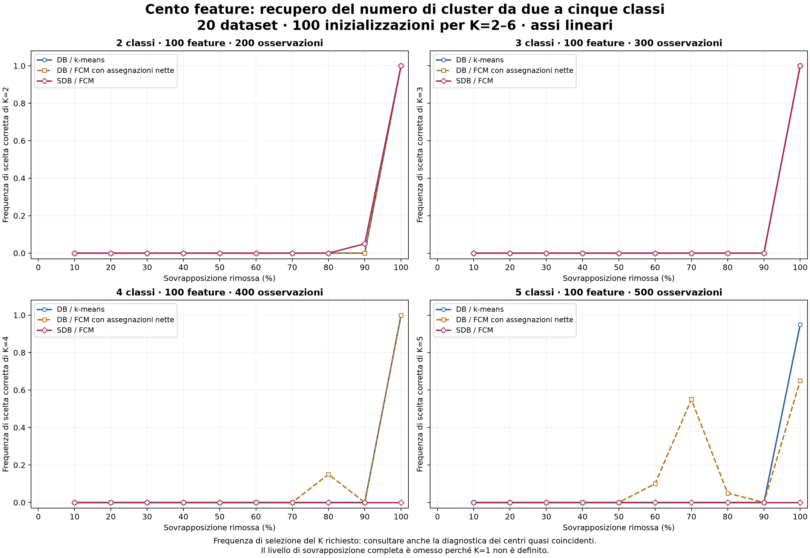

The primary curves select the requested K by its arithmetic mean index. In high dimensions, nearly coincident FCM centers can still give numerical hard labels, or a requested K that happens to equal the generating count. Neither alone establishes distinct recovered classes. The separate screening and held-out diagnostics below are essential to interpretation.

SDB's selected K at the disjoint endpoint (number of datasets):

| Classes | No selection | K=2 | K=3 | K=4 | K=5 | K=6 |
| :-- | :-- | :-- | :-- | :-- | :-- | :-- |
| 2 | 0 | 20 | 0 | 0 | 0 | 0 |
| 3 | 0 | 0 | 20 | 0 | 0 | 0 |
| 4 | 0 | 0 | 20 | 0 | 0 | 0 |
| 5 | 0 | 0 | 20 | 0 | 0 | 0 |

Held-out classification accuracy with **K fixed to the generating count**, using the best native-objective partition among 100 starts:

| Classes | Joint overlap | K-means accuracy | FCM accuracy | Bayes reference |
| :-- | :-- | :-- | :-- | :-- |
| 2 | 10% | 85.08% | 84.12% | 95.00% |
| 2 | 0% | 100.00% | 100.00% | 100.00% |
| 3 | 10% | 76.98% | 66.37% | 93.33% |
| 3 | 0% | 100.00% | 100.00% | 100.00% |
| 4 | 10% | 73.70% | 50.00% | 92.50% |
| 4 | 0% | 100.00% | 100.00% | 100.00% |
| 5 | 10% | 71.77% | 40.00% | 92.00% |
| 5 | 0% | 100.00% | 100.00% | 100.00% |

This fixed-K analysis separates the algorithm's ability to assign observations from the index's ranking of candidate K values. In degenerate FCM solutions, argmax labels can depend on tiny departures from uniform membership; their numerical accuracy is not evidence of well-separated fuzzy centers.

## Protocol

Class j has center `(j-(C-1)/2) * d * (1,...,1)` and 100 independent `Triangular(-1,0,1)` noise coordinates, with equal priors. Each class contributes 100 training and 2,000 independent held-out observations. The first ten coordinates and observation ordering exactly match the earlier ten-feature random streams at the same coordinate shift. Base draws are paired across overlap levels; training and test streams are separate.

Candidate K is 2–6. Each dataset and K uses seeds 0–99. The original FCM and SDB implementation files are unchanged: FCM m=2, maximum 1,000 iterations and membership tolerance 1e-7; published SDB q=1, Euclidean p=2 and raw mean memberships. K-means uses one start per seed, maximum 1,000 iterations and tolerance 1e-7. Selection minimizes the arithmetic mean index over all 100 starts; smaller K breaks ties.

As in the ten-feature study, mathematically undefined scores are recorded as +inf with their reason and are never dropped from the mean. Only finite means are eligible. `selected_k=0` means no selection, counted as failure. DB on hardened FCM labels can evaluate fewer occupied groups than requested, so occupancy is explicitly recorded. New score archives retain 17 significant digits and are reloaded with round-trip float parsing.

At complete overlap there is one observable distribution, despite the latent class labels. All three indices are undefined at K=1; that endpoint is omitted from recovery curves and retained only as a descriptive numerical diagnostic. At d=2 the closed supports touch only at a probability-zero boundary and are disjoint almost surely.

## Calibrating joint overlap in 100 dimensions

The target is the adjacent-pair joint-density overlap `OD(d) = integral min(product t(x_r), product t(x_r-d)) dx`, with `t(x)=max(1-|x|,0)`. It is not the per-coordinate overlap or the overlap of projected scatterplots. FCM's fuzzifier stays fixed at m=2.

A one-dimensional likelihood-ratio distribution makes the 100-dimensional integral tractable. Under the first density and conditional on the common support `[d-1,1]`, define `Y=log(t(X-d)/t(X))`. The common-support probability is `M=1-d²/2` for d<1 and `M=(2-d)²/2` for d≥1. Independence and reflection symmetry imply `OD(d)=2*M**D*P(Y1+...+YD>0)` for 0<d<2.

The ratio is strictly increasing in X. For r=exp(y), its inverse is `x=d/(1-r)-1` when d<1 and r<1-d, `x=1-d/(r-1)` when d<1 and r>1/(1-d), and `x=(r+d-1)/(1+r)` otherwise. The triangular CDF therefore gives exact probability masses in each log-ratio bin. FFT convolution raises the discrete characteristic function to the 100th power; half the central-bin mass approximates the continuous zero boundary.

Calibration uses **2^19 bins over approximately [-64,64]**, with a scalar root tolerance of 1e-10. It is checked with **2^21 bins**, then by doubling the domain at the same refined bin width. Maximum refinement discrepancy from a target is **0.00004205 percentage points**; maximum widened-domain difference is **2.31e-14** in probability units. The prespecified checks are 2e-5 and 1e-8 respectively. Endpoints are exact.

An independent method integrates the last coordinate analytically and the other 99 using conditional importance quadrature: **four scrambled Sobol sequences of 2^18 points each**. The largest discrepancy between their average and refined convolution is **0.006937 percentage points**, within the 0.15-percentage-point cross-check tolerance. Individual estimates and scramble standard errors are saved. Convolution is also tested against the exact one-coordinate formula and independent three-coordinate Gauss quadrature. These are numerical checks, not rigorous error bounds. [The ten-feature note](TECHNICAL_NOTES_TEN_FEATURES.md) describes the independent conditional integration identity.

| Step | Target overlap | Refined convolution | Coordinate shift | Per-coordinate overlap |
| :-- | :-- | :-- | :-- | :-- |
| 0 | 100% | 100.0000000% | 0.0000000000 | 100.0000% |
| 1 | 90% | 89.9999580% | 0.0079974672 | 99.2019% |
| 2 | 80% | 79.9999797% | 0.0161442387 | 98.3921% |
| 3 | 70% | 69.9999871% | 0.0245999776 | 97.5551% |
| 4 | 60% | 59.9999912% | 0.0335620667 | 96.6720% |
| 5 | 50% | 49.9999937% | 0.0433032338 | 95.7166% |
| 6 | 40% | 39.9999956% | 0.0542457148 | 94.6490% |
| 7 | 30% | 29.9999970% | 0.0671366799 | 93.3990% |
| 8 | 20% | 19.9999982% | 0.0835732328 | 91.8173% |
| 9 | 10% | 9.9999992% | 0.1083817667 | 89.4555% |
| 10 | 0% | 0.0000000% | 2.0000000000 | 0.0000% |

Equal overlap steps are not equal geometric distances. In particular, the final step changes the per-coordinate shift from about 0.1084 to 2. Connecting lines interpolate between sampled levels; this grid cannot locate transitions below 10% remaining overlap. The equal-prior Bayes-accuracy reference is `1-((C-1)/C)*OD`, up to numerical calibration accuracy.

## Distinct-center and convergence checks

The conservative screening rejects an SDB/FCM candidate if any of its 100 starts has minimum center distance divided by training-data RMS radius below 1e-6. DB/hardened FCM additionally requires exactly K occupied labels in every start. The threshold is a diagnostic choice, not a modification of SDB or a universal criterion.

Correct selections at disjointness after screening:

| Classes | DB / k-means | DB / hardened FCM | SDB / FCM |
| :-- | :-- | :-- | :-- |
| 2 | 20/20 | 20/20 | 20/20 |
| 3 | 20/20 | 20/20 | 20/20 |
| 4 | 20/20 | 20/20 | 0/20 |
| 5 | 19/20 | 1/20 | 0/20 |

| Classes | Nearly coincident FCM fits | Hard groups < requested K | Undefined SDB | Capped fits refitted | Still capped | Changed SDB choices |
| :-- | :-- | :-- | :-- | :-- | :-- | :-- |
| 2 | 108000 | 2564 | 104 | 0 | 0 | 0 |
| 3 | 106000 | 12271 | 42 | 0 | 0 | 0 |
| 4 | 104000 | 23418 | 31 | 0 | 0 | 0 |
| 5 | 102064 | 31880 | 72 | 43 | 0 | 0 |

Each row describes 110,000 configurations across all K and overlap levels. These counts are not failure rates of the selected model alone.

Extending all **43 capped FCM fits** to 10,000 iterations leaves **0** at the cap and changes **0/2,640 K choices**, including **0/880 SDB choices**. Primary results retain the 1,000-iteration protocol.

No correct-count frequency changes at any sampled level.

Refits regenerate the same data from exact provenance JSON shifts, seeds and package versions. Cached individual refits and dataset/step checkpoints can resume only with matching inputs and source hashes. Reaching the cap is not convergence, and near-coincidence remains a separate issue even when the membership convergence criterion is satisfied. Extended selections, per-level recovery and post-refit screening are saved separately.

## Comparison with earlier feature counts

Correct-count selections with disjoint supports:

| Classes | Features | DB / k-means | DB / hardened FCM | SDB / FCM |
| :-- | :-- | :-- | :-- | :-- |
| 2 | 1 | 20/20 | 20/20 | 20/20 |
| 2 | 2 | 20/20 | 20/20 | 20/20 |
| 2 | 3 | 20/20 | 20/20 | 20/20 |
| 2 | 10 | 20/20 | 20/20 | 20/20 |
| 2 | 100 | 20/20 | 20/20 | 20/20 |
| 3 | 1 | 20/20 | 20/20 | 15/20 |
| 3 | 2 | 20/20 | 20/20 | 16/20 |
| 3 | 3 | 20/20 | 20/20 | 19/20 |
| 3 | 10 | 20/20 | 20/20 | 20/20 |
| 3 | 100 | 20/20 | 20/20 | 20/20 |
| 4 | 1 | 20/20 | 20/20 | 0/20 |
| 4 | 2 | 20/20 | 20/20 | 0/20 |
| 4 | 3 | 20/20 | 20/20 | 0/20 |
| 4 | 10 | 20/20 | 20/20 | 0/20 |
| 4 | 100 | 20/20 | 20/20 | 0/20 |
| 5 | 1 | 20/20 | 20/20 | 0/20 |
| 5 | 2 | 20/20 | 20/20 | 0/20 |
| 5 | 3 | Not available | Not available | Not available |
| 5 | 10 | 20/20 | 17/20 | 0/20 |
| 5 | 100 | 19/20 | 13/20 | 0/20 |

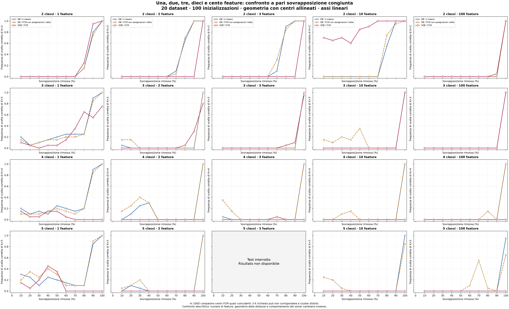

The earlier five-class, three-feature experiment remains interrupted and unavailable; it is never plotted as zero. All fifteen previous score archives remain unchanged. Matching joint overlap controls population classification difficulty in this geometry, while distances, memberships and solver behavior still change with dimension. This balanced, collinear design does not establish a general dimensionality effect or universal superiority of an index. Total sample size also grows with class count, and K=2–6 leaves fewer over-counting alternatives when C increases.

## Results for each class count

### 2 classes

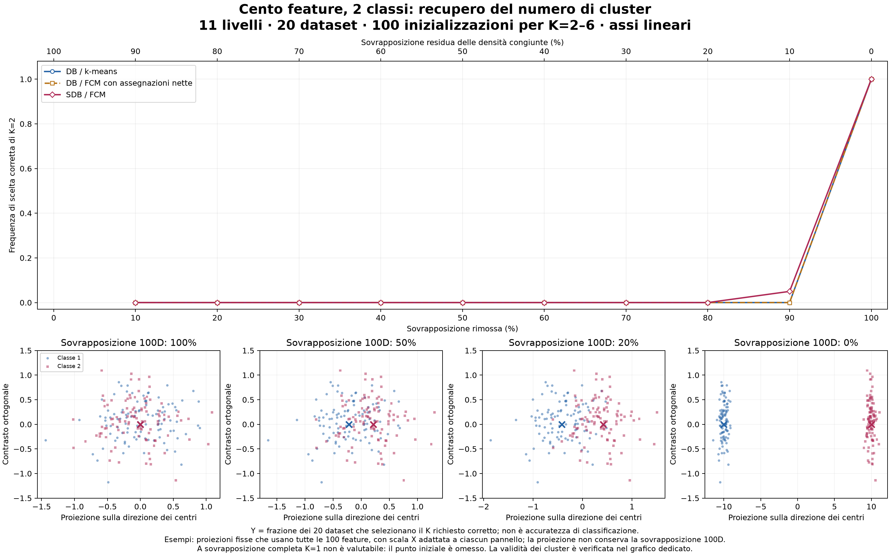

Examples project all 100 coordinates onto the known center direction and an orthogonal contrast. X-axis ranges adapt per panel and are labeled; projected overlap is not the calibrated joint overlap.

| Joint overlap | DB / k-means | DB / hardened FCM | SDB / FCM | Screened DB / k-means | Screened DB / hardened FCM | Screened SDB / FCM |
| :-- | :-- | :-- | :-- | :-- | :-- | :-- |
| 100% | 0/20 | 0/20 | 0/20 | 0/20 | 0/20 | 0/20 |
| 90% | 0/20 | 0/20 | 0/20 | 0/20 | 0/20 | 0/20 |
| 80% | 0/20 | 0/20 | 0/20 | 0/20 | 0/20 | 0/20 |
| 70% | 0/20 | 0/20 | 0/20 | 0/20 | 0/20 | 0/20 |
| 60% | 0/20 | 0/20 | 0/20 | 0/20 | 0/20 | 0/20 |
| 50% | 0/20 | 0/20 | 0/20 | 0/20 | 0/20 | 0/20 |
| 40% | 0/20 | 0/20 | 0/20 | 0/20 | 0/20 | 0/20 |
| 30% | 0/20 | 0/20 | 0/20 | 0/20 | 0/20 | 0/20 |
| 20% | 0/20 | 0/20 | 0/20 | 0/20 | 0/20 | 0/20 |
| 10% | 0/20 | 0/20 | 1/20 | 0/20 | 0/20 | 0/20 |
| 0% | 20/20 | 20/20 | 20/20 | 20/20 | 20/20 | 20/20 |

The 100%-overlap row has no identifiable generating count and is descriptive only.


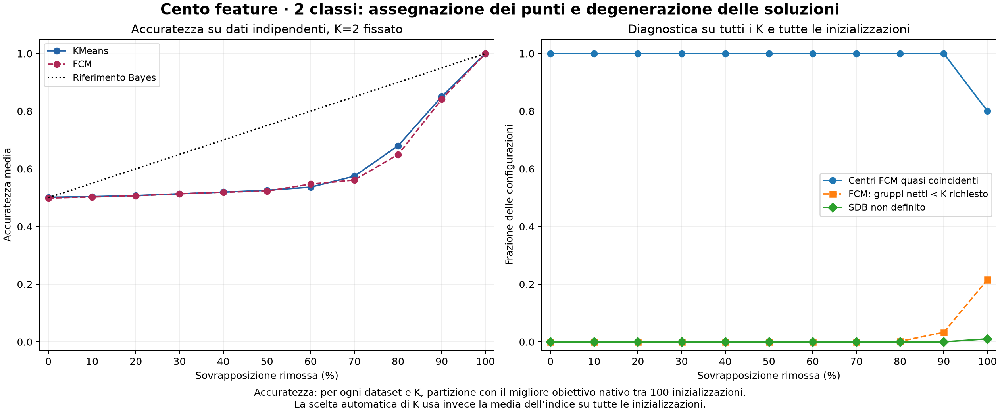

[Selected-K distribution](../results/figures/overlap_100features_2classes_selected_k.png) · [Full synthetic results](../results/supplementary_overlap_100features_2classes/)

### 3 classes

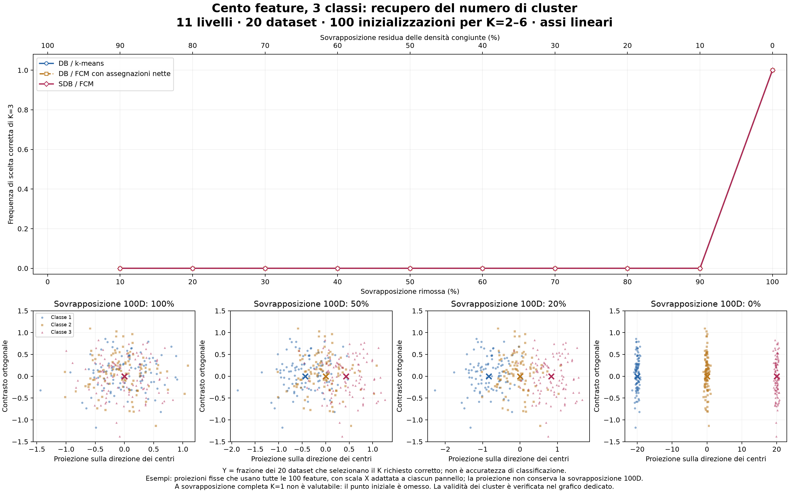

Examples project all 100 coordinates onto the known center direction and an orthogonal contrast. X-axis ranges adapt per panel and are labeled; projected overlap is not the calibrated joint overlap.

| Joint overlap | DB / k-means | DB / hardened FCM | SDB / FCM | Screened DB / k-means | Screened DB / hardened FCM | Screened SDB / FCM |
| :-- | :-- | :-- | :-- | :-- | :-- | :-- |
| 100% | 0/20 | 0/20 | 0/20 | 0/20 | 0/20 | 0/20 |
| 90% | 0/20 | 0/20 | 0/20 | 0/20 | 0/20 | 0/20 |
| 80% | 0/20 | 0/20 | 0/20 | 0/20 | 0/20 | 0/20 |
| 70% | 0/20 | 0/20 | 0/20 | 0/20 | 0/20 | 0/20 |
| 60% | 0/20 | 0/20 | 0/20 | 0/20 | 0/20 | 0/20 |
| 50% | 0/20 | 0/20 | 0/20 | 0/20 | 0/20 | 0/20 |
| 40% | 0/20 | 0/20 | 0/20 | 0/20 | 0/20 | 0/20 |
| 30% | 0/20 | 0/20 | 0/20 | 0/20 | 0/20 | 0/20 |
| 20% | 0/20 | 0/20 | 0/20 | 0/20 | 0/20 | 0/20 |
| 10% | 0/20 | 0/20 | 0/20 | 0/20 | 0/20 | 0/20 |
| 0% | 20/20 | 20/20 | 20/20 | 20/20 | 20/20 | 20/20 |

The 100%-overlap row has no identifiable generating count and is descriptive only.

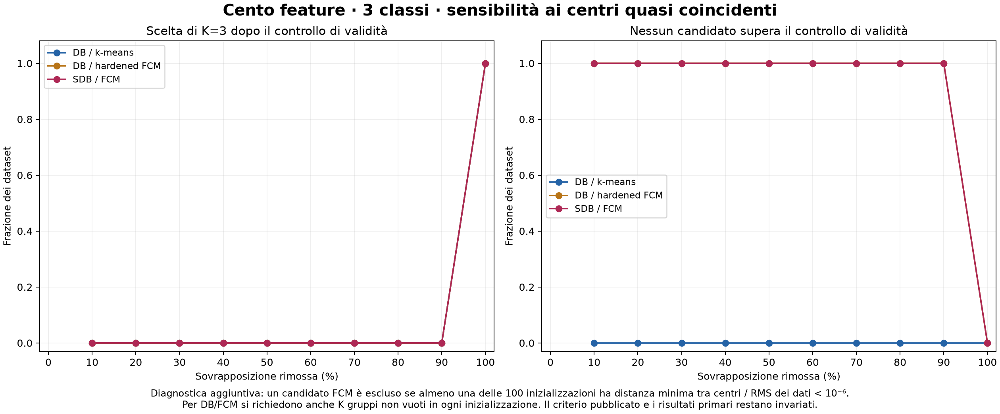

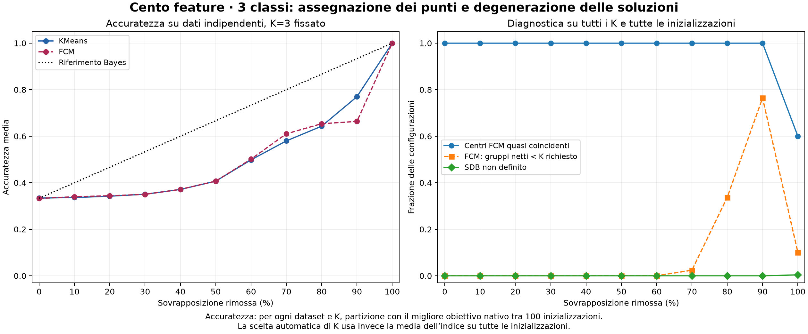

[Selected-K distribution](../results/figures/overlap_100features_3classes_selected_k.png) · [Full synthetic results](../results/supplementary_overlap_100features_3classes/)

### 4 classes

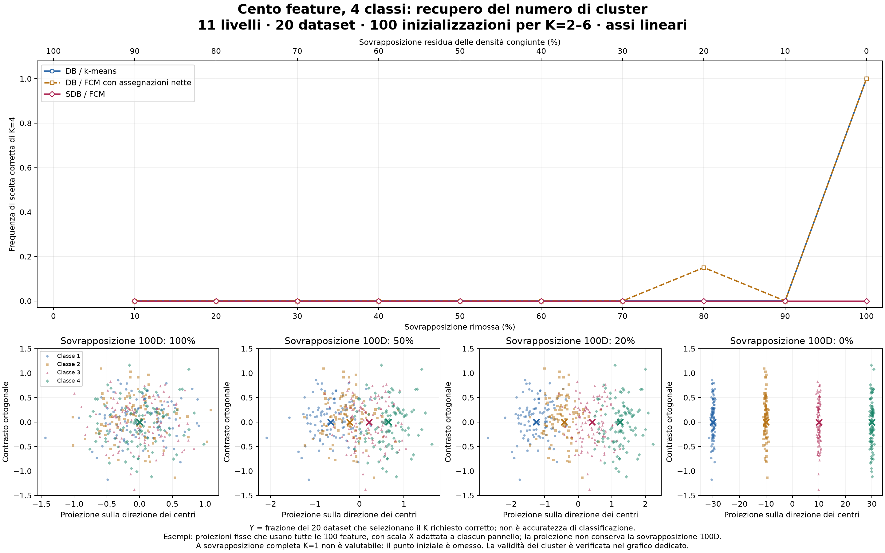

Examples project all 100 coordinates onto the known center direction and an orthogonal contrast. X-axis ranges adapt per panel and are labeled; projected overlap is not the calibrated joint overlap.

| Joint overlap | DB / k-means | DB / hardened FCM | SDB / FCM | Screened DB / k-means | Screened DB / hardened FCM | Screened SDB / FCM |
| :-- | :-- | :-- | :-- | :-- | :-- | :-- |
| 100% | 0/20 | 0/20 | 0/20 | 0/20 | 0/20 | 0/20 |
| 90% | 0/20 | 0/20 | 0/20 | 0/20 | 0/20 | 0/20 |
| 80% | 0/20 | 0/20 | 0/20 | 0/20 | 0/20 | 0/20 |
| 70% | 0/20 | 0/20 | 0/20 | 0/20 | 0/20 | 0/20 |
| 60% | 0/20 | 0/20 | 0/20 | 0/20 | 0/20 | 0/20 |
| 50% | 0/20 | 0/20 | 0/20 | 0/20 | 0/20 | 0/20 |
| 40% | 0/20 | 0/20 | 0/20 | 0/20 | 0/20 | 0/20 |
| 30% | 0/20 | 0/20 | 0/20 | 0/20 | 0/20 | 0/20 |
| 20% | 0/20 | 3/20 | 0/20 | 0/20 | 0/20 | 0/20 |
| 10% | 0/20 | 0/20 | 0/20 | 0/20 | 0/20 | 0/20 |
| 0% | 20/20 | 20/20 | 0/20 | 20/20 | 20/20 | 0/20 |

The 100%-overlap row has no identifiable generating count and is descriptive only.

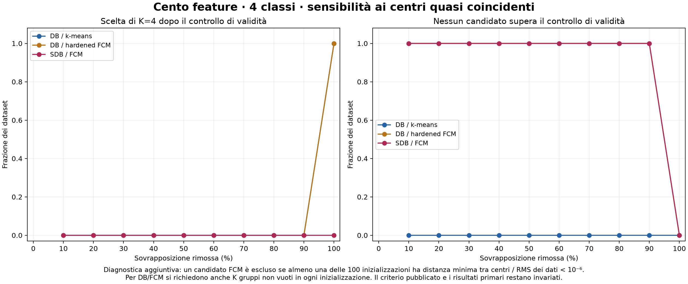

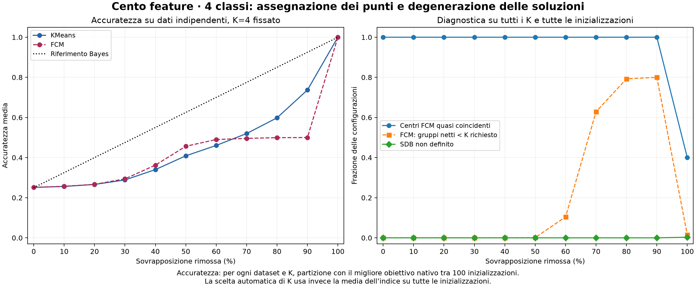

[Selected-K distribution](../results/figures/overlap_100features_4classes_selected_k.png) · [Full synthetic results](../results/supplementary_overlap_100features_4classes/)

### 5 classes

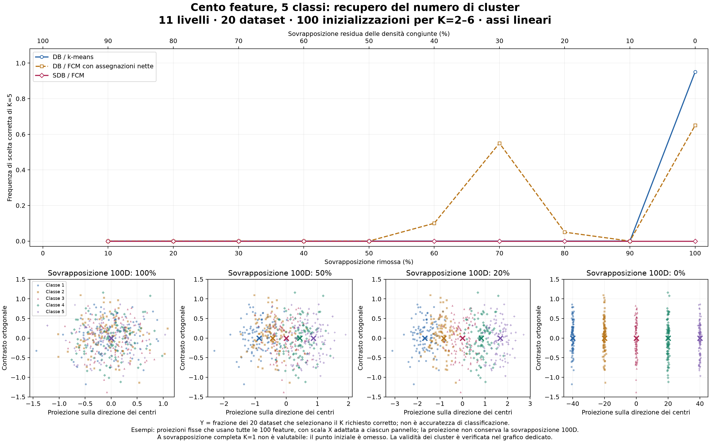

Examples project all 100 coordinates onto the known center direction and an orthogonal contrast. X-axis ranges adapt per panel and are labeled; projected overlap is not the calibrated joint overlap.

| Joint overlap | DB / k-means | DB / hardened FCM | SDB / FCM | Screened DB / k-means | Screened DB / hardened FCM | Screened SDB / FCM |
| :-- | :-- | :-- | :-- | :-- | :-- | :-- |
| 100% | 0/20 | 0/20 | 0/20 | 0/20 | 0/20 | 0/20 |
| 90% | 0/20 | 0/20 | 0/20 | 0/20 | 0/20 | 0/20 |
| 80% | 0/20 | 0/20 | 0/20 | 0/20 | 0/20 | 0/20 |
| 70% | 0/20 | 0/20 | 0/20 | 0/20 | 0/20 | 0/20 |
| 60% | 0/20 | 0/20 | 0/20 | 0/20 | 0/20 | 0/20 |
| 50% | 0/20 | 0/20 | 0/20 | 0/20 | 0/20 | 0/20 |
| 40% | 0/20 | 2/20 | 0/20 | 0/20 | 0/20 | 0/20 |
| 30% | 0/20 | 11/20 | 0/20 | 0/20 | 0/20 | 0/20 |
| 20% | 0/20 | 1/20 | 0/20 | 0/20 | 0/20 | 0/20 |
| 10% | 0/20 | 0/20 | 0/20 | 0/20 | 0/20 | 0/20 |
| 0% | 19/20 | 13/20 | 0/20 | 19/20 | 1/20 | 0/20 |

The 100%-overlap row has no identifiable generating count and is descriptive only.

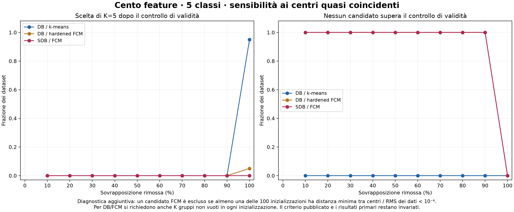

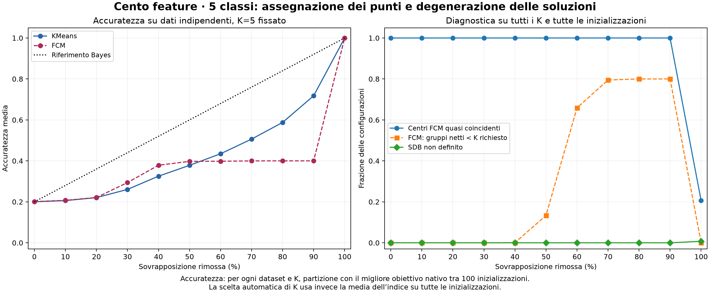

[Selected-K distribution](../results/figures/overlap_100features_5classes_selected_k.png) · [Full synthetic results](../results/supplementary_overlap_100features_5classes/)

## Reproduction

From the repository root, after installing the benchmark and development dependencies:

```text
python scripts/python/supplementary_overlap_hundred_features.py --classes 2 3 4 5 --workers 12 --checkpoint-root .local_overlap_checkpoints/hundred
python scripts/python/check_hundred_feature_convergence.py --input-dir results/supplementary_overlap_100features_2classes --workers 4
python scripts/python/plot_overlap_hundred_features.py --input-dir results/supplementary_overlap_100features_2classes
python scripts/python/plot_overlap_hundred_features.py --compare-all
python scripts/python/report_hundred_features.py
pytest -q
```

Repeat the per-class convergence and plotting commands for classes 3, 4 and 5. Calibration JSON retains the exact shifts; checkpoints also record source hashes and the execution environment. Use a separate output/checkpoint directory for changed inputs, source or environment. The four new full score grids are synthetic and public. Private original participant-level archives remain excluded; the extension does not change the earlier fMRI or abstract-reproduction results.
