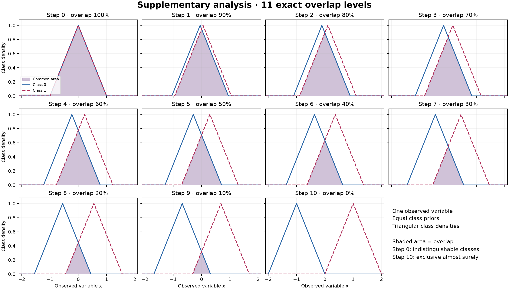
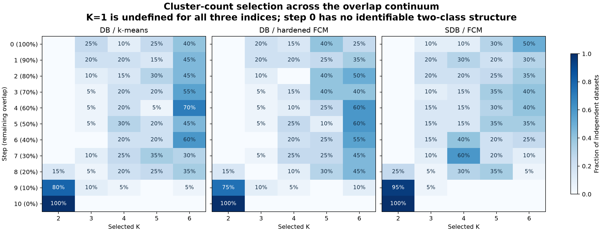
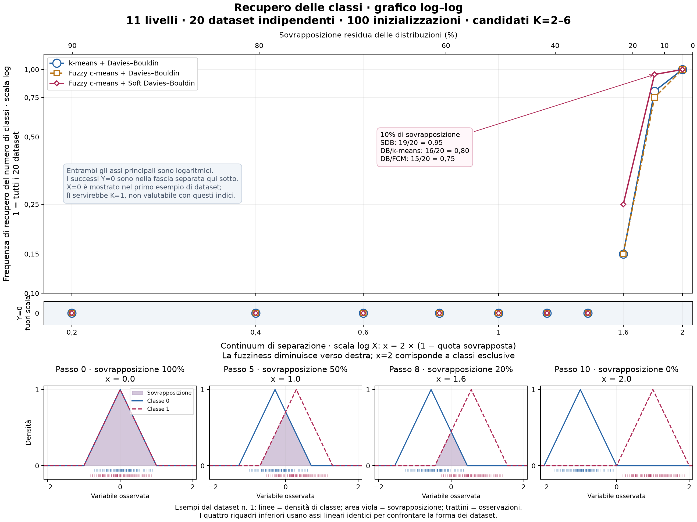
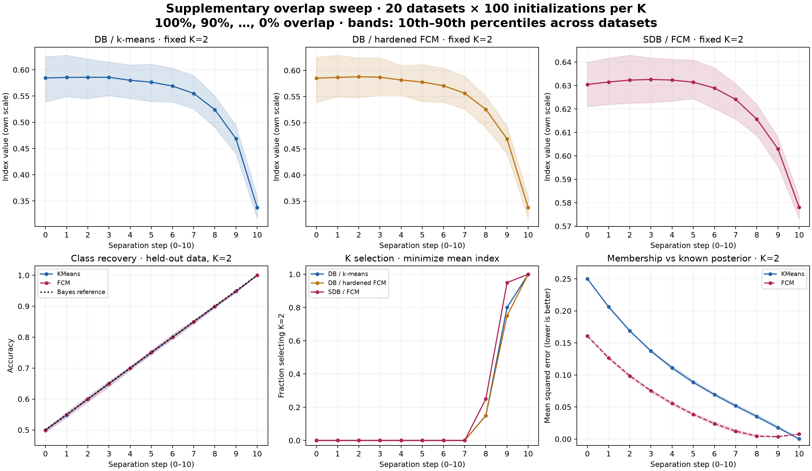

# Technical note 1 — supplementary analysis of a 1D overlap continuum

**17 November 2026. New synthetic experiment, not an experiment or result from the 2018 paper.**

This experiment asks when DB on k-means, DB on hardened fuzzy c-means, and the published SDB on fuzzy c-means recognize two increasingly separated classes. It measures class recovery and cluster-count selection separately. The three index values are not treated as comparable accuracy scores.

## Dataset: eleven exact overlap levels

There is one observed variable, two equally likely generating classes, and triangular class-conditional densities with fixed half-width 1:

```text
f0(x) = max(1 - |x + d/2|, 0)
f1(x) = max(1 - |x - d/2|, 0)
overlap O(d) = integral min(f0(x), f1(x)) dx = (1 - d/2)^2,  0 <= d <= 2
step s = 0, 1, ..., 10
O_s = 1 - s/10
d_s = 2 * (1 - sqrt(O_s))
```

Thus **step 0 means 100% overlap**, followed by 90%, 80%, …, and **step 10 means zero overlap**. Percentages describe the common probability-density area, not the proportion of training samples in a shared interval. Center distances are consequently nonuniform. Numerical quadrature tests verify every 10-percentage-point decrement.

At step 0, both class distributions coincide: the latent labels cannot be recovered from x and the observable population is a single distribution. At step 10, the positive-density supports are disjoint; their closed supports touch only at x=0, where both densities vanish. Class membership is therefore exclusive almost surely. This is genuine zero overlap, which finite translations of unbounded Gaussian densities would not provide.



[PDF](../results/figures/overlap_distributions.pdf) · [SVG](../results/figures/overlap_distributions.svg) · [Example datasets: 200 samples at each step](../results/supplementary_overlap/example_datasets.csv)

## Protocol

- **20 independent dataset replicates**, each with 100 training observations per class, hence 200 observations and one variable.
- The same base draws and latent labels are translated across the 11 steps within a replicate. This paired design reduces sampling noise; the steps are not independent replicates.
- **100 independent starts for each candidate K=2–6**: 20 × 11 × 5 × 100 = **110,000 configurations**, comprising 110,000 k-means and 110,000 FCM fits and **330,000 index values**.
- K-means uses k-means++ and `n_init=1` for each of the 100 starts. FCM uses independent random membership initialization. Each algorithm therefore receives 100 starts per dataset/step/K. This differs from the historical fMRI implementation's ten internal k-means starts per outer seed.
- FCM m=2 is fixed; SDB uses the published q=1, p=2, raw-mean-membership formula. The data overlap changes, not the FCM fuzzifier. No feature standardization is applied.
- Both solvers allow 1,000 iterations and tolerance 1e-7, with their respective stopping rules. Seeds are 0–99. Dataset generation uses `SeedSequence([20261117, replicate, test_flag])`.
- For **K selection**, each criterion is averaged over the 100 starts for each K, then minimized over K=2–6. A numerical tie is resolved by the lower K. No true labels or test observations enter this selection.
- For **external evaluation**, the partition with the smallest native training objective among the 100 starts is retained separately for each algorithm and K. It is evaluated on **4,000 independent test observations**, balanced by class. The same held-out draws are translated across steps. Training and test samples are independent.
- Accuracy at fixed K=2 uses centers ordered left-to-right to resolve cluster names, without label-based fitting. ARI is invariant to cluster names and also evaluates the partition at the selected K. The same FCM partition underlies both FCM indices.
- Bands in the figures are the **10th–90th percentiles across the 20 dataset replicates**, after averaging initialization scores. They are descriptive ranges, not confidence intervals and not 2,000 independent observations.

The [configuration, environment versions and code hashes](../results/supplementary_overlap/provenance.json), [all synthetic-run scores](../results/supplementary_overlap/per_initialization.csv.gz), and [best-objective test results](../results/supplementary_overlap/best_objective_partitions.csv) are public. No participant or fMRI data enter this supplementary analysis.

## Results: selecting K=2

Each entry counts independent datasets selecting K=2 out of 20.

| Step | Remaining overlap | DB / k-means | DB / hardened FCM | SDB / FCM |
|--:|--:|--:|--:|--:|
| 0 | 100% | 0/20 | 0/20 | 0/20 |
| 1 | 90% | 0/20 | 0/20 | 0/20 |
| 2 | 80% | 0/20 | 0/20 | 0/20 |
| 3 | 70% | 0/20 | 0/20 | 0/20 |
| 4 | 60% | 0/20 | 0/20 | 0/20 |
| 5 | 50% | 0/20 | 0/20 | 0/20 |
| 6 | 40% | 0/20 | 0/20 | 0/20 |
| 7 | 30% | 0/20 | 0/20 | 0/20 |
| 8 | 20% | 3/20 | 3/20 | **5/20** |
| 9 | 10% | 16/20 | 15/20 | **19/20** |
| 10 | 0% | **20/20** | **20/20** | **20/20** |

At 10% overlap, SDB has the highest observed K=2 selection rate, **95% versus 80% and 75%**. Mean held-out ARI after K selection is **0.7873** for SDB/FCM, **0.7325** for DB/k-means, and **0.7037** for DB/hardened FCM. These are descriptive differences in one simulation family with 20 independent replicates, not a general or significance-tested superiority claim.

All methods select K above 2 at steps 0–7. At step 0, K=2 is not an identifiable ground truth; the single-distribution solution **K=1 is undefined for all three indices** and is not assigned an artificial zero score. At steps 1–7, two distinct generating classes exist, but the index minimizers oversegment these weakly separated mixtures. The complete distribution of selected K, including K=6 boundary selections, is shown below.



[PDF](../results/figures/overlap_selected_k.pdf) · [SVG](../results/figures/overlap_selected_k.svg) · [Per-dataset selections](../results/supplementary_overlap/selected_k.csv)

## Focused view: success from 0 to 1

The following Italian-language view uses the requested display coordinate **x = 2(1 − O)**: 0 is complete overlap and 2 is complete separation. This is a rescaled separation coordinate, not the FCM exponent or the fitted number of clusters. Fuzziness decreases to the right. The vertical axis is the fraction of datasets selecting the correct generating class count, not the fraction of correctly classified observations. Both main axes are logarithmic. Zero success frequencies are shown in a separate strip outside the logarithmic Y scale; they are not replaced by a positive value. The x=0 endpoint is excluded from the main logarithmic plot, and its correct observable count is one, for which these criteria are undefined. Four examples below show 100%, 50%, 20% and 0% overlap, with class densities and actual training observations from replicate 0 on identical linear axes.



[PDF](../results/figures/overlap_success_it.pdf) · [SVG](../results/figures/overlap_success_it.svg)

## Class recovery and fuzzy memberships

At fixed K=2, the algorithms have nearly identical hard-label accuracy and track the population Bayes reference, **1 − O/2**. At 50% overlap, mean accuracy is **75.02% for k-means and 75.12% for FCM**; at 10% overlap it is **94.84% and 94.82%**; at zero overlap it is **99.985% and 99.9775%**. Small deviations from the population reference reflect finite training and test samples. A learned boundary need not exactly match the population boundary even when classes are exclusive.

The known posterior is `P(class=1 | x) = f1(x)/(f0(x)+f1(x))`. Comparing FCM memberships and crisp k-means assignments with this posterior yields a common diagnostic: mean squared error. At 50% overlap it is **0.03855 for FCM versus 0.08861 for crisp k-means**. At zero overlap, the ordering reverses: **0.007772 versus 0.000150**. FCM with m=2 retains soft memberships even when the generating classes are exclusive. Its memberships are not calibrated posterior probabilities, and this comparison is not an index-selection result.

At complete overlap, the correct posterior is 0.5 everywhere. FCM's posterior MSE is still **0.16075**, versus **0.25** for crisp assignments: forcing a two-center partition introduces unsupported certainty. A constant 0.5 membership would have zero posterior MSE at that endpoint. The experiment therefore does not establish that FCM recognizes a single class.



The upper panels use separate vertical scales. All three mean indices decline toward complete separation, but none is strictly monotone over the full sweep. Mean within-replicate Spearman correlations between step and fixed-K index are approximately **−0.705 for DB/k-means**, **−0.690 for DB/hardened FCM**, and **−0.679 for SDB/FCM**. SDB's advantage in K selection at 10–20% overlap does not imply the strongest monotonic response to separation.

[PDF](../results/figures/overlap_results.pdf) · [SVG](../results/figures/overlap_results.svg) · [Full sweep table](../results/supplementary_overlap/sweep_summary.csv) · [K=2 test metrics](../results/supplementary_overlap/k2_performance.csv)

## Convergence and scope

All 330,000 index values are finite. **144 of 110,000 FCM fits (0.131%)** reached the 1,000-iteration limit; no k-means fit reached it. These runs are retained in the primary results. Rerunning those exact 144 cases with a 10,000-iteration limit leaves none at the limit and gives maximum membership fixed-point residual **9.95 × 10⁻⁸**. Substituting their extended-run scores changes **0 of 660 index-based K choices**. See the [sensitivity check](../results/supplementary_overlap/convergence_sensitivity.json) and [individual synthetic reruns](../results/supplementary_overlap/convergence_sensitivity_runs.csv). This check addresses K selection; it does not recompute the best-objective held-out partitions.

This is a balanced, one-dimensional, compact-support example with a fixed sample size, candidate-K range, fuzzifier and class shape. It separates three conclusions: SDB shows an observed K-selection advantage near separation; FCM represents overlapping memberships better than crisp assignments under the stated posterior diagnostic; neither algorithm has a substantial hard-classification advantage at fixed K=2. None of these conclusions establishes universal superiority or replaces the original paper's validation.

For the external metrics and algorithm conventions, see the primary [scikit-learn clustering evaluation documentation](https://scikit-learn.org/stable/modules/clustering.html#clustering-performance-evaluation). The overlap formula and Bayes reference above follow directly from the specified synthetic densities.

## Reproduce

```bash
python -m pip install -e ".[benchmarks,dev]"
python scripts/python/supplementary_overlap.py --workers 4
python scripts/python/check_overlap_convergence.py
python scripts/python/plot_supplementary_overlap.py
python scripts/python/plot_overlap_success.py
pytest -q
```

The full run took about eight minutes in the recorded environment. To rebuild tables and figures without refitting:

```bash
python scripts/python/supplementary_overlap.py --summarize-only
python scripts/python/plot_supplementary_overlap.py
python scripts/python/plot_overlap_success.py
```

To explore another protocol without overwriting these results, pass a separate `--output-dir` under `results/recomputed/`. Keep the seed budget, sampling replicates and candidate-K range explicit when comparing experiments.
