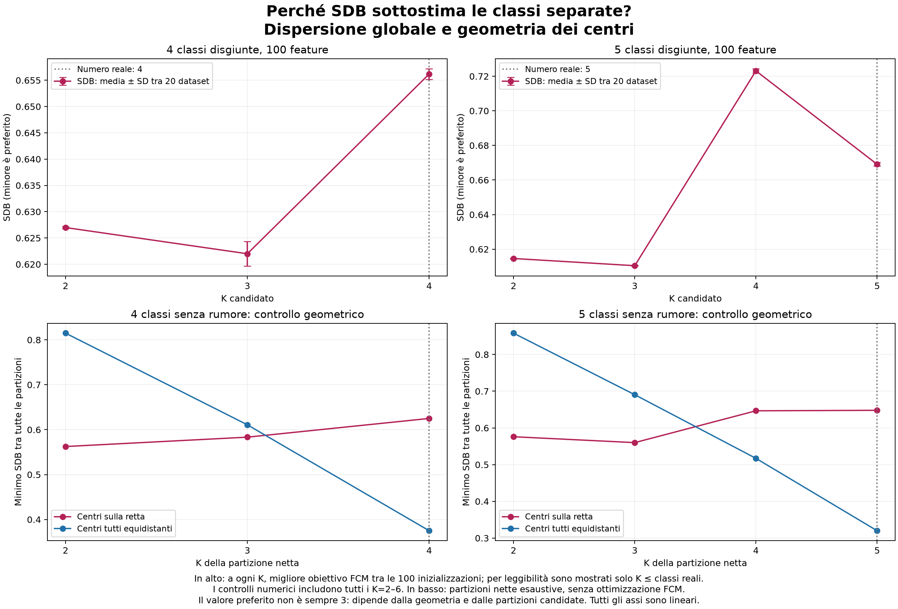

# Technical note 8 — why SDB can prefer three clusters to four or five

**19 November 2026. Post-hoc diagnostic analysis of Technical note 7; outside the original paper.**

The main mechanism is the interaction of **global scatter, average cluster memberships and collinear geometry** in the published SDB formula. FCM can recover the true separated classes when K is supplied, yet SDB ranks a coarser partition better. Three is not a universal preferred cluster count. No original index, solver, score archive or primary result was changed.

## Formula-level explanation

For q=1, write `r_ni = ||x_n-center_i||` and `p_i = mean_n u_ni`. The published equations (5)–(8) give

```text
S_i = mean_n r_ni                         # ALL points, not only cluster i
A_i = S_i * p_i                          # product of two separate means
R_ij = (A_i + A_j) / ||center_i-center_j||
SDB = mean_i max_(j != i) R_ij
```

This matches the [author-provided paper, equations (5)–(8)](https://www.researchgate.net/publication/328399507_A_Soft_Davies-Bouldin_Separation_Measure) and the unchanged [Python implementation](../scripts/python/sdb/index.py). For fixed centers, the memberships enter only through their column means: permuting membership rows leaves SDB unchanged. Thus `mean(r)*mean(u)` does not retain the point-by-point association between high membership and short distance.

For compact classes on a line, far-away classes keep each global scatter large. Merging classes reduces the number of nearby centers and can improve the ratios, despite losing real classes. The maximum over neighboring ratios and the final average determine which coarser candidate wins. Wider gaps alone do not eliminate this mechanism: in the noiseless limit, scaling the data multiplies both the numerator and denominator equally. Repeating coordinates likewise leaves these ratios unchanged.

This is distinct from the nearly coincident-center behavior at intermediate overlap. At the disjoint endpoint, the winning K=3 solutions and the best true-K solutions have distinct centers. The issue there is their ranking by the index.

## Checks on the completed hundred-feature experiment

All 20 datasets for each of C=4 and C=5 were examined at zero overlap. Mean, median, minimum SDB over starts and SDB evaluated on the best native-objective FCM fit **all select K=3 in 20/20 datasets for both class counts**, using K=2–6. Therefore averaging the 100 starts is not the sole cause.

We reproduced **200 fits**: one best-native-objective fit from the existing 100 starts at each dataset and K, with the original exact data, seeds and 1,000-iteration settings. Every reproduced objective and SDB was checked against the saved score. Mean SDB on these fits (one fit per dataset/K; lower is preferred):

| Classi | SDB K=2 | SDB K=3 | SDB K=4 | SDB K=5 | ARI al K reale |
| :-- | --: | --: | --: | --: | --: |
| 4 | 0.626984 | 0.622000 | 0.656188 | — | 1.000 |
| 5 | 0.614610 | 0.610453 | 0.723123 | 0.669076 | 1.000 |

The true-K solutions have **ARI=1 on every training dataset**. Their held-out accuracy was also 100% in note 7. FCM therefore finds the true classes when their number is supplied; SDB still favors K=3. The table omits K>C only for readability; they remain in every selection and in the data files.

On dataset 0 with four classes, the K=3 hard assignments merge the two middle classes. With five classes, the K=3 hard assignments merge the first two classes, retain the middle class and merge the final two. These are representative examples, not a claim that every fit uses identical memberships. Full contingency tables and classwise mean memberships are saved.

There is an additional numerical penalty in the primary C=5/K=5 candidate: 64 of its 2,000 starts have coincident centers and undefined SDB, retained as +inf. This worsens the arithmetic means but does not explain away the result: the finite best-objective and median comparisons above still favor K=3. Extending the 43 capped C=5/K=4 runs to 10,000 iterations in note 7 changed no selections.

## Exact counterexamples without FCM or noise

Take four equally weighted classes concentrated at `0,1,2,3`. Each location may be replicated arbitrarily many times.

* Correct four-cluster partition: global scatters `(1.5,1,1,1.5)`, mean memberships `(1/4,1/4,1/4,1/4)`, hence **SDB = 5/8 = 0.625**.
* Merge the middle classes: groups `{0}, {1,2}, {3}`, centers `(0,1.5,3)`, global scatters `(1.5,1,1.5)`, masses `(1/4,1/2,1/4)`. The worst-neighbor ratios are all `(0.375+0.5)/1.5`, hence **SDB = 7/12 = 0.583333**, below the true partition.

For five classes at `0,1,2,3,4`, the true partition gives **81/125 = 0.648**. The three groups `{0}, {1,2,3}, {4}` have centers `(0,2,4)`, global scatters `(2,1.2,2)`, masses `(1/5,3/5,1/5)` and **SDB = 14/25 = 0.56**.

These strict inequalities already establish under-counting without random starts, overlapping supports, noisy coordinates or solver failure. Classic DB would be zero for the perfect point-mass partitions; this SDB formula does not reduce to classic within-cluster DB merely by making memberships crisp.

Enumerating **all** nontrivial set partitions gives 14 cases for four points and 51 for five. Among these crisp candidates, the line has its minimum at **K=2 for four classes** and **K=3 for five**. The earlier K=3 result refers to the candidates produced by FCM, not a universal global optimum of SDB over arbitrary partitions.

As a geometric control, put the same number of noiseless, equally weighted classes at the vertices of a regular simplex, with all pairwise distances equal to 1. Exhaustive enumeration now favors the **correct K for both four and five classes**. This demonstrates dependence on the inter-class geometry. It is a deterministic control, not a new noisy 100-feature benchmark or a general guarantee.



## Diagnostic changes to the scatter term

Keeping the reproduced FCM centers and memberships fixed, replace only the effective radius entering the same pairwise-ratio/maximum/average construction:

| Effective radius | Meaning | C=4: chosen K | C=5: chosen K |
| :-- | :-- | :-- | :-- |
| `E[r] E[u]` | Published SDB | 3 in 20/20 | 3 in 20/20 |
| `E[r] E[hard(u)]` | Harden memberships, retain global scatter and centers | 2 in 20/20 | 3 in 20/20 |
| `E[u*r]` | Couple each distance to its own membership | 4 in 20/20 | 5 in 20/20 |
| `E[u*r] / E[u]` | Membership-weighted conditional mean distance | 4 in 20/20 | 5 in 20/20 |

All choices use K=2–6. True labels are used only for evaluation, never for these score selections. Hardened classic DB on the same selected fits, with hard centroids recomputed as its definition requires, also selects the correct K in 20/20 for both counts.

The coupled term obeys `E[u*r] = E[u]E[r] + Cov(u,r)`. For these fits, the membership-distance association matters: large distances to other classes should not contribute as though they had the same membership as close points. These controlled comparisons locate the mechanism; they **do not validate a new index**, and changing the formula would no longer reproduce the original SDB. Independent geometries, unequal masses, additional overlap levels and over-clustering cases would be needed before proposing a replacement.

## Reproducibility and limits

The [diagnostic bundle](../results/sdb_undercounting_diagnosis/) contains aggregation choices, original endpoint summaries, reproduced fits, per-cluster formula terms, membership/contingency tables, all noiseless partitions, control choices and source/data hashes. The [diagnostic script](../scripts/python/diagnose_sdb_undercounting.py) preserves original code and data. New tests verify the exact rational counterexamples, invariance to scale and replicated coordinates, loss of rowwise membership information, exhaustive partition counts and the simplex control.

```text
python scripts/python/diagnose_sdb_undercounting.py --workers 8
python scripts/python/report_sdb_undercounting.py
pytest -q tests/test_sdb_undercounting_diagnosis.py
```

This is a post-hoc explanation of a specific balanced, collinear experiment. It does not imply that SDB always returns three, nor that all fuzzy indices or all high-dimensional datasets share this behavior. It also does not re-evaluate the paper's fMRI data or alter the earlier reproduction results.
