# Technical note 6 — ten features across the overlap continuum

**19 November 2026. Supplementary synthetic analysis outside the 2018 paper. All new plot axes are linear.**

Ten informative features, **2–5 classes**, **11 nominal joint-overlap levels**, **20 independent datasets** and **100 initializations per candidate K=2–6** produce **440,000 configurations and 880,000 primary algorithm fits**. The three criteria are DB/k-means, DB/hardened FCM and the published SDB/FCM. Frequencies below count datasets, not initializations or correctly classified observations.

## Main result

In this geometry, SDB recovers two or three completely disjoint classes in all 20 datasets, but under-counts four and five classes. At 10% remaining overlap it recovers none of the three-, four- or five-class datasets. More features therefore do not remove the model-selection limitation observed in the earlier sweeps.

Correct-count selections when the class supports are completely disjoint:

| Classes | DB / k-means | DB / hardened FCM | SDB / FCM |
| :-- | :-- | :-- | :-- |
| 2 | 20/20 | 20/20 | 20/20 |
| 3 | 20/20 | 20/20 | 20/20 |
| 4 | 20/20 | 20/20 | 0/20 |
| 5 | 20/20 | 17/20 | 0/20 |

At **10% remaining joint overlap**:

| Classes | DB / k-means | DB / hardened FCM | SDB / FCM |
| :-- | :-- | :-- | :-- |
| 2 | 20/20 | 19/20 | 20/20 |
| 3 | 0/20 | 0/20 | 0/20 |
| 4 | 0/20 | 0/20 | 0/20 |
| 5 | 0/20 | 0/20 | 0/20 |

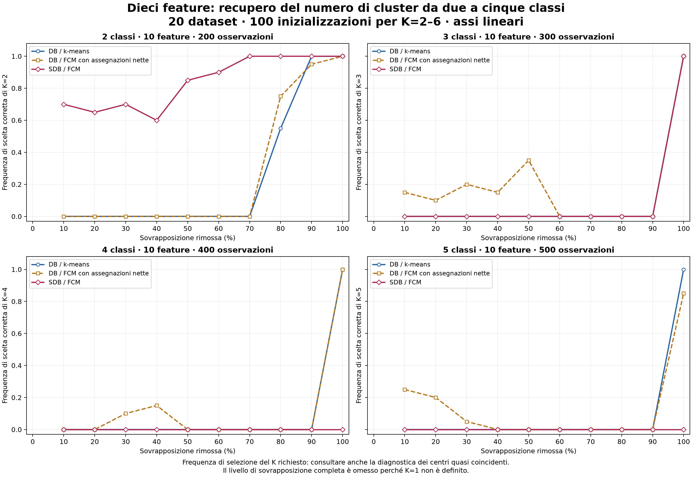

These primary curves select the **requested K** by mean index. In ten dimensions, FCM often produces nearly coincident centers or fewer occupied hard-label groups than requested. Consequently, choosing the generating K is not by itself evidence of recovering distinct classes. The diagnostic below explicitly separates those cases.

At the disjoint endpoint, SDB selects the following requested K values (counts of datasets):

| Classes | No selection | K=2 | K=3 | K=4 | K=5 | K=6 |
| :-- | :-- | :-- | :-- | :-- | :-- | :-- |
| 2 | 0 | 20 | 0 | 0 | 0 | 0 |
| 3 | 0 | 0 | 20 | 0 | 0 | 0 |
| 4 | 0 | 5 | 15 | 0 | 0 | 0 |
| 5 | 0 | 0 | 20 | 0 | 0 | 0 |

Held-out classification accuracy at that same endpoint, with **K fixed to the generating class count** and the best native-objective partition among 100 starts:

| Classes | K-means accuracy | FCM accuracy |
| :-- | :-- | :-- |
| 2 | 100.00% | 100.00% |
| 3 | 100.00% | 100.00% |
| 4 | 100.00% | 100.00% |
| 5 | 100.00% | 100.00% |

The disjoint-endpoint under-counts concern the index's ranking of candidate K values. They must be distinguished from the near-coincident-center behavior observed during the overlapping part of the sweep.

For four disjoint classes, the 100-start SDB mean for K=2 is lower than the mean for K=4 in **20/20 datasets**. The following summary makes the competing scores visible (smaller is better):

| Candidate K | Mean SDB across datasets | Minimum dataset mean | Maximum dataset mean |
| :-- | :-- | :-- | :-- |
| 2 | 0.625461 | 0.624089 | 0.626638 |
| 3 | 0.618762 | 0.604800 | 0.638121 |
| 4 | 0.655668 | 0.648579 | 0.666109 |

This table summarizes already-computed per-dataset means; the actual K selection is performed separately within each dataset. The lower scores at K=2 or K=3 explain the under-count despite perfect fixed-K=4 held-out accuracy.

## Protocol and calibrated overlap

Class j has center `(j-(C-1)/2) * d * (1,...,1)` and ten independent `Triangular(-1,0,1)` noise coordinates. Priors are equal; all coordinates carry the same class shift. Each class supplies 100 training and 2,000 independent held-out observations. The first three random feature streams and observation ordering match the earlier experiments at the same coordinate shift. Base draws are paired across overlap levels; training and test streams are separate.

Joint adjacent-pair overlap is `O10(d) = integral min(product t(x_r), product t(x_r-d)) dx`, with `t(z)=max(1-|z|,0)`. A target of 10% refers to this ten-dimensional integral, not to a coordinate, projected scatterplot or intersection of all classes. FCM fuzzifier m=2 is fixed throughout.

The final coordinate is integrated exactly using the weighted minimum of two piecewise linear triangular densities. The remaining nine use importance quadrature under the first density restricted to their common support: **2^18 scrambled Sobol points**, fixed seed 20261119, and a scalar root solver. **Four independent scrambles of 2^20 points each** validate the nine interior targets. Endpoints O(0)=1 and O(2)=0 are exact. Maximum observed validation discrepancy is **0.004195 percentage points**, below the prespecified check tolerance of 0.02 percentage points. This is a numerical accuracy check, not a rigorous bound. The complete estimates and scramble standard errors are saved in each bundle.

The conditional identity is tested against independent three-dimensional quadrature and a separate direct ten-dimensional joint-density estimator. [SciPy's Sobol documentation](https://docs.scipy.org/doc/scipy/reference/generated/scipy.stats.qmc.Sobol.html) describes scrambled sequences and power-of-two sampling; the conditional density reduction is derived for this experiment.

| Step | Target overlap | Reference overlap | Coordinate shift | Per-coordinate overlap |
| :-- | :-- | :-- | :-- | :-- |
| 0 | 100% | 100.000000% | 0.000000000 | 100.0000% |
| 1 | 90% | 89.998845% | 0.029355650 | 97.0860% |
| 2 | 80% | 79.998096% | 0.059325893 | 94.1554% |
| 3 | 70% | 69.998262% | 0.090483102 | 91.1564% |
| 4 | 60% | 59.998191% | 0.123542896 | 88.0273% |
| 5 | 50% | 49.997394% | 0.159489686 | 84.6870% |
| 6 | 40% | 39.995987% | 0.199841149 | 81.0143% |
| 7 | 30% | 29.996815% | 0.247256972 | 76.8027% |
| 8 | 20% | 20.001132% | 0.307389441 | 71.6233% |
| 9 | 10% | 10.004195% | 0.397176680 | 64.2261% |
| 10 | 0% | 0.000000% | 2.000000000 | 0.0000% |

At complete overlap the labels are indistinguishable and there is one observable distribution; all three indices are undefined at K=1. That endpoint is omitted from recovery curves and retained only as a descriptive numerical diagnostic. At d=2 the supports are disjoint almost surely (closed supports touch on a probability-zero boundary). The Bayes-accuracy reference is `1 - ((C-1)/C)*O10`, up to the reported interior calibration error.

Equal overlap steps are **not equal geometric shifts**. In particular, moving from 10% overlap to exactly disjoint supports changes the per-coordinate shift from about 0.397 to 2. The connecting plot segments interpolate between sampled levels; this coarse grid cannot locate transitions at overlaps below 10%.

## Undefined scores and distinct-cluster sensitivity

The published FCM and SDB implementations are **unchanged**: FCM m=2, 1,000 iterations, membership tolerance 1e-7; SDB q=1, Euclidean p=2 and raw mean memberships. K-means uses one start for each of seeds 0–99, the same iteration cap and tolerance. Primary selection minimizes the arithmetic mean across all 100 starts, with smaller K breaking ties.

Unlike the earlier completed sweeps, some ten-feature scores are undefined because centers coincide. The runner records **+inf with the exact degeneracy reason**. A mean containing an undefined score remains +inf and is ineligible; scores are never silently dropped or imputed. If all candidates are ineligible, `selected_k=0` means **no selection** and counts as failure, not a zero-cluster solution. This explicit handling extends the protocol for previously unencountered undefined evaluations and must be considered when comparing dimensions.

Even finite SDB scores can be numerically large when centers are almost coincident. We record minimum center distance divided by the RMS radius of the training data, occupancy of hardened FCM labels and deviation from uniform membership for every start. The **separate conservative sensitivity** rejects a candidate if any of its 100 starts has relative center distance below 1e-6; DB/hardened FCM additionally requires exactly K occupied labels in every start. It uses the same scores and does not modify the published index. Screening thresholds are diagnostic choices, not a claimed universal criterion.

Correct selections at disjointness after this diagnostic screening:

| Classes | DB / k-means | DB / hardened FCM | SDB / FCM |
| :-- | :-- | :-- | :-- |
| 2 | 20/20 | 20/20 | 20/20 |
| 3 | 20/20 | 20/20 | 20/20 |
| 4 | 20/20 | 20/20 | 0/20 |
| 5 | 20/20 | 6/20 | 0/20 |

| Classes | Near-coincident FCM fits | Hard groups < requested K | Undefined SDB scores | Capped fits refitted | Changed SDB choices |
| :-- | :-- | :-- | :-- | :-- | :-- |
| 2 | 103014 | 49793 | 497 | 2091 | 0 |
| 3 | 92664 | 43695 | 6885 | 3964 | 0 |
| 4 | 82222 | 34329 | 7039 | 5410 | 0 |
| 5 | 72565 | 29745 | 9940 | 7098 | 0 |

Every row represents 110,000 configurations. Degeneracy counts include all K and all overlap levels, so they should not be read as failure rates of the selected model alone.

## Convergence sensitivity

Extending all **18,563 capped FCM fits** to 10,000 iterations leaves **747** at the cap and changes **1/2,640 K selections**, including **0/880 SDB selections**. Primary results retain the 1,000-iteration protocol.

Changes in correct-count frequencies after extending the capped fits:

| Classes | Joint overlap | Criterion | Primary correct K | Extended correct K |
| :-- | :-- | :-- | :-- | :-- |
| 2 | 10% | DB / hardened FCM | 19/20 | 20/20 |

In the binary study at 10% overlap, hardened-FCM DB changes from 19/20 to 20/20 and therefore matches SDB's unchanged 20/20. The primary one-dataset difference at that level is not stable to this convergence check.

The extended choices, per-level recovery frequencies and post-refit distinct-cluster screening are saved separately. Reaching the iteration limit is not treated as convergence; near-coincidence remains a separate diagnostic even for converged fits.

Refits reconstruct training data from the saved seeds and the archived per-row separation. The CSV round trip differs from the primary JSON shift by at most 5.6e-17; both endpoints remain exact. This is a cap-sensitivity rerun at floating-point precision, not a bitwise continuation of the original iterates.

## Comparison with one, two and three features

For **three classes**, the direction of the descriptive feature-count trend depends on overlap:

| Features | SDB: disjoint | SDB: 10% overlap |
| :-- | :-- | :-- |
| 1 | 15/20 | 11/20 |
| 2 | 16/20 | 6/20 |
| 3 | 19/20 | 2/20 |
| 10 | 20/20 | 0/20 |

The improved disjoint endpoint does not imply better recovery throughout the overlap continuum. With ten features, SDB selects K=3 in none of the nine interior levels of this sweep.

Correct-count selections at disjointness:

| Classes | Features | DB / k-means | DB / hardened FCM | SDB / FCM |
| :-- | :-- | :-- | :-- | :-- |
| 2 | 1 | 20/20 | 20/20 | 20/20 |
| 2 | 2 | 20/20 | 20/20 | 20/20 |
| 2 | 3 | 20/20 | 20/20 | 20/20 |
| 2 | 10 | 20/20 | 20/20 | 20/20 |
| 3 | 1 | 20/20 | 20/20 | 15/20 |
| 3 | 2 | 20/20 | 20/20 | 16/20 |
| 3 | 3 | 20/20 | 20/20 | 19/20 |
| 3 | 10 | 20/20 | 20/20 | 20/20 |
| 4 | 1 | 20/20 | 20/20 | 0/20 |
| 4 | 2 | 20/20 | 20/20 | 0/20 |
| 4 | 3 | 20/20 | 20/20 | 0/20 |
| 4 | 10 | 20/20 | 20/20 | 0/20 |
| 5 | 1 | 20/20 | 20/20 | 0/20 |
| 5 | 2 | 20/20 | 20/20 | 0/20 |
| 5 | 3 | Not available | Not available | Not available |
| 5 | 10 | 20/20 | 17/20 | 0/20 |

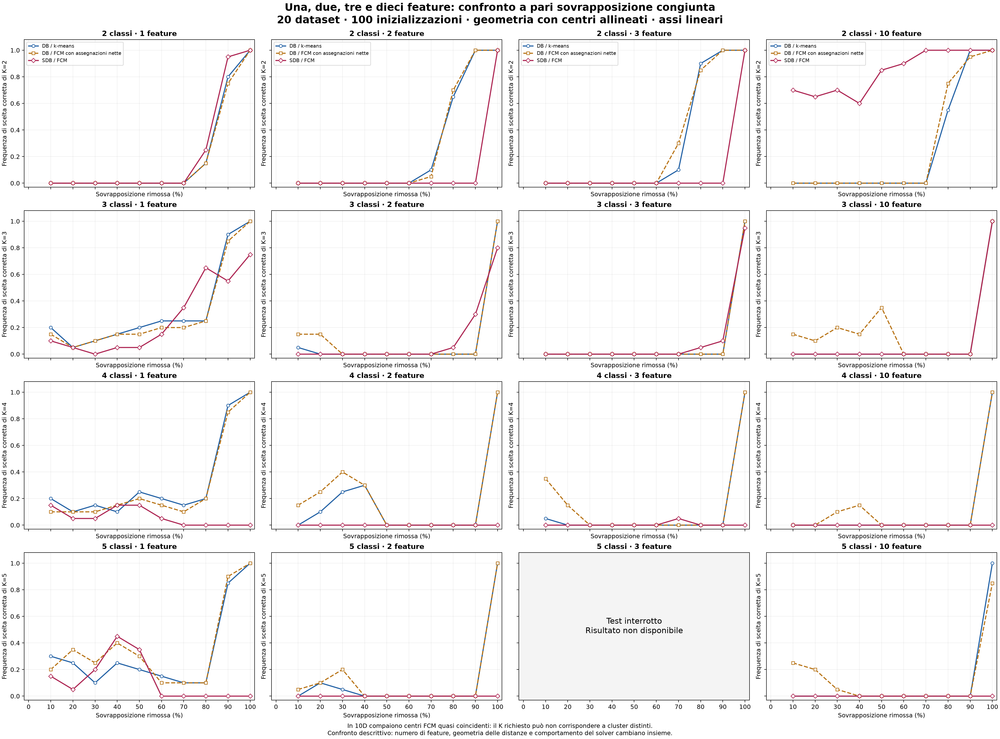

The **five-class, three-feature experiment remains incomplete after the previous interruption** and is shown as unavailable, never as zero. See [Technical note 5](TECHNICAL_NOTES_THREE_FEATURES.md) for the completed three-feature results. Earlier score archives have not been recomputed.

This is one balanced, collinear class geometry. Matching overlap approximately matches the population classification difficulty, but distances, fuzzy memberships and solver behavior change with dimension. Frequencies are descriptive; neither dimensionality effects nor superiority across arbitrary datasets follow from this experiment. With more classes, total sample size rises (100 per class), and the fixed K=2–6 search leaves fewer over-counting alternatives.

## Results for each class count

### 2 classes

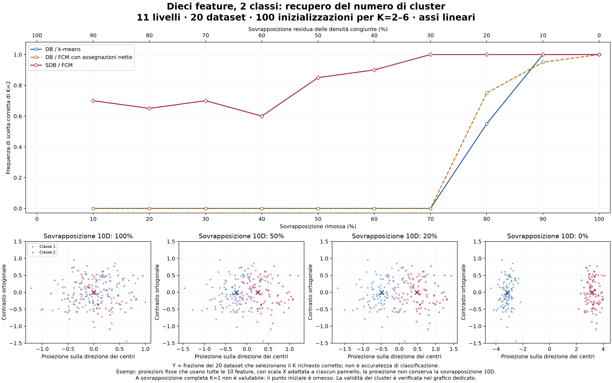

The example panels use fixed projections along the known center direction and an orthogonal contrast involving all ten coordinates. X-axis ranges adapt per panel and are labeled; projected overlap is not the ten-dimensional overlap used for calibration.

| Joint overlap | DB / k-means | DB / hardened FCM | SDB / FCM | Screened DB / k-means | Screened DB / hardened FCM | Screened SDB / FCM |
| :-- | :-- | :-- | :-- | :-- | :-- | :-- |
| 100% | 0/20 | 0/20 | 15/20 | 0/20 | 0/20 | 0/20 |
| 90% | 0/20 | 0/20 | 14/20 | 0/20 | 0/20 | 0/20 |
| 80% | 0/20 | 0/20 | 13/20 | 0/20 | 0/20 | 0/20 |
| 70% | 0/20 | 0/20 | 14/20 | 0/20 | 0/20 | 0/20 |
| 60% | 0/20 | 0/20 | 12/20 | 0/20 | 0/20 | 0/20 |
| 50% | 0/20 | 0/20 | 17/20 | 0/20 | 0/20 | 0/20 |
| 40% | 0/20 | 0/20 | 18/20 | 0/20 | 0/20 | 0/20 |
| 30% | 0/20 | 0/20 | 20/20 | 0/20 | 0/20 | 0/20 |
| 20% | 11/20 | 15/20 | 20/20 | 11/20 | 0/20 | 0/20 |
| 10% | 20/20 | 19/20 | 20/20 | 20/20 | 19/20 | 19/20 |
| 0% | 20/20 | 20/20 | 20/20 | 20/20 | 20/20 | 20/20 |

The 100%-overlap row has no identifiable generating count and is descriptive only.

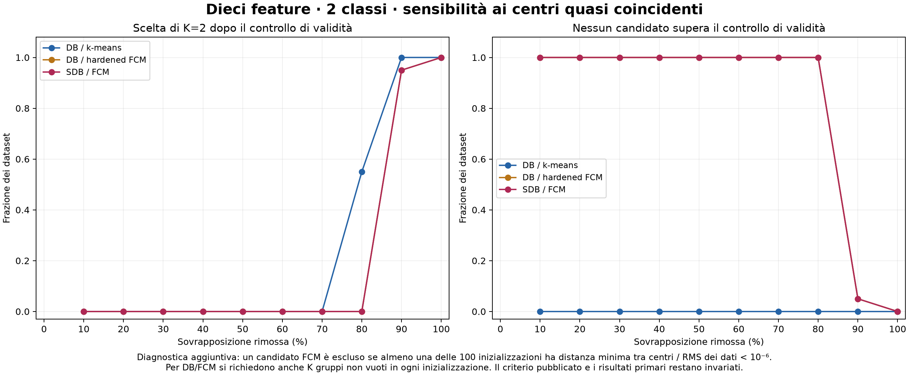

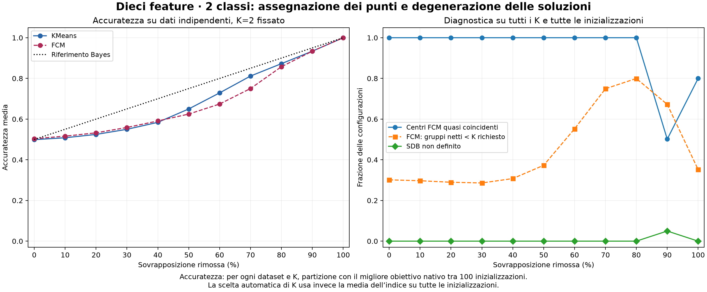

[Selected-K distribution](../results/figures/overlap_10features_2classes_selected_k.png) · [Full synthetic results](../results/supplementary_overlap_10features_2classes/)

### 3 classes

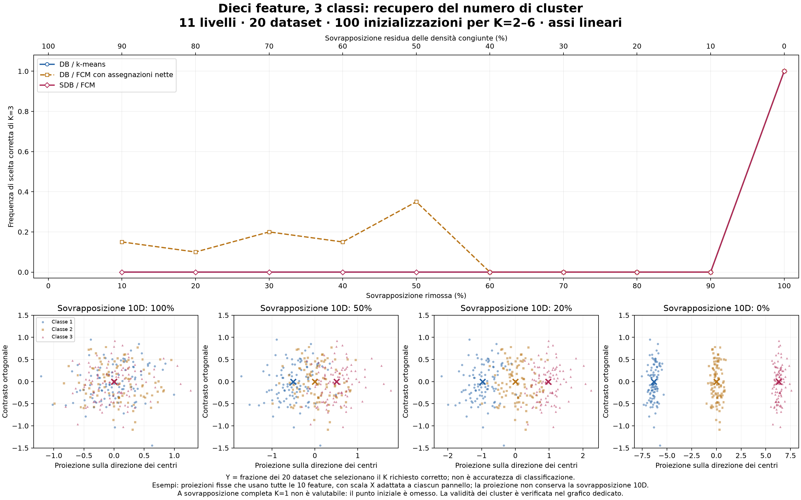

The example panels use fixed projections along the known center direction and an orthogonal contrast involving all ten coordinates. X-axis ranges adapt per panel and are labeled; projected overlap is not the ten-dimensional overlap used for calibration.

| Joint overlap | DB / k-means | DB / hardened FCM | SDB / FCM | Screened DB / k-means | Screened DB / hardened FCM | Screened SDB / FCM |
| :-- | :-- | :-- | :-- | :-- | :-- | :-- |
| 100% | 0/20 | 0/20 | 0/20 | 0/20 | 0/20 | 0/20 |
| 90% | 0/20 | 3/20 | 0/20 | 0/20 | 0/20 | 0/20 |
| 80% | 0/20 | 2/20 | 0/20 | 0/20 | 0/20 | 0/20 |
| 70% | 0/20 | 4/20 | 0/20 | 0/20 | 0/20 | 0/20 |
| 60% | 0/20 | 3/20 | 0/20 | 0/20 | 0/20 | 0/20 |
| 50% | 0/20 | 7/20 | 0/20 | 0/20 | 0/20 | 0/20 |
| 40% | 0/20 | 0/20 | 0/20 | 0/20 | 0/20 | 0/20 |
| 30% | 0/20 | 0/20 | 0/20 | 0/20 | 0/20 | 0/20 |
| 20% | 0/20 | 0/20 | 0/20 | 0/20 | 0/20 | 0/20 |
| 10% | 0/20 | 0/20 | 0/20 | 0/20 | 0/20 | 0/20 |
| 0% | 20/20 | 20/20 | 20/20 | 20/20 | 20/20 | 20/20 |

The 100%-overlap row has no identifiable generating count and is descriptive only.

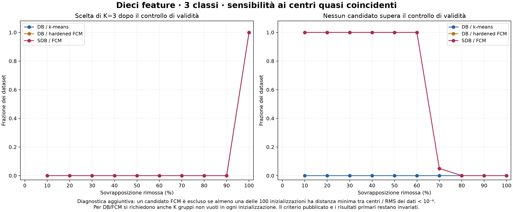

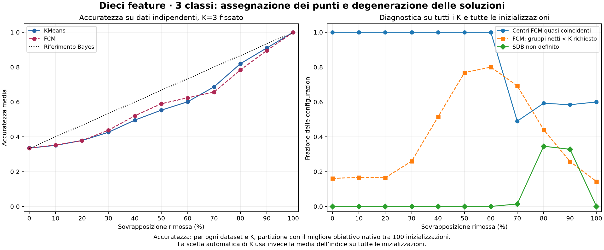

[Selected-K distribution](../results/figures/overlap_10features_3classes_selected_k.png) · [Full synthetic results](../results/supplementary_overlap_10features_3classes/)

### 4 classes

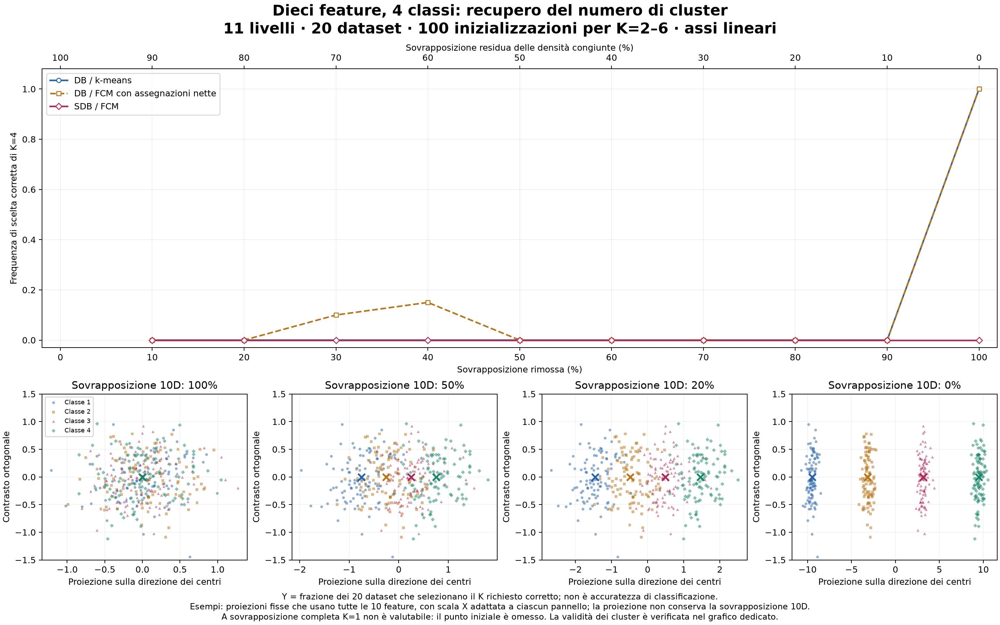

The example panels use fixed projections along the known center direction and an orthogonal contrast involving all ten coordinates. X-axis ranges adapt per panel and are labeled; projected overlap is not the ten-dimensional overlap used for calibration.

| Joint overlap | DB / k-means | DB / hardened FCM | SDB / FCM | Screened DB / k-means | Screened DB / hardened FCM | Screened SDB / FCM |
| :-- | :-- | :-- | :-- | :-- | :-- | :-- |
| 100% | 0/20 | 3/20 | 0/20 | 0/20 | 0/20 | 0/20 |
| 90% | 0/20 | 0/20 | 0/20 | 0/20 | 0/20 | 0/20 |
| 80% | 0/20 | 0/20 | 0/20 | 0/20 | 0/20 | 0/20 |
| 70% | 0/20 | 2/20 | 0/20 | 0/20 | 0/20 | 0/20 |
| 60% | 0/20 | 3/20 | 0/20 | 0/20 | 0/20 | 0/20 |
| 50% | 0/20 | 0/20 | 0/20 | 0/20 | 0/20 | 0/20 |
| 40% | 0/20 | 0/20 | 0/20 | 0/20 | 0/20 | 0/20 |
| 30% | 0/20 | 0/20 | 0/20 | 0/20 | 0/20 | 0/20 |
| 20% | 0/20 | 0/20 | 0/20 | 0/20 | 0/20 | 0/20 |
| 10% | 0/20 | 0/20 | 0/20 | 0/20 | 0/20 | 0/20 |
| 0% | 20/20 | 20/20 | 0/20 | 20/20 | 20/20 | 0/20 |

The 100%-overlap row has no identifiable generating count and is descriptive only.

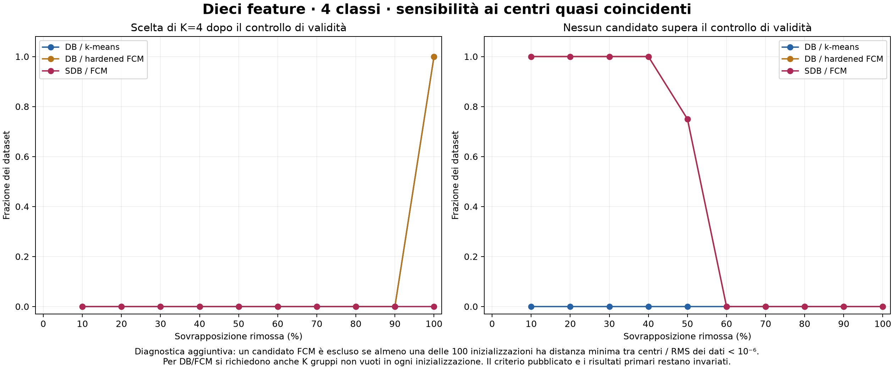

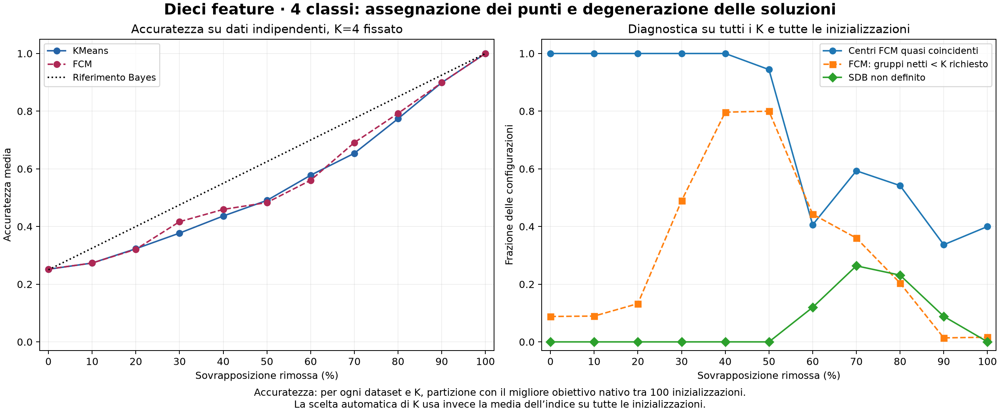

[Selected-K distribution](../results/figures/overlap_10features_4classes_selected_k.png) · [Full synthetic results](../results/supplementary_overlap_10features_4classes/)

### 5 classes

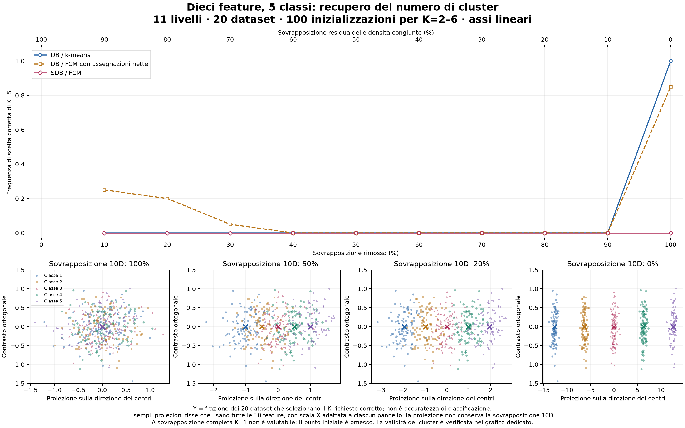

The example panels use fixed projections along the known center direction and an orthogonal contrast involving all ten coordinates. X-axis ranges adapt per panel and are labeled; projected overlap is not the ten-dimensional overlap used for calibration.

| Joint overlap | DB / k-means | DB / hardened FCM | SDB / FCM | Screened DB / k-means | Screened DB / hardened FCM | Screened SDB / FCM |
| :-- | :-- | :-- | :-- | :-- | :-- | :-- |
| 100% | 0/20 | 4/20 | 0/20 | 0/20 | 0/20 | 0/20 |
| 90% | 0/20 | 5/20 | 0/20 | 0/20 | 0/20 | 0/20 |
| 80% | 0/20 | 4/20 | 0/20 | 0/20 | 0/20 | 0/20 |
| 70% | 0/20 | 1/20 | 0/20 | 0/20 | 0/20 | 0/20 |
| 60% | 0/20 | 0/20 | 0/20 | 0/20 | 0/20 | 0/20 |
| 50% | 0/20 | 0/20 | 0/20 | 0/20 | 0/20 | 0/20 |
| 40% | 0/20 | 0/20 | 0/20 | 0/20 | 0/20 | 0/20 |
| 30% | 0/20 | 0/20 | 0/20 | 0/20 | 0/20 | 0/20 |
| 20% | 0/20 | 0/20 | 0/20 | 0/20 | 0/20 | 0/20 |
| 10% | 0/20 | 0/20 | 0/20 | 0/20 | 0/20 | 0/20 |
| 0% | 20/20 | 17/20 | 0/20 | 20/20 | 6/20 | 0/20 |

The 100%-overlap row has no identifiable generating count and is descriptive only.

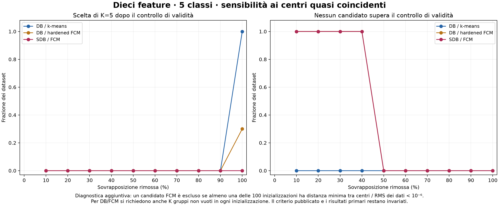

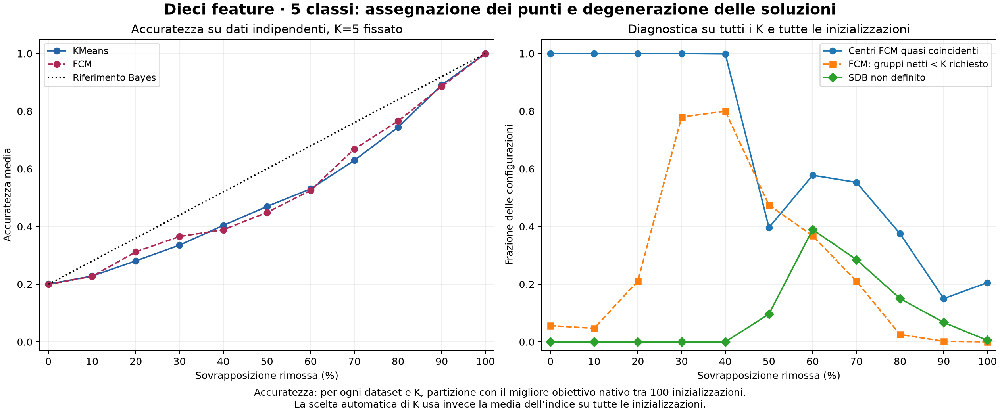

[Selected-K distribution](../results/figures/overlap_10features_5classes_selected_k.png) · [Full synthetic results](../results/supplementary_overlap_10features_5classes/)

## Reproduction and saved data

Run from the repository root after installing the benchmark and development dependencies:

```text
python scripts/python/resume_ten_feature_overlap.py --classes 2 3 4 5 --workers 12 --checkpoint-root .local_overlap_checkpoints
python scripts/python/check_ten_feature_convergence.py --input-dir results/supplementary_overlap_10features_2classes --workers 4
python scripts/python/plot_overlap_ten_features.py --input-dir results/supplementary_overlap_10features_2classes
python scripts/python/plot_overlap_ten_features.py --compare-all
pytest -q
```

Repeat the convergence and per-class plot commands for 3, 4 and 5 classes. Dataset/step checkpoints and individual capped-fit convergence checkpoints are written atomically and may be resumed only with the identical input/configuration and source hashes. A stopped cell or refit can be repeated; completed work is retained. The four full score grids are synthetic and public. Private subject-level fMRI archives remain excluded; this experiment neither changes nor reinterprets the earlier abstract-reproduction counts.

The resume entry point preserves the exact floating-point shifts from checkpoint/provenance JSON instead of reconstructing them from rounded CSV fields. It checks the saved Python/package versions; use the recorded environment for a strict resume, or a separate output/checkpoint directory for a new environment.
