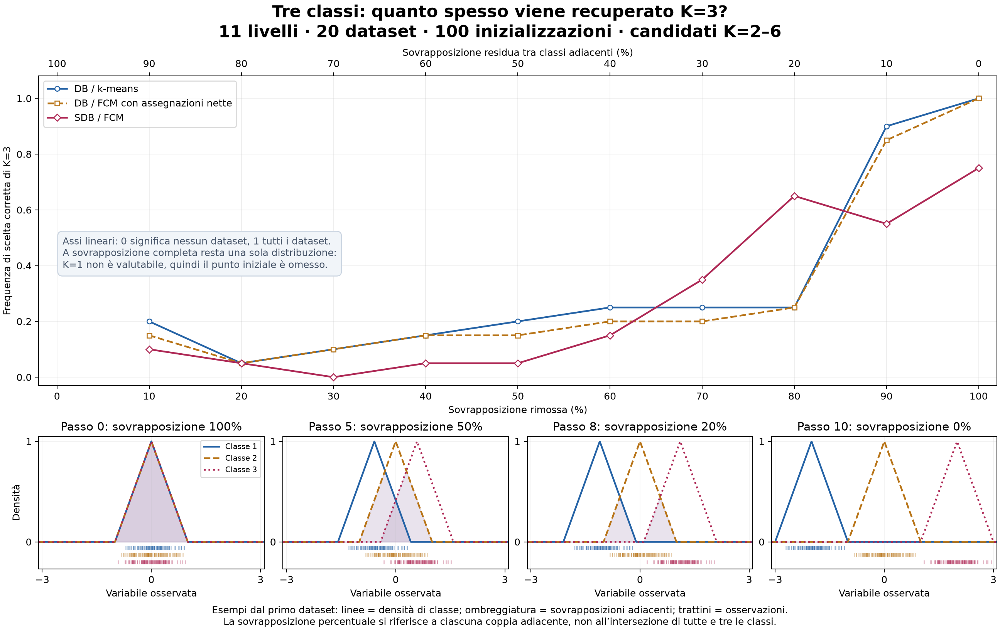
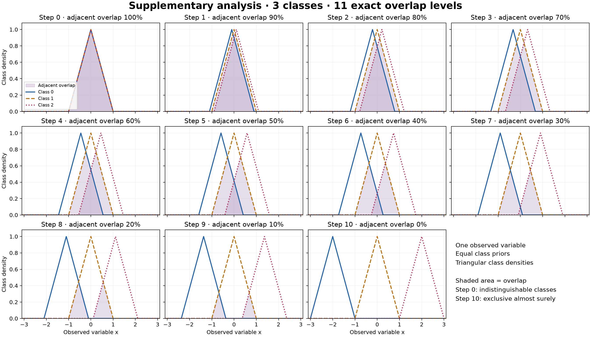
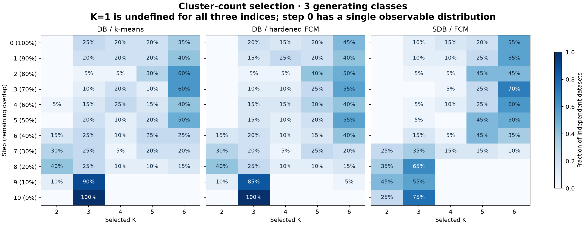
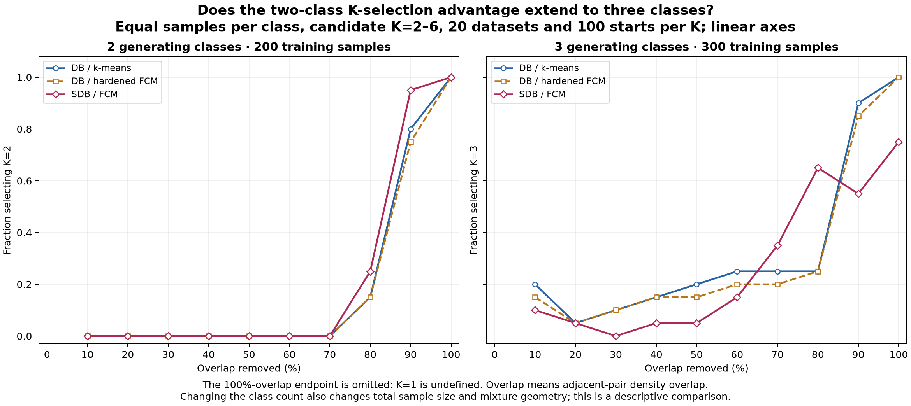
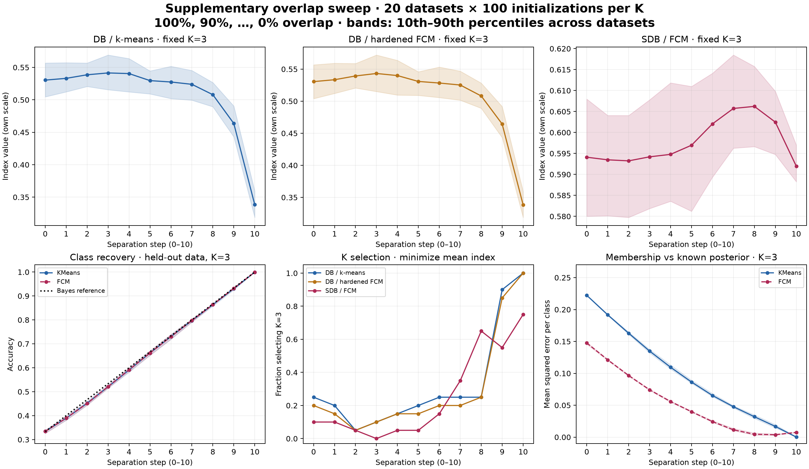

# Technical note 2 — three classes across an overlap continuum

**17 November 2026. Supplementary synthetic analysis, outside the 2018 paper. All figures in this note use linear axes.**

**Follow-up:** [Technical note 3 extends the same 100-start sweep to four and five classes](TECHNICAL_NOTES_FOUR_FIVE_CLASSES.md), with a direct comparison of all four studies on linear axes. The three-class results below are preserved.

**The two-class advantage does not extend across the full three-class sweep.** At 20% adjacent overlap, SDB selects the generating count K=3 in **13/20 datasets**, versus **5/20 for each DB criterion**. At 10% overlap, the ordering reverses: **11/20 for SDB**, **18/20 for DB/k-means**, and **17/20 for DB/hardened FCM**. With disjoint classes, SDB selects K=3 in **15/20**, while both DB criteria select it in **20/20**. SDB chooses K=2 in its five endpoint errors. Extending capped FCM fits changes none of these selections.



[PDF](../results/figures/overlap_3classes_recovery_it.pdf) · [SVG](../results/figures/overlap_3classes_recovery_it.svg) · [Full synthetic results](../results/supplementary_overlap_3classes/)

The lower X axis is overlap removed, from 0% to 100%; the upper axis is remaining overlap. Y is the fraction of **20 independent datasets** selecting K=3, from 0 to 1. It is not sample-classification accuracy or a frequency over the 100 starts. The four lower panels show 100%, 50%, 20% and 0% overlap, including observations from replicate 0. At complete overlap, the observable population is one distribution; K=1 is undefined for these indices, so that endpoint is omitted from the recovery curves.

## Dataset and exact overlap definition

The [two-class experiment](TECHNICAL_NOTES_OVERLAP.md) is extended to three equally likely triangular classes in one observed variable. Each density has half-width 1; their centers are equally spaced:

```text
centers = [-d, 0, d]
f_j(x) = max(1 - |x - center_j|, 0)
adjacent overlap O(d) = integral min(f_j(x), f_(j+1)(x)) dx = (1-d/2)^2
step s = 0, 1, ..., 10
O_s = 1 - s/10
d_s = 2 * (1 - sqrt(O_s))
```

Thus each **adjacent pair** has overlap 100%, 90%, …, 0%. This percentage is a shared probability-density area, not the fraction of observations in a common interval and not the common intersection of all three classes. The two outer classes have overlap `max(1-d, 0)^2`. At step 0 all three densities coincide and latent labels are unidentifiable from x. At step 10 their positive-density supports are disjoint; neighboring closed supports touch only at zero-density points. For positive steps, the evaluation target is the **three generating components**, which need not appear as three visually distinct modes at high overlap.

The population Bayes accuracy is `1 - 2*O/3`, from 1/3 at complete overlap to 1 at disjointness. More generally, for this equal-prior, equally spaced construction it is `1 - ((C-1)/C)*O`. Normalizing Bayes error by `1 - 1/C` gives O for either two or three classes. Numerical quadrature tests verify all eleven adjacent-overlap levels and the Bayes reference.



[Example dataset CSV](../results/supplementary_overlap_3classes/example_datasets.csv) · [PDF](../results/figures/overlap_3classes_distributions.pdf) · [SVG](../results/figures/overlap_3classes_distributions.svg)

## Protocol

- **20 independent dataset replicates**, with **100 training observations per class: 300 total**, and one variable. The earlier two-class experiment used 200 total; samples per class are held fixed.
- Within a replicate, the same base draws and latent labels are translated across all eleven steps. Dataset seeds use `SeedSequence([20261117, replicate, test_flag])`. The steps are paired, not independent replicates.
- **100 starts, seeds 0–99, for each candidate K=2–6**: 20 × 11 × 5 × 100 = **110,000 configurations**, comprising 110,000 k-means fits, 110,000 FCM fits, and **330,000 index values**.
- K-means uses k-means++ with `n_init=1` per outer seed. FCM uses random memberships, fixed m=2, and the published SDB definition: q=1, p=2 and raw mean memberships. No feature standardization is applied.
- The primary iteration cap is 1,000 and tolerance 1e-7, with each solver's stopping rule. Reaching the cap is recorded and checked separately.
- For each replicate/step, **minimize the index averaged over the 100 starts** over K=2–6. True labels and test data do not enter K selection. An exact tie selects the lower K.
- For external evaluation, retain the smallest native training-objective partition separately for each algorithm and K. Evaluate on **6,000 independent test observations**, 2,000 per class. The same held-out base draws are translated across steps.
- At fixed K=3, centers are ordered left to right to assign class names without label-based fitting. ARI is also measured at the selected K and is invariant to cluster names. Posterior MSE averages squared errors over observations **and all three class columns**; `test_Brier` uses the same per-class averaging. These are separate diagnostics, not additional K-selection rules.

## Correct generating-count recovery at every step

Each entry is the number of independent datasets selecting K=3, out of 20.

| Step | Adjacent overlap | DB / k-means | DB / hardened FCM | SDB / FCM |
|--:|--:|--:|--:|--:|
| 0 | 100% | — | — | — |
| 1 | 90% | 4/20 | 3/20 | 2/20 |
| 2 | 80% | 1/20 | 1/20 | 1/20 |
| 3 | 70% | 2/20 | 2/20 | 0/20 |
| 4 | 60% | 3/20 | 3/20 | 1/20 |
| 5 | 50% | 4/20 | 3/20 | 1/20 |
| 6 | 40% | 5/20 | 4/20 | 3/20 |
| 7 | 30% | 5/20 | 4/20 | 7/20 |
| 8 | 20% | 5/20 | 5/20 | 13/20 |
| 9 | 10% | 18/20 | 17/20 | 11/20 |
| 10 | 0% | 20/20 | 20/20 | 15/20 |

The dash at step 0 means correct observable-count recovery cannot be evaluated: K=1 is excluded by the definitions. The saved tables retain the frequency of selecting K=3 at that endpoint, but it is not a success rate for the single observable distribution. Strong overlap often leads all criteria to over-split the data; SDB's high-separation errors instead under-select K.



[Per-dataset choices](../results/supplementary_overlap_3classes/selected_k.csv) · [Sweep summary](../results/supplementary_overlap_3classes/sweep_summary.csv) · [PDF](../results/figures/overlap_3classes_selected_k.pdf)

## Why SDB misses five disjoint cases

At zero overlap, replicates **1, 3, 12, 16 and 17** select K=2 under SDB. Their mean SDB values are:

| Replicate | SDB at K=2 | SDB at K=3 |
|--:|--:|--:|
| 1 | 0.591805 | 0.596907 |
| 3 | 0.591487 | 0.593384 |
| 12 | 0.594627 | 0.597893 |
| 16 | 0.592672 | 0.600511 |
| 17 | 0.592658 | 0.593609 |

Lower SDB is preferred, so these values favor two clusters. For these replicate/K pairs, the range of SDB across all 100 starts is at most **3.12 × 10⁻⁹**; none reaches the iteration cap. This endpoint behavior is not explained by a few anomalous starts or the averaging of extreme scores. The best-objective FCM partitions at K=3 nevertheless have held-out ARI **0.995–0.999**, whereas the selected K=2 partitions have ARI **0.444–0.458**. In these cases FCM can recover the three classes when K is fixed, but minimizing SDB prefers a smaller count.

This is an observed limitation of this criterion/protocol on this geometry. It does not establish that SDB always underestimates K with three classes. The score margins are small, and the outcome varies across finite samples. Values come from [mean scores](../results/supplementary_overlap_3classes/mean_scores.csv), [all starts](../results/supplementary_overlap_3classes/per_initialization.csv.gz), and [best-objective partitions](../results/supplementary_overlap_3classes/best_objective_partitions.csv).

## Comparison with two classes and external accuracy



[PDF](../results/figures/overlap_2_vs_3_recovery.pdf) · [SVG](../results/figures/overlap_2_vs_3_recovery.svg)

With two classes and 10% overlap, SDB recovered K=2 in 19/20 datasets, versus 16/20 and 15/20 for the DB criteria; all reached 20/20 at disjointness. With three classes, SDB has its clearest observed advantage at 20% overlap, then falls behind the DB criteria at 10% and 0%. The class-count change also changes total sample size and mixture geometry, so this is a descriptive extension with equal samples per class, not an isolated estimate of the effect of class count.

At fixed K=3, mean hard-label accuracy remains very similar between algorithms: at 50% overlap, **66.18% for k-means and 66.17% for FCM**; at 10%, **93.03% and 93.17%**; at zero, **99.973% and 99.965%**. Both track the stated Bayes reference. Under each criterion's selected K, mean test ARI at disjointness is **0.99920 for DB/k-means**, **0.99895 for DB/hardened FCM**, and **0.86182 for SDB/FCM**.

At 50% overlap, posterior MSE per class is **0.03989 for fuzzy FCM versus 0.08641 for crisp k-means**. At disjointness it is **0.007513 versus 0.000178**. FCM with m=2 retains soft memberships even for disjoint generating classes; its memberships are not automatically calibrated posteriors. This membership diagnostic does not imply better K selection.



Each index uses its own linear vertical scale. Bands show the 10th–90th percentiles over 20 dataset-level results, not confidence intervals. The middle lower panel includes step 0 as a selection frequency only. [K=3 test metrics](../results/supplementary_overlap_3classes/k3_performance.csv) · [PDF](../results/figures/overlap_3classes_results.pdf)

## Convergence, verification and scope

All **330,000 index values are finite**. **123/110,000 FCM fits (0.112%)** reached 1,000 iterations; no k-means fit did. Rerunning those exact configurations with a 10,000-iteration cap leaves **zero** at the cap and a maximum membership fixed-point residual of **9.97 × 10⁻⁸**. Replacing their index scores changes **0/660 K choices**. Primary scores remain unchanged; this sensitivity check does not refit the held-out best-objective evaluation. See [diagnostics](../results/supplementary_overlap_3classes/diagnostics.json) and [convergence sensitivity](../results/supplementary_overlap_3classes/convergence_sensitivity.json).

Tests check exact overlap and Bayes integrals, paired generation, endpoint posteriors, binary-score regression, complete 100-start grids and recomputed means/K choices for both studies. The full three-class run took about **10.5 minutes** in the recorded environment. [Provenance](../results/supplementary_overlap_3classes/provenance.json) records versions, configuration and SHA-256 hashes. All data in this supplementary bundle are synthetic.

Twenty independent samples of one balanced, one-dimensional triangular geometry do not establish a universal ranking or statistical significance. The experiment shows where the earlier SDB advantage persists and where it reverses, while preserving the original two-class results and the separate fMRI analysis.

## Reproduce

```bash
python -m pip install -e ".[benchmarks,dev]"
python scripts/python/supplementary_overlap.py --classes 3 --workers 4
python scripts/python/check_overlap_convergence.py --input-dir results/supplementary_overlap_3classes
python scripts/python/plot_supplementary_overlap.py --input-dir results/supplementary_overlap_3classes
python scripts/python/plot_overlap_recovery_linear.py
pytest -q
```

To rebuild summary tables without refitting, run `python scripts/python/supplementary_overlap.py --classes 3 --summarize-only`, then the plotting commands. For alternate settings, use a separate `--output-dir` under `results/recomputed/`. The two-class score archive and historical figures are preserved; the direct comparison above and all new three-class figures use linear axes.
