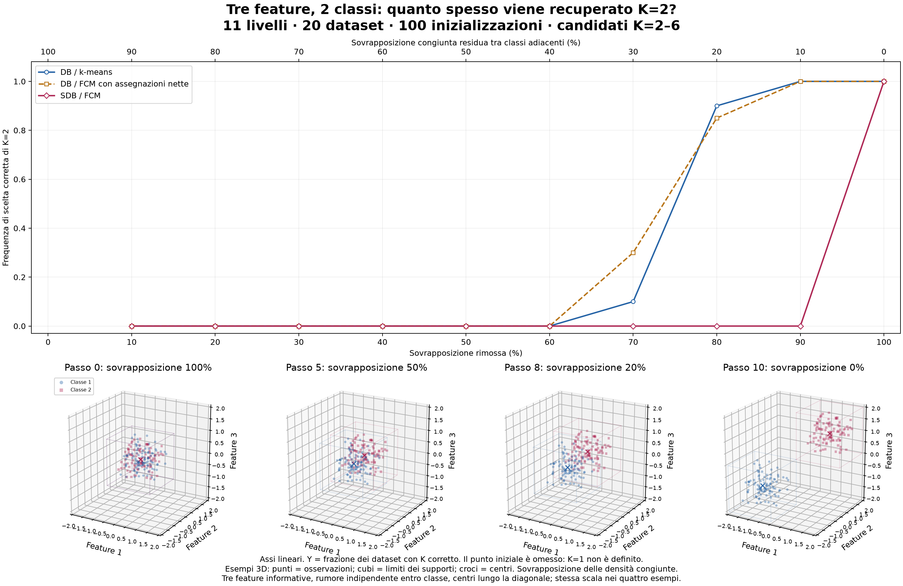
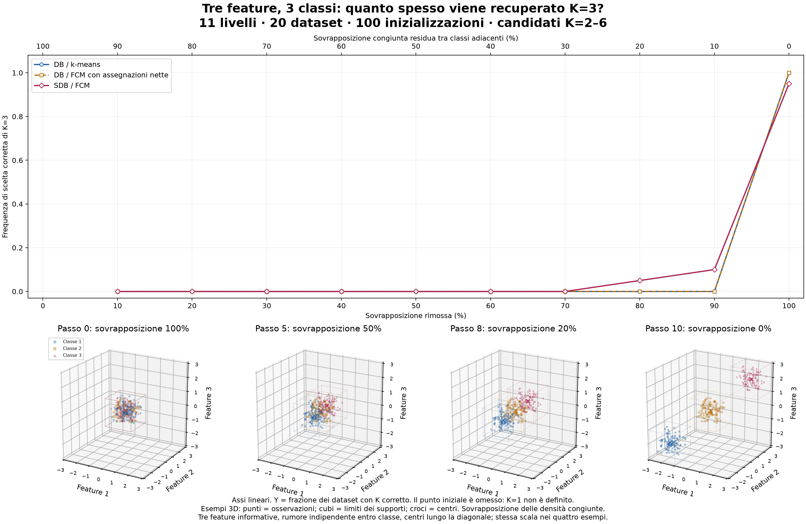
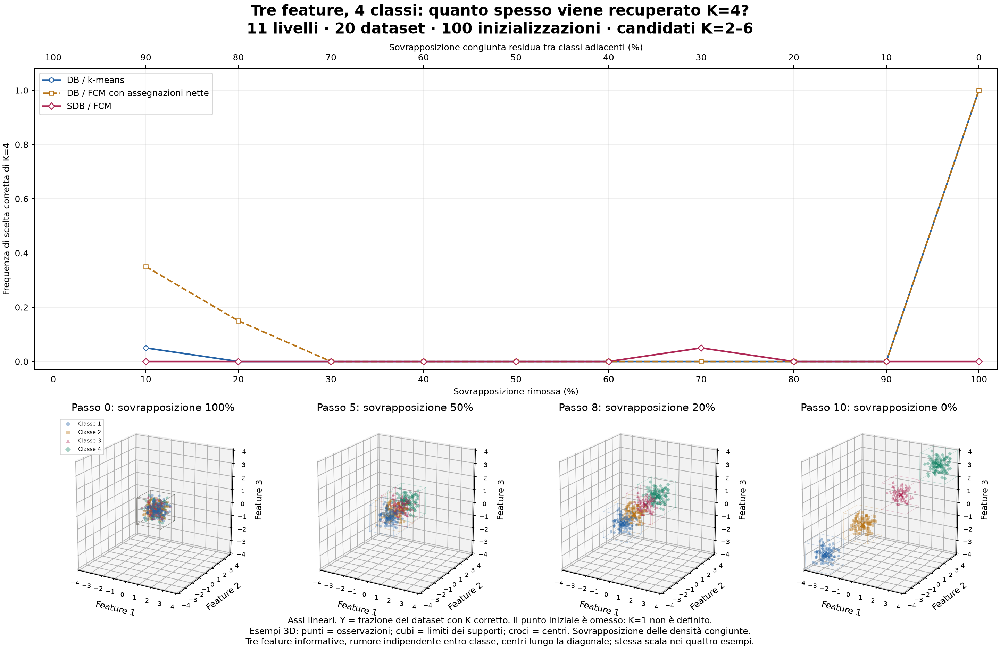

# Technical note 5 — three features: completed studies

**18 November 2026 experiments; status documented 19 November 2026. Supplementary analysis outside the original paper.**

The three-feature studies with **2, 3 and 4 classes are complete**: 11 joint-overlap levels, 20 independent datasets and 100 starts per K=2–6. The five-class run was interrupted at the user's request before its final archive was written; **no five-class three-feature result is available**. The later ten-feature study does not fill that missing cell.

## Main result

Correct K selections at complete separation:

| Classes | DB / k-means | DB / hardened FCM | SDB / FCM |
| :-- | :-- | :-- | :-- |
| 2 | 20/20 | 20/20 | 20/20 |
| 3 | 20/20 | 20/20 | 19/20 |
| 4 | 20/20 | 20/20 | 0/20 |

At 10% remaining joint overlap, SDB recovers K=2 in 0/20, K=3 in 2/20, and K=4 in 0/20 datasets. Both DB criteria recover K=2 in 20/20, K=3 in 0/20 and K=4 in 0/20. For four disjoint classes, SDB selects K=3 in 18/20 and K=2 in 2/20. These are count-selection frequencies, not classification accuracy.

All features have independent triangular noise within class; centers lie along (1,1,1). Joint overlap is the integral of the minimum of adjacent product densities. One coordinate is integrated exactly and two use Gauss–Legendre quadrature (256 nodes per knot segment), checked at order 512. It is not a planar likelihood-boundary approximation. At complete overlap there is one observable distribution, but K=1 is undefined and omitted from recovery curves.

Extending all 3,965 capped FCM fits in these three completed studies to 10,000 iterations leaves none capped and changes no K selections. Fixed-K held-out accuracy at disjointness is 100% for both algorithms in all three studies. The four-class SDB result concerns model selection despite recoverable classes at fixed K.

## 2 classes

[Full synthetic results](../results/supplementary_overlap_3features_2classes/)

## 3 classes

[Full synthetic results](../results/supplementary_overlap_3features_3classes/)

## 4 classes

[Full synthetic results](../results/supplementary_overlap_3features_4classes/)

[Continue to Technical note 6: ten features](TECHNICAL_NOTES_TEN_FEATURES.md).
