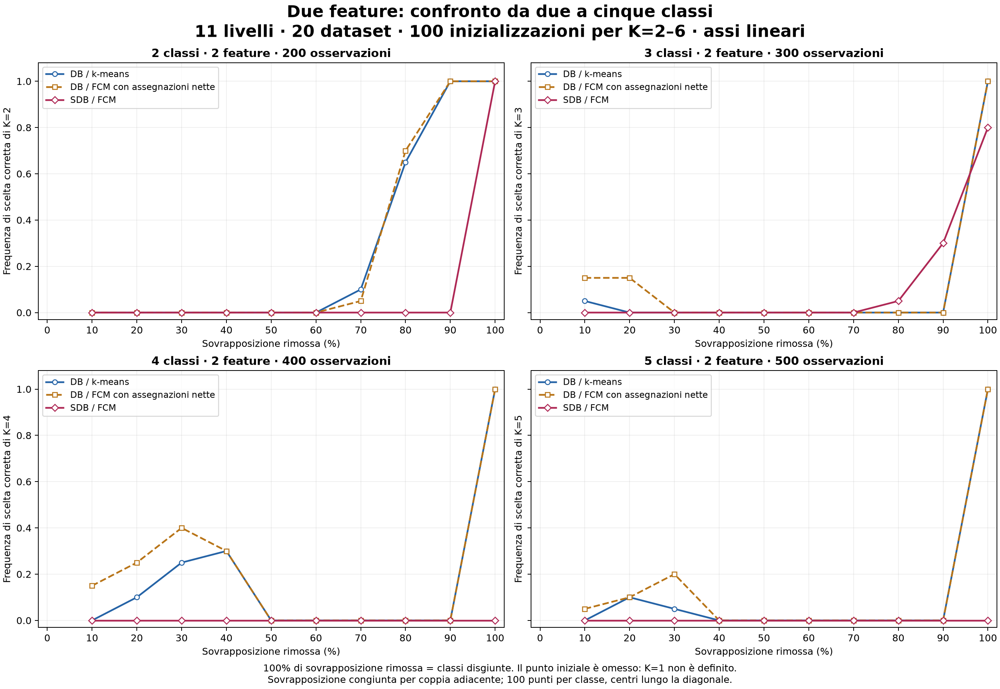
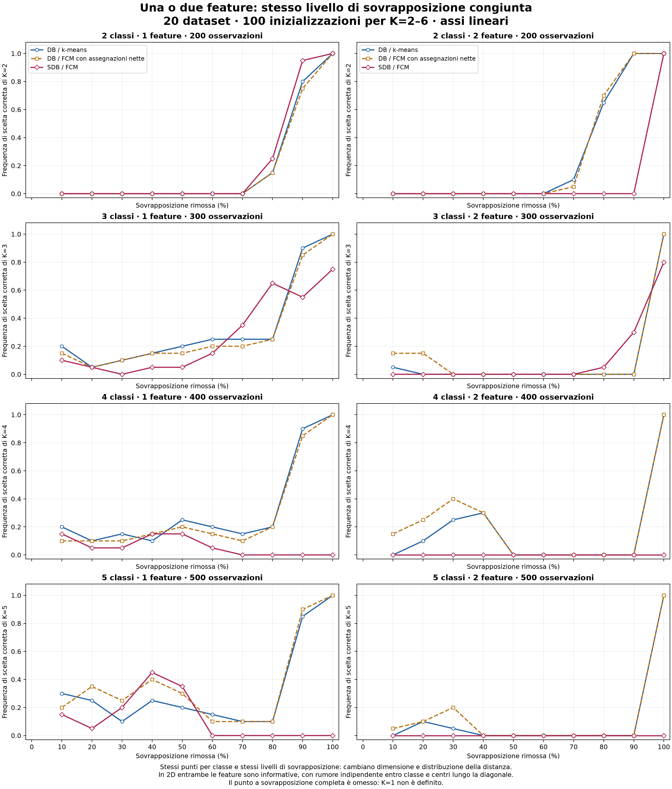
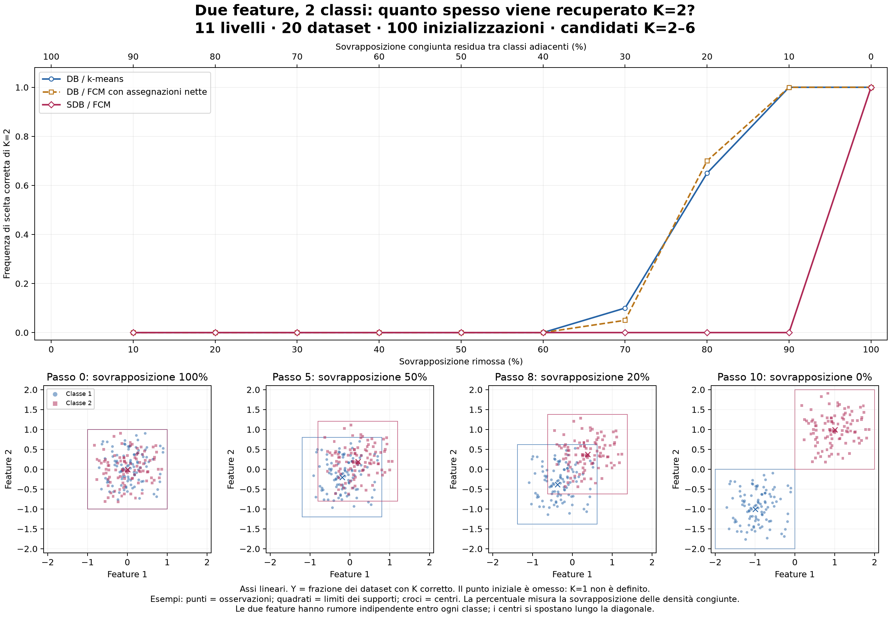
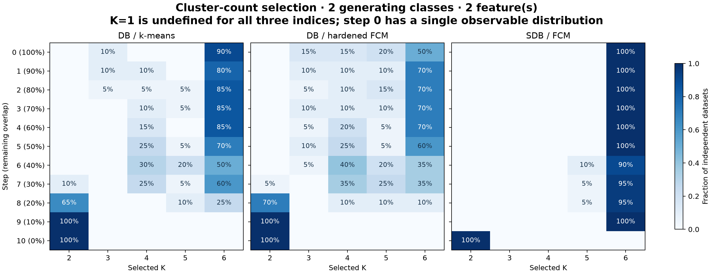
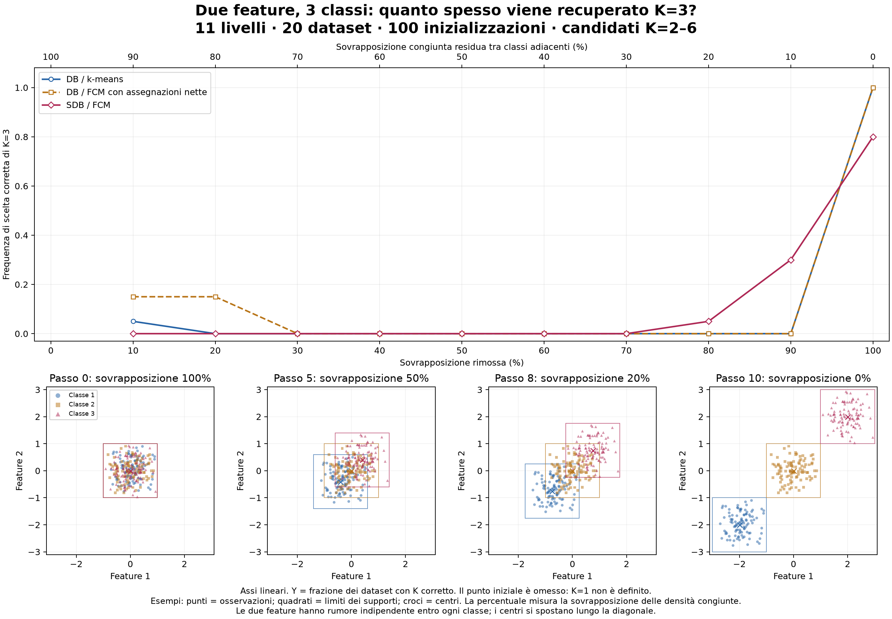
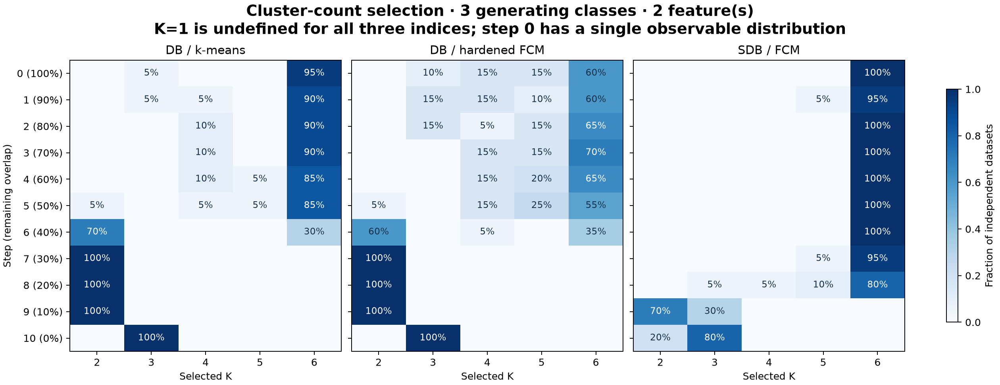
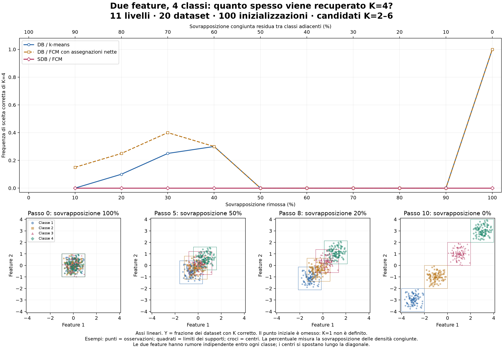
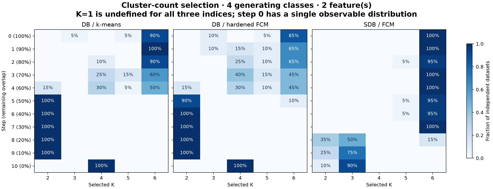
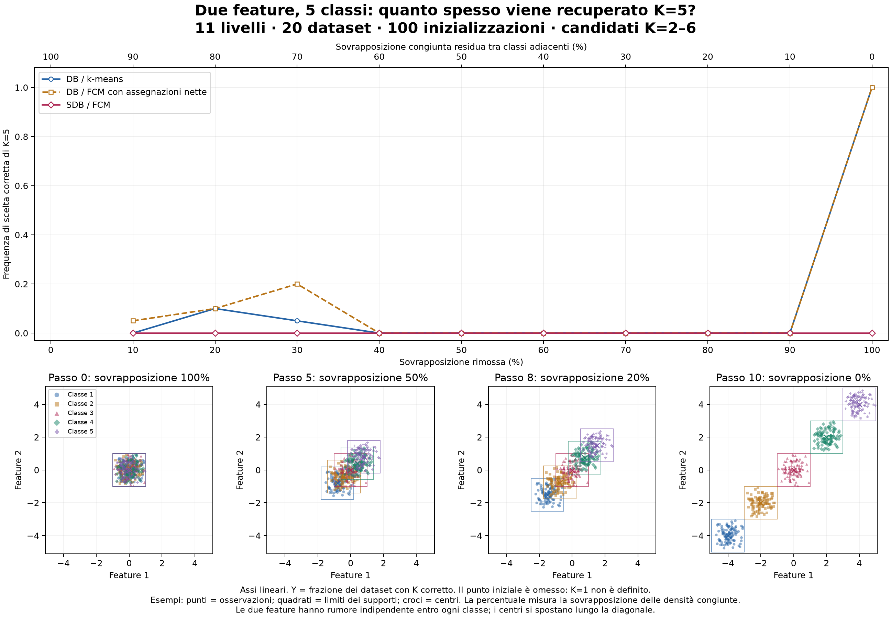
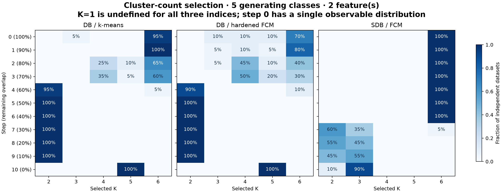

# Technical note 4 — two features across the overlap continuum

**18 November 2026. New supplementary synthetic experiments, outside the 2018 paper. All new figures use linear axes.**

The overlap test is repeated with **two informative features and 2, 3, 4 and 5 classes**, retaining **11 overlap levels, 20 independent datasets and 100 initializations per candidate K=2–6**. The primary protocol comprises **440,000 configurations, 880,000 algorithm fits and 1,320,000 index values**, plus the separate convergence checks below.

## Main result

At 10% joint overlap with **two classes**, SDB correct-count recovery changes from **19/20 with one feature** to **0/20 with two features**. In the new two-feature study, DB/k-means recovers K=2 in **20/20** and DB/hardened FCM in **20/20**. The earlier binary SDB advantage therefore does not transfer to this two-feature geometry at that overlap.

The ranking is not uniform: with **three classes at 10% joint overlap**, SDB recovers K=3 in **6/20**, versus **0/20 for DB/k-means** and **0/20 for DB/hardened FCM**. These frequencies are descriptive and do not establish statistical significance.

At disjointness, SDB selects the correct count as follows: K=2: **20/20**; K=3: **16/20**; K=4: **0/20**; K=5: **0/20**. The table compares the original one-feature studies with the new two-feature studies at this endpoint. These are frequencies across 20 datasets, not the fraction of correctly assigned observations or of successful starts.

| Classes | Features | DB / k-means | DB / hardened FCM | SDB / FCM |
| :-- | :-- | :-- | :-- | :-- |
| 2 | 1 | 20/20 | 20/20 | 20/20 |
| 2 | 2 | 20/20 | 20/20 | 20/20 |
| 3 | 1 | 20/20 | 20/20 | 15/20 |
| 3 | 2 | 20/20 | 20/20 | 16/20 |
| 4 | 1 | 20/20 | 20/20 | 0/20 |
| 4 | 2 | 20/20 | 20/20 | 0/20 |
| 5 | 1 | 20/20 | 20/20 | 0/20 |
| 5 | 2 | 20/20 | 20/20 | 0/20 |



[PDF](../results/figures/overlap_2features_2_to_5_recovery.pdf) · [SVG](../results/figures/overlap_2features_2_to_5_recovery.svg)

Near separation, the two-feature counts are:

| Classes | Joint overlap | DB / k-means | DB / hardened FCM | SDB / FCM |
| :-- | :-- | :-- | :-- | :-- |
| 2 | 20% | 13/20 | 14/20 | 0/20 |
| 2 | 10% | 20/20 | 20/20 | 0/20 |
| 2 | 0% | 20/20 | 20/20 | 20/20 |
| 3 | 20% | 0/20 | 0/20 | 1/20 |
| 3 | 10% | 0/20 | 0/20 | 6/20 |
| 3 | 0% | 20/20 | 20/20 | 16/20 |
| 4 | 20% | 0/20 | 0/20 | 0/20 |
| 4 | 10% | 0/20 | 0/20 | 0/20 |
| 4 | 0% | 20/20 | 20/20 | 0/20 |
| 5 | 20% | 0/20 | 0/20 | 0/20 |
| 5 | 10% | 0/20 | 0/20 | 0/20 |
| 5 | 0% | 20/20 | 20/20 | 0/20 |

Extending all **3,256 capped FCM fits** to 10,000 iterations leaves **0** at the cap and changes **1/2,640 K selections** across the four studies, including **0/880 SDB selections**. The displayed results retain the primary protocol.

## Two informative features and joint overlap

For class j, both coordinates have triangular noise with half-width 1 and variance 1/6. The two noise draws are **independent conditional on class**. Both class means move, so both features are informative; the second coordinate is not a copy of the first. The pooled coordinates can be correlated because they share a class label. Class centers are **collinear along the diagonal**, so this experiment does not cover arbitrary two-dimensional arrangements.

```text
C = 2, 3, 4 or 5; equal class priors
a_j = (j - (C-1)/2) * d, j = 0, ..., C-1
center_j = (a_j, a_j)
t(z) = max(1 - abs(z), 0)
f_j(x1,x2) = t(x1-a_j) * t(x2-a_j)
O_2(d) = integral over R^2 of min(f_j, f_(j+1))
       = ((2-d)^4 - 4*max(1-d,0)^4)/12, 0 <= d <= 2
step s = 0, ..., 10; solve O_2(d_s) = 1-s/10
one-coordinate overlap O_1(d) = (1-d/2)^2
population Bayes accuracy = 1 - ((C-1)/C)*O_2
```

The percentage refers to the **shared probability density of each adjacent pair in the full two-feature space**. It is not a percentage of shared observations, overlap length, square area, or marginal overlap on each coordinate. Matching the joint overlap also matches the population Bayes accuracy at the same C. Simply using the old one-feature shift on both axes would make the two-feature classification easier at a nominally identical percentage.

For adjacent centers (0,0) and (d,d), the equal-density boundary is x1+x2=d. Thus O_2(d)=2P(T1+T2>d), with independent centered triangular variables T1,T2. Their sum is a sum of four independent Uniform(0,1) variables minus 2; the corresponding piecewise polynomial gives the expression above. The [SciPy Irwin–Hall documentation](https://docs.scipy.org/doc/scipy/reference/generated/scipy.stats.irwinhall.html) describes this uniform-sum distribution. The implementation's formula is independently checked by double numerical quadrature at every non-disjoint level, with exact endpoint checks. Ordered log-concave class densities give the Bayes envelope identity max(f_j)=sum(f_j)-sum(min(f_j,f_(j+1))), yielding the displayed Bayes reference.

The calibration, common to all four class counts, is:

| Step | Joint overlap | Overlap per coordinate | Shift per coordinate | Center distance |
| :-- | :-- | :-- | :-- | :-- |
| 0 | 100% | 100.000% | 0.000000 | 0.000000 |
| 1 | 90% | 92.621% | 0.075207 | 0.106358 |
| 2 | 80% | 85.410% | 0.151644 | 0.214458 |
| 3 | 70% | 78.269% | 0.230601 | 0.326119 |
| 4 | 60% | 71.098% | 0.313608 | 0.443509 |
| 5 | 50% | 63.782% | 0.402727 | 0.569541 |
| 6 | 40% | 56.168% | 0.501088 | 0.708645 |
| 7 | 30% | 48.015% | 0.614147 | 0.868534 |
| 8 | 20% | 38.849% | 0.753421 | 1.065499 |
| 9 | 10% | 27.386% | 0.953361 | 1.348256 |
| 10 | 0% | 0.000% | 2.000000 | 2.828427 |

At step 0 all class densities coincide and posteriors equal 1/C. The observable population then has one distribution. DB and SDB are undefined at K=1; the correct-count curves omit this endpoint. Saved target-K frequencies at step 0 are not success rates for detecting one class. At step 10 positive-density supports are disjoint; neighboring closed squares touch only at a corner with zero probability. At intermediate steps, the target is the number of generating components, which need not equal the number of visible modes.

## Unchanged fitting and evaluation protocol

- **100 training and 2,000 independent test observations per class:** total training sizes 200/300/400/500 and test sizes 4,000/6,000/8,000/10,000. No standardization; both features have identical units and conditional variance.
- Feature 1 and sample order use `SeedSequence([20261117, replicate, test_flag])`, exactly preserving the one-feature base noise and labels. Feature 2 uses a separate `SeedSequence([20261117, replicate, test_flag, 2])`. At a given coordinate shift, feature 1 matches the original generator; at matched joint overlap the shifts differ. Each replicate reuses its base draws across the eleven levels, so levels are paired.
- **100 starts, seeds 0–99, at every K=2–6**, for k-means++ (`n_init=1` per seed) and FCM (random memberships, fixed m=2). Both primary solvers use a cap of 1,000 iterations and tolerance 1e-7, with their respective stopping rules. Euclidean distances and training objectives use both coordinates.
- SDB uses the published q=1, p=2, raw-mean-membership formula. K minimizes the **index averaged over all 100 starts** for each dataset and overlap level; exact ties select the smaller K. Labels and test data do not enter this selection.
- External evaluation uses the partition with the smallest native training objective separately for each algorithm and K. At fixed K=C, class names are assigned by ordering centroid projections onto the diagonal, without fitting to test labels. Selected-K ARI is invariant to label permutation. Posterior MSE and Brier components average over observations and class columns.
- The candidate range remains K=2–6; increasing C leaves fewer over-counting alternatives. With C=5, only K=6 can overestimate the generating count. A selection of K=6 is at the search boundary, not an optimum established over larger counts. This and the changing total sample size limit comparisons across class counts.

## One versus two features



[PDF](../results/figures/overlap_1_vs_2_features.pdf) · [SVG](../results/figures/overlap_1_vs_2_features.svg) · [One-feature two-class note](TECHNICAL_NOTES_OVERLAP.md) · [Three-class note](TECHNICAL_NOTES_THREE_CLASSES.md) · [Four/five-class note](TECHNICAL_NOTES_FOUR_FIVE_CLASSES.md)

Each row fixes the class count; columns compare one and two features at the same joint density overlap. Axes are linear; lines connect the tested levels and do not represent extra intermediate simulations. Adding a feature changes the geometry of Euclidean distances and fuzzy memberships even when the Bayes overlap is matched. These descriptive results therefore test this particular extension, rather than isolating a universal effect of dimensionality.

## 2 classes with two features



[PDF](../results/figures/overlap_2features_2classes_recovery_it.pdf) · [SVG](../results/figures/overlap_2features_2classes_recovery_it.svg) · [Full synthetic results](../results/supplementary_overlap_2features_2classes/)

| Step | Joint overlap | DB / k-means | DB / hardened FCM | SDB / FCM |
| :-- | :-- | :-- | :-- | :-- |
| 0 | 100% | — | — | — |
| 1 | 90% | 0/20 | 0/20 | 0/20 |
| 2 | 80% | 0/20 | 0/20 | 0/20 |
| 3 | 70% | 0/20 | 0/20 | 0/20 |
| 4 | 60% | 0/20 | 0/20 | 0/20 |
| 5 | 50% | 0/20 | 0/20 | 0/20 |
| 6 | 40% | 0/20 | 0/20 | 0/20 |
| 7 | 30% | 2/20 | 1/20 | 0/20 |
| 8 | 20% | 13/20 | 14/20 | 0/20 |
| 9 | 10% | 20/20 | 20/20 | 0/20 |
| 10 | 0% | 20/20 | 20/20 | 20/20 |

The four example panels show actual training observations from replicate 0 at 100%, 50%, 20% and 0% joint overlap. Squares show support limits and crosses show generating centers; the percentage measures shared density, not square intersection area. The dash marks undefined observable-count evaluation at complete overlap.

At **10% joint overlap**, SDB chooses K=6 in 20/20 datasets. With K=2 fixed, held-out FCM accuracy at that level is **94.9300%** against the **95.00%** population Bayes reference.

At **zero overlap**, the selected-K distribution is:

| Criterion | K=2 | K=3 | K=4 | K=5 | K=6 |
| :-- | :-- | :-- | :-- | :-- | :-- |
| DB / k-means | 20 | 0 | 0 | 0 | 0 |
| DB / hardened FCM | 20 | 0 | 0 | 0 | 0 |
| SDB / FCM | 20 | 0 | 0 | 0 | 0 |

At fixed K=2, mean held-out accuracy is **100.0000% for k-means** and **100.0000% for FCM**. With K selected by each criterion, held-out ARI is DB / k-means: **1.00000**, DB / hardened FCM: **1.00000**, SDB / FCM: **1.00000**. Count recovery and class assignment at fixed K are different evaluations.

At this endpoint, **2 FCM fits** reach the primary iteration cap. SDB selects the true count in all 20 datasets at this endpoint.



[Selected K per dataset](../results/supplementary_overlap_2features_2classes/selected_k.csv) · [Mean index scores](../results/supplementary_overlap_2features_2classes/mean_scores.csv) · [Fixed-K test metrics](../results/supplementary_overlap_2features_2classes/k2_performance.csv)

All **330,000 index values are finite**. Across the full sweep, **832 capped FCM fits** are rerun from the same seeds with a 10,000-iteration cap. **0** remain at that cap; maximum extended fixed-point residual is **9.98e-08**. Substituting these extended scores changes **0/660 K selections** and **0/33 criterion/step target-K frequencies**; the latter count includes the descriptive, unscored complete-overlap endpoint. Primary archives, tables and plots retain the 1,000-iteration protocol. This sensitivity analysis concerns K selection, not a refit of held-out best-objective partitions. [Convergence details](../results/supplementary_overlap_2features_2classes/convergence_sensitivity.json) · [Recovery-frequency comparison](../results/supplementary_overlap_2features_2classes/convergence_recovery_rates.csv).

The [eleven dataset panels](../results/figures/overlap_2features_2classes_distributions.png) and [index/accuracy/membership diagnostics](../results/figures/overlap_2features_2classes_results.png) show the entire sweep. Diagnostic bands are 10th–90th percentiles across datasets, not confidence intervals. Each index has its own linear Y scale. At zero overlap, posterior MSE per class is **0.003409 for FCM**, versus **0.000000 for crisp k-means**; FCM memberships with m=2 need not be calibrated posteriors or crisp at disjointness.

At fixed K=2, the mean within-replicate Spearman correlation of index with separation step is DB / k-means: **-0.941**, DB / hardened FCM: **-0.935**, SDB / FCM: **-0.939**. A positive correlation means an index tends to increase as the classes separate. Raw DB and SDB magnitudes are not comparable measures of accuracy.

## 3 classes with two features



[PDF](../results/figures/overlap_2features_3classes_recovery_it.pdf) · [SVG](../results/figures/overlap_2features_3classes_recovery_it.svg) · [Full synthetic results](../results/supplementary_overlap_2features_3classes/)

| Step | Joint overlap | DB / k-means | DB / hardened FCM | SDB / FCM |
| :-- | :-- | :-- | :-- | :-- |
| 0 | 100% | — | — | — |
| 1 | 90% | 1/20 | 3/20 | 0/20 |
| 2 | 80% | 0/20 | 3/20 | 0/20 |
| 3 | 70% | 0/20 | 0/20 | 0/20 |
| 4 | 60% | 0/20 | 0/20 | 0/20 |
| 5 | 50% | 0/20 | 0/20 | 0/20 |
| 6 | 40% | 0/20 | 0/20 | 0/20 |
| 7 | 30% | 0/20 | 0/20 | 0/20 |
| 8 | 20% | 0/20 | 0/20 | 1/20 |
| 9 | 10% | 0/20 | 0/20 | 6/20 |
| 10 | 0% | 20/20 | 20/20 | 16/20 |

The four example panels show actual training observations from replicate 0 at 100%, 50%, 20% and 0% joint overlap. Squares show support limits and crosses show generating centers; the percentage measures shared density, not square intersection area. The dash marks undefined observable-count evaluation at complete overlap.

At **10% joint overlap**, SDB chooses K=2 in 14/20 datasets, K=3 in 6/20 datasets. With K=3 fixed, held-out FCM accuracy at that level is **93.0625%** against the **93.33%** population Bayes reference.

At **zero overlap**, the selected-K distribution is:

| Criterion | K=2 | K=3 | K=4 | K=5 | K=6 |
| :-- | :-- | :-- | :-- | :-- | :-- |
| DB / k-means | 0 | 20 | 0 | 0 | 0 |
| DB / hardened FCM | 0 | 20 | 0 | 0 | 0 |
| SDB / FCM | 4 | 16 | 0 | 0 | 0 |

At fixed K=3, mean held-out accuracy is **100.0000% for k-means** and **100.0000% for FCM**. With K selected by each criterion, held-out ARI is DB / k-means: **1.00000**, DB / hardened FCM: **1.00000**, SDB / FCM: **0.89143**. Count recovery and class assignment at fixed K are different evaluations.

At this endpoint, **31 FCM fits** reach the primary iteration cap. In the 4 SDB count errors at disjointness, mean SDB at the true K exceeds mean SDB at the selected K by **0.000397–0.006632**. The primary mean-index rule therefore favors the incorrect count.



[Selected K per dataset](../results/supplementary_overlap_2features_3classes/selected_k.csv) · [Mean index scores](../results/supplementary_overlap_2features_3classes/mean_scores.csv) · [Fixed-K test metrics](../results/supplementary_overlap_2features_3classes/k3_performance.csv)

All **330,000 index values are finite**. Across the full sweep, **739 capped FCM fits** are rerun from the same seeds with a 10,000-iteration cap. **0** remain at that cap; maximum extended fixed-point residual is **9.96e-08**. Substituting these extended scores changes **0/660 K selections** and **0/33 criterion/step target-K frequencies**; the latter count includes the descriptive, unscored complete-overlap endpoint. Primary archives, tables and plots retain the 1,000-iteration protocol. This sensitivity analysis concerns K selection, not a refit of held-out best-objective partitions. [Convergence details](../results/supplementary_overlap_2features_3classes/convergence_sensitivity.json) · [Recovery-frequency comparison](../results/supplementary_overlap_2features_3classes/convergence_recovery_rates.csv).

The [eleven dataset panels](../results/figures/overlap_2features_3classes_distributions.png) and [index/accuracy/membership diagnostics](../results/figures/overlap_2features_3classes_results.png) show the entire sweep. Diagnostic bands are 10th–90th percentiles across datasets, not confidence intervals. Each index has its own linear Y scale. At zero overlap, posterior MSE per class is **0.003640 for FCM**, versus **0.000000 for crisp k-means**; FCM memberships with m=2 need not be calibrated posteriors or crisp at disjointness.

At fixed K=3, the mean within-replicate Spearman correlation of index with separation step is DB / k-means: **-0.357**, DB / hardened FCM: **-0.364**, SDB / FCM: **0.215**. A positive correlation means an index tends to increase as the classes separate. Raw DB and SDB magnitudes are not comparable measures of accuracy.

## 4 classes with two features



[PDF](../results/figures/overlap_2features_4classes_recovery_it.pdf) · [SVG](../results/figures/overlap_2features_4classes_recovery_it.svg) · [Full synthetic results](../results/supplementary_overlap_2features_4classes/)

| Step | Joint overlap | DB / k-means | DB / hardened FCM | SDB / FCM |
| :-- | :-- | :-- | :-- | :-- |
| 0 | 100% | — | — | — |
| 1 | 90% | 0/20 | 3/20 | 0/20 |
| 2 | 80% | 2/20 | 5/20 | 0/20 |
| 3 | 70% | 5/20 | 8/20 | 0/20 |
| 4 | 60% | 6/20 | 6/20 | 0/20 |
| 5 | 50% | 0/20 | 0/20 | 0/20 |
| 6 | 40% | 0/20 | 0/20 | 0/20 |
| 7 | 30% | 0/20 | 0/20 | 0/20 |
| 8 | 20% | 0/20 | 0/20 | 0/20 |
| 9 | 10% | 0/20 | 0/20 | 0/20 |
| 10 | 0% | 20/20 | 20/20 | 0/20 |

The four example panels show actual training observations from replicate 0 at 100%, 50%, 20% and 0% joint overlap. Squares show support limits and crosses show generating centers; the percentage measures shared density, not square intersection area. The dash marks undefined observable-count evaluation at complete overlap.

At **10% joint overlap**, SDB chooses K=2 in 5/20 datasets, K=3 in 15/20 datasets. With K=4 fixed, held-out FCM accuracy at that level is **92.1112%** against the **92.50%** population Bayes reference.

At **zero overlap**, the selected-K distribution is:

| Criterion | K=2 | K=3 | K=4 | K=5 | K=6 |
| :-- | :-- | :-- | :-- | :-- | :-- |
| DB / k-means | 0 | 0 | 20 | 0 | 0 |
| DB / hardened FCM | 0 | 0 | 20 | 0 | 0 |
| SDB / FCM | 2 | 18 | 0 | 0 | 0 |

At fixed K=4, mean held-out accuracy is **100.0000% for k-means** and **100.0000% for FCM**. With K selected by each criterion, held-out ARI is DB / k-means: **1.00000**, DB / hardened FCM: **1.00000**, SDB / FCM: **0.63741**. Count recovery and class assignment at fixed K are different evaluations.

At this endpoint, **0 FCM fits** reach the primary iteration cap. In the 20 SDB count errors at disjointness, mean SDB at the true K exceeds mean SDB at the selected K by **0.039887–0.061949**. The primary mean-index rule therefore favors the incorrect count.



[Selected K per dataset](../results/supplementary_overlap_2features_4classes/selected_k.csv) · [Mean index scores](../results/supplementary_overlap_2features_4classes/mean_scores.csv) · [Fixed-K test metrics](../results/supplementary_overlap_2features_4classes/k4_performance.csv)

All **330,000 index values are finite**. Across the full sweep, **878 capped FCM fits** are rerun from the same seeds with a 10,000-iteration cap. **0** remain at that cap; maximum extended fixed-point residual is **9.97e-08**. Substituting these extended scores changes **0/660 K selections** and **0/33 criterion/step target-K frequencies**; the latter count includes the descriptive, unscored complete-overlap endpoint. Primary archives, tables and plots retain the 1,000-iteration protocol. This sensitivity analysis concerns K selection, not a refit of held-out best-objective partitions. [Convergence details](../results/supplementary_overlap_2features_4classes/convergence_sensitivity.json) · [Recovery-frequency comparison](../results/supplementary_overlap_2features_4classes/convergence_recovery_rates.csv).

The [eleven dataset panels](../results/figures/overlap_2features_4classes_distributions.png) and [index/accuracy/membership diagnostics](../results/figures/overlap_2features_4classes_results.png) show the entire sweep. Diagnostic bands are 10th–90th percentiles across datasets, not confidence intervals. Each index has its own linear Y scale. At zero overlap, posterior MSE per class is **0.003404 for FCM**, versus **0.000000 for crisp k-means**; FCM memberships with m=2 need not be calibrated posteriors or crisp at disjointness.

At fixed K=4, the mean within-replicate Spearman correlation of index with separation step is DB / k-means: **-0.340**, DB / hardened FCM: **-0.360**, SDB / FCM: **0.729**. A positive correlation means an index tends to increase as the classes separate. Raw DB and SDB magnitudes are not comparable measures of accuracy.

## 5 classes with two features



[PDF](../results/figures/overlap_2features_5classes_recovery_it.pdf) · [SVG](../results/figures/overlap_2features_5classes_recovery_it.svg) · [Full synthetic results](../results/supplementary_overlap_2features_5classes/)

| Step | Joint overlap | DB / k-means | DB / hardened FCM | SDB / FCM |
| :-- | :-- | :-- | :-- | :-- |
| 0 | 100% | — | — | — |
| 1 | 90% | 0/20 | 1/20 | 0/20 |
| 2 | 80% | 2/20 | 2/20 | 0/20 |
| 3 | 70% | 1/20 | 4/20 | 0/20 |
| 4 | 60% | 0/20 | 0/20 | 0/20 |
| 5 | 50% | 0/20 | 0/20 | 0/20 |
| 6 | 40% | 0/20 | 0/20 | 0/20 |
| 7 | 30% | 0/20 | 0/20 | 0/20 |
| 8 | 20% | 0/20 | 0/20 | 0/20 |
| 9 | 10% | 0/20 | 0/20 | 0/20 |
| 10 | 0% | 20/20 | 20/20 | 0/20 |

The four example panels show actual training observations from replicate 0 at 100%, 50%, 20% and 0% joint overlap. Squares show support limits and crosses show generating centers; the percentage measures shared density, not square intersection area. The dash marks undefined observable-count evaluation at complete overlap.

At **10% joint overlap**, SDB chooses K=2 in 9/20 datasets, K=3 in 11/20 datasets. With K=5 fixed, held-out FCM accuracy at that level is **91.5870%** against the **92.00%** population Bayes reference.

At **zero overlap**, the selected-K distribution is:

| Criterion | K=2 | K=3 | K=4 | K=5 | K=6 |
| :-- | :-- | :-- | :-- | :-- | :-- |
| DB / k-means | 0 | 0 | 0 | 20 | 0 |
| DB / hardened FCM | 0 | 0 | 0 | 20 | 0 |
| SDB / FCM | 2 | 18 | 0 | 0 | 0 |

At fixed K=5, mean held-out accuracy is **100.0000% for k-means** and **100.0000% for FCM**. With K selected by each criterion, held-out ARI is DB / k-means: **1.00000**, DB / hardened FCM: **1.00000**, SDB / FCM: **0.52570**. Count recovery and class assignment at fixed K are different evaluations.

At this endpoint, **20 FCM fits** reach the primary iteration cap. In the 20 SDB count errors at disjointness, mean SDB at the true K exceeds mean SDB at the selected K by **0.049129–0.086003**. The primary mean-index rule therefore favors the incorrect count.



[Selected K per dataset](../results/supplementary_overlap_2features_5classes/selected_k.csv) · [Mean index scores](../results/supplementary_overlap_2features_5classes/mean_scores.csv) · [Fixed-K test metrics](../results/supplementary_overlap_2features_5classes/k5_performance.csv)

All **330,000 index values are finite**. Across the full sweep, **807 capped FCM fits** are rerun from the same seeds with a 10,000-iteration cap. **0** remain at that cap; maximum extended fixed-point residual is **9.97e-08**. Substituting these extended scores changes **1/660 K selections** and **1/33 criterion/step target-K frequencies**; the latter count includes the descriptive, unscored complete-overlap endpoint. Primary archives, tables and plots retain the 1,000-iteration protocol. This sensitivity analysis concerns K selection, not a refit of held-out best-objective partitions. [Convergence details](../results/supplementary_overlap_2features_5classes/convergence_sensitivity.json) · [Recovery-frequency comparison](../results/supplementary_overlap_2features_5classes/convergence_recovery_rates.csv).

| Replicate | Step | Joint overlap | Criterion | Primary K | Extended K |
| :-- | :-- | :-- | :-- | :-- | :-- |
| 14 | 3 | 70% | DB_fcm_hard | 5 | 6 |

The affected target-K frequency is shown explicitly below.

| Step | Joint overlap | Criterion | Primary correct count | Extended correct count |
| :-- | :-- | :-- | :-- | :-- |
| 3 | 70% | DB_fcm_hard | 4/20 | 3/20 |

The [eleven dataset panels](../results/figures/overlap_2features_5classes_distributions.png) and [index/accuracy/membership diagnostics](../results/figures/overlap_2features_5classes_results.png) show the entire sweep. Diagnostic bands are 10th–90th percentiles across datasets, not confidence intervals. Each index has its own linear Y scale. At zero overlap, posterior MSE per class is **0.003084 for FCM**, versus **0.000000 for crisp k-means**; FCM memberships with m=2 need not be calibrated posteriors or crisp at disjointness.

At fixed K=5, the mean within-replicate Spearman correlation of index with separation step is DB / k-means: **-0.345**, DB / hardened FCM: **-0.332**, SDB / FCM: **0.846**. A positive correlation means an index tends to increase as the classes separate. Raw DB and SDB magnitudes are not comparable measures of accuracy.

## Scope, checks and reproduction

These are descriptive results from 20 independent datasets per class count and one balanced, collinear, triangular-product geometry. They are not statistical significance claims or a universal ranking. The number of generating components, number of visible modes, selected K, fixed-K classification accuracy and posterior fidelity are different targets. The supplementary findings neither establish nor contradict the original abstract's separate numerical index comparisons.

Tests check joint-overlap calibration by independent quadrature, Bayes-envelope identities, independent feature noise, exact endpoint posteriors, use of both coordinates in distance/membership calculations, the unchanged seeded one-feature generator and scores, and all eight complete supplementary grids. Provenance records settings, package versions, runtimes, code hashes and score hashes. Original one-feature score archives and fMRI results are retained.

```bash
python -m pip install -e ".[benchmarks,dev]"
# Run each C in 2, 3, 4, 5:
python scripts/python/supplementary_overlap.py --features 2 --classes C --workers 8
python scripts/python/check_overlap_convergence.py --input-dir results/supplementary_overlap_2features_Cclasses --workers 4
python scripts/python/plot_supplementary_overlap.py --input-dir results/supplementary_overlap_2features_Cclasses
python scripts/python/plot_overlap_two_features.py --input-dir results/supplementary_overlap_2features_Cclasses
# After all four studies:
python scripts/python/plot_overlap_two_features.py --compare-all
pytest -q
```

Replace C in both command arguments and paths with the desired class count. Workers change scheduling only; each solver uses one numerical-library thread. To rebuild summary tables without fitting, add `--summarize-only` to the corresponding run command. Use a separate `--output-dir` under `results/recomputed/` for alternative settings. The new bundles contain only synthetic data; no participant-level fMRI data are published.
